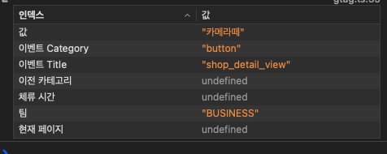

# 해결 (1)

원문 페이지 ID: 4800221954bc83e7920481d814584d1e

> 원문 스냅샷. 명세 확정·앱 배포·수집 완료를 뜻하지 않습니다.

## 원문 속성

```json
{
  "title": "해결 (1)"
}
```

<p>
웹: 
</p>

<ol>
<li>
현재 이벤트가 찍혀 있지 않음. ? 
</li>
</ol>



<p>
→ 혹은 이벤트 카테고리를 button에서 scroll로 바꾸시는걸 깜빡하신게 아닐까… 
</p>


<ol start="2">
<li>
추가로 스크롤 이벤트 말고 click 이벤트도 추가해주실수 있나요? <br />ex) 리뷰 탭에서 메뉴 탭으로 이동하면 
</li>
</ol>

<details>
<summary>예시</summary>

<ul>
<li>
event\_label : shop\_detail\_view
</li>
<li>
value : \{상점이름\} 
</li>
<li>
event\_category : click
</li>
</ul>
</details>


