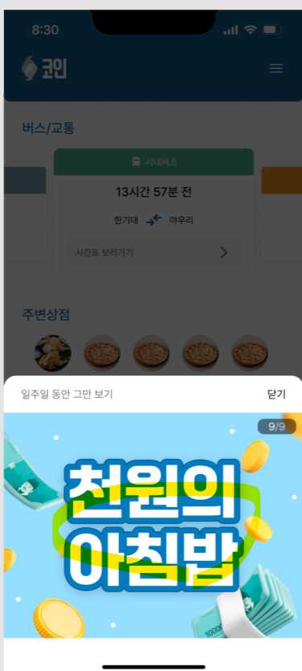
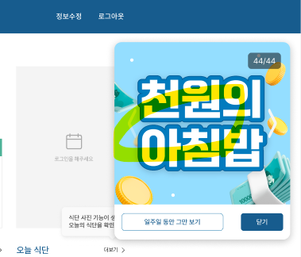
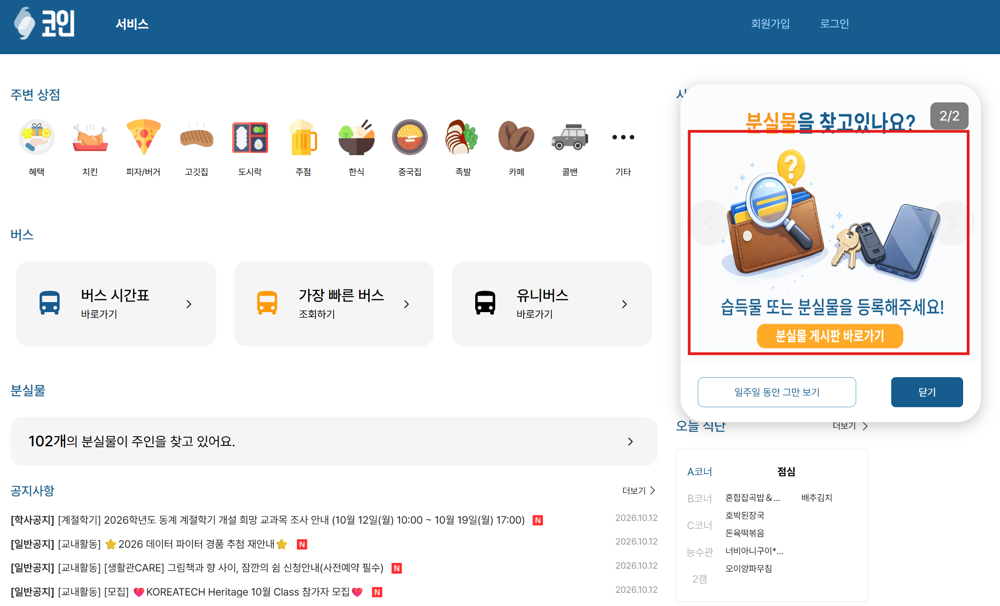
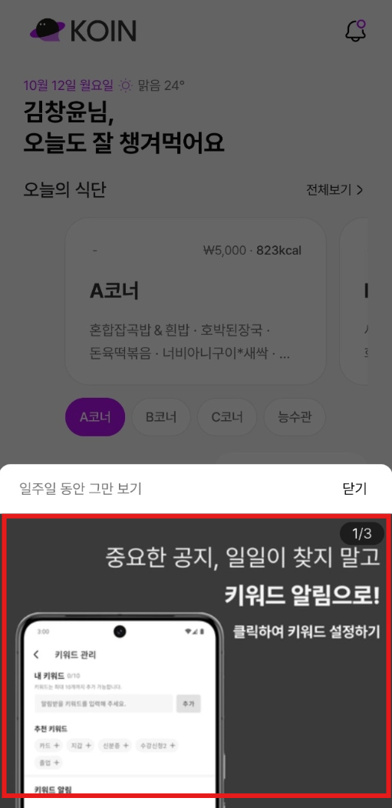

# 1-2. 메인_모달_클릭

원문 페이지 ID: 4900221954bc82428c5681834f36834a

> 원문 스냅샷. 명세 확정·앱 배포·수집 완료를 뜻하지 않습니다.

## 원문 속성

```json
{
  "platform": [
    "WEB",
    "ANDROID",
    "IOS"
  ],
  "url": "source-page-id:4900221954bc82428c5681834f36834a",
  "상태": "로깅 필요",
  "이름": "1-2. 메인\\_모달\\_클릭",
  "태그": [
    "1. 메인_모달"
  ]
}
```

<details>
<summary>이전 로깅</summary>

- 설명: 메인화면 모달을 클릭
- event\_name : “CAMPUS”
- event\_label : “main\_modal”
- value : \{title값\}
- event\_category : “click”
- 참고사진



- 웹 참고사진


</details>

<details>
<summary>새 로깅 (26.10.12) — 초안</summary>

- 설명: 메인 화면의 배너 모달 본문을 클릭하여 연결된 콘텐츠 또는 서비스로 이동.
- screen\_view: <code>main</code>
- event\_name: <code>DA2</code>
- event\_label: <code>banner__main__modal__click</code>
- value: \{배너 ID\}
- event\_category: <code>click</code>

<details>
<summary>검토사항</summary>

- 검토 메모 (2026-10-28): 기존 모달 본문 클릭 순간 조건과 value·event\_name·category·플랫폼·기존 사진을 유지한다. 네이밍 정리로 서버 성공 이벤트나 추가 전송을 만들지 않으며, SDK 발화·한 번 전송은 미확인이다.
</details>

<details>
<summary>참고사진 · 웹</summary>

<b>웹</b>


</details>

<details>
<summary>참고사진 · 모바일</summary>

<b>모바일</b>


</details>
</details>
