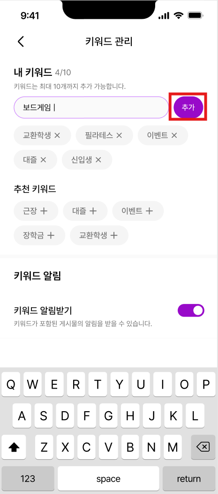

# 7-3. 키워드_추가_클릭

원문 페이지 ID: 4980221954bc8372bbc6015ff307fe49

> 원문 스냅샷. 명세 확정·앱 배포·수집 완료를 뜻하지 않습니다.

## 원문 속성

```json
{
  "platform": [
    "ANDROID",
    "IOS"
  ],
  "url": "source-page-id:4980221954bc8372bbc6015ff307fe49",
  "상태": "로깅 필요",
  "이름": "7-3. 키워드\\_추가\\_클릭",
  "태그": [
    "7. 키워드 관리(APP)"
  ]
}
```

<details>
<summary>과거 로깅</summary>

<p>
이전 로깅 없음 
</p>
</details>

<details>
<summary>새 로깅</summary>

<ul>
<li>
설명: 키워드 관리에서 내 키워드를 입력하고 추가 버튼을 클릭했을 때 발생하는 이벤트 
</li>
<li>
screen\_view: <code>notice_keyword_manage</code>
</li>
<li>
event\_name: <code>DA2</code>
</li>
<li>
event\_label: <code>board__notice_keyword_manage__keyword_manage__add__submit</code>
</li>
<li>
value: \{입력한 키워드\}
</li>
<li>
event\_category: <code>submit</code>
</li>
</ul>

<b>참고사진 · 모바일</b>

<b>모바일</b>


</details>
