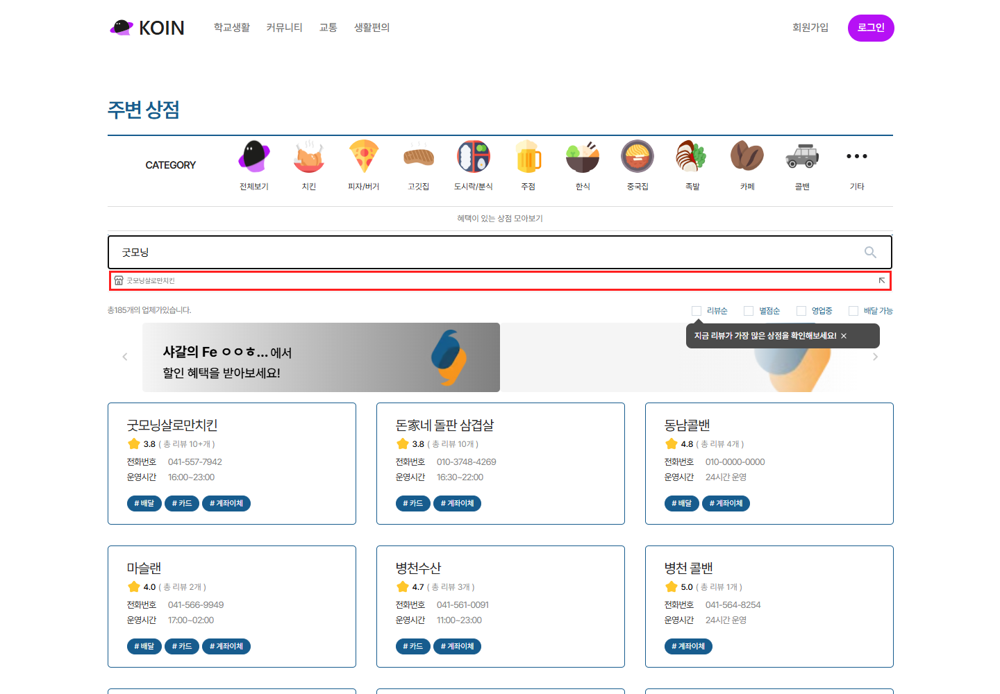
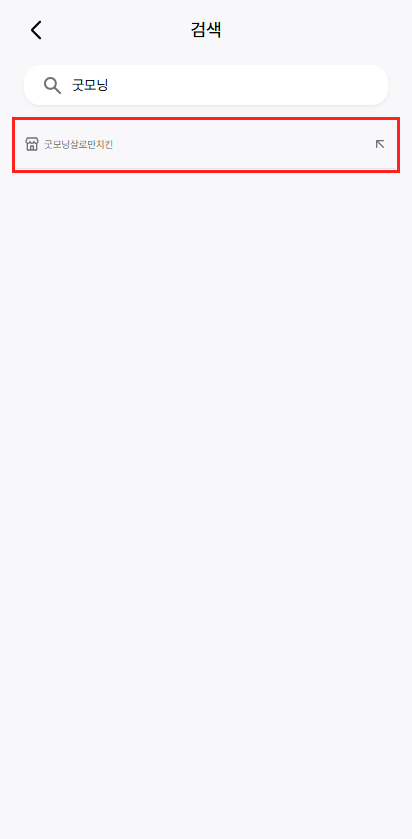

# 2-22 검색 결과 → 상점 상세 (클릭)

원문 페이지 ID: 4990221954bc82568e8881f0ce310b9e

> 원문 스냅샷. 명세 확정·앱 배포·수집 완료를 뜻하지 않습니다.

## 원문 속성

```json
{
  "platform": [
    "IOS",
    "ANDROID"
  ],
  "url": "source-page-id:4990221954bc82568e8881f0ce310b9e",
  "상태": "로깅 필요",
  "생성일": "2026-11-12T05:07:35.165Z",
  "이벤트 이름": "2-22 검색 결과 → 상점 상세 (클릭)",
  "태그": [
    "2. 상점 카테고리"
  ]
}
```

<details>
<summary>과거 로깅</summary>

- event\_label: <code>shop_categories_search_click</code>
- value: \{상점이름\}
- event\_category: click
</details>

<details>
<summary>새 로깅</summary>

- 설명: 상점 검색 결과에서 상점을 선택해 해당 상점 상세 화면으로 진입할 때 기록한다.
- screen\_view: <code>shop_search</code>
- event\_name: <code>DA1</code>
- event\_label: <code>shop__shop_search__shop_detail__entry__click</code>
- value: \{상점이름\}
- event\_category: <code>click</code>

### 참고사진

<columns>
<column ratio="50">
<b>웹</b>





Stage PC 웹 · 검색 결과 행 선택

</column>
<column ratio="50">
<b>모바일</b>





Stage 모바일 웹 · 검색 결과 행 선택

</column>
</columns>
</details>
