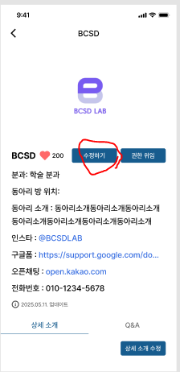
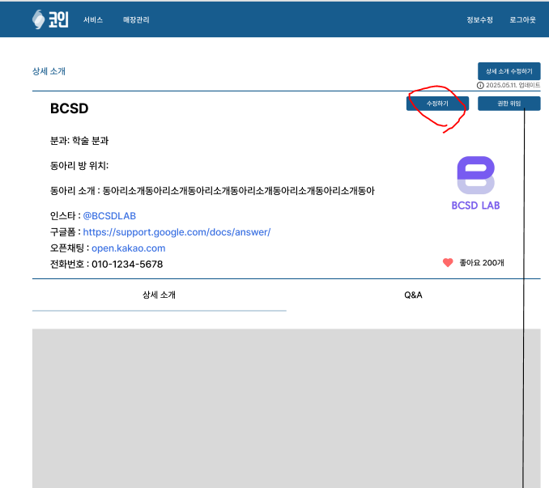

# 5-1.동아리_수정하기 클릭

원문 페이지 ID: 4b00221954bc83d29bd081fb6b10c6e2

> 사용자 제공 ZIP 내보내기 보관본. 레거시·동결·검토 상태는 원문을 따르며 코드 생성 승인·앱 배포 완료를 뜻하지 않습니다.

platform: ANDROID, IOS, WEB
상태: 완료

- 설명: 동아리 소개 화면에서 수정하기 버튼 클릭
- event_name : “CAMPUS”
- event_label : “club_correction”
- value : “수정하기”
- event_category : “click”
- 참고사진

- 웹 참고사진

