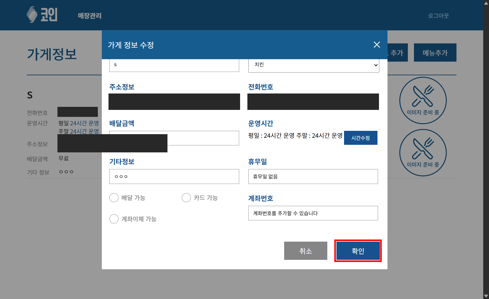

# 2-2 가게 정보 수정 - 확인

원문 페이지 ID: 4bd0221954bc8387b0f481849725421a

> 누락 원본 복구 스냅샷. 원본의 과거값·검토 기록을 보존하며 생성 계약으로 자동 승인하지 않습니다.

대조 기록: [87개 원본 복구 및 8개 차이 정리](../recovery-review.md)

관련 기존 보관본: [2-2 가게 정보 수정 - 확인](8f60221954bc838bb94801fe9da49bd7.md)

## 원문 속성

```json
{
  "platform": [
    "WEB"
  ],
  "url": "source-page-id:4bd0221954bc8387b0f481849725421a",
  "상태": "완료",
  "생성일": "2026-11-08T10:51:51.741Z",
  "이벤트 이름": "2-2 가게 정보 수정 - 확인",
  "태그": [
    "2. 가게 정보 수정"
  ]
}
```

<details>
<summary>이전 로깅</summary>


event\_params.key


- event\_label : store\_info\_edit\_confirm
- value : 가게 정보 수정 완료
- event\_category : click

</details>


<details>
<summary>새 로깅 (26.10.17)</summary>


- 설명: 사장님 가게 정보 수정 화면에서 확인 버튼을 클릭해 수정한 가게 정보를 저장하는 경우
- screen\_view: <code>owner_shop_edit</code>
- event\_name: <code>DA1</code>
- event\_label: <code>owner__owner_shop_edit__shop_manage__edit_confirm__click</code>
- value: 가게 정보 수정 완료
- event\_category: <code>click</code>

<details>
<summary>검토사항</summary>


- 통합 가이드: [로깅 통합 가이드](3c30221954bc8214b1c481c5bbb6fba5.md)
- 모바일: 없음 (사장님 사이트는 웹 전용, 모바일 브라우저로 열어도 같은 웹 로깅)
- label DA2 기준 정렬 (2026-10-27): <code>owner__owner_shop_edit__submit__click</code> → <code>owner__owner_shop_edit__shop_manage__edit_confirm__click</code>

</details>


### 참고사진 (확인 버튼)


<b>웹</b>

<details>
<summary>참고사진 · 웹</summary>


웹 — 가게 정보 수정 확인 (출처: stage 실제 캡처, 빨간 네모 = 클릭 위치)





</details>


<b>모바일</b>

<details>
<summary>참고사진 · 모바일</summary>


모바일 — 해당 없음 (웹 전용)

</details>


</details>
