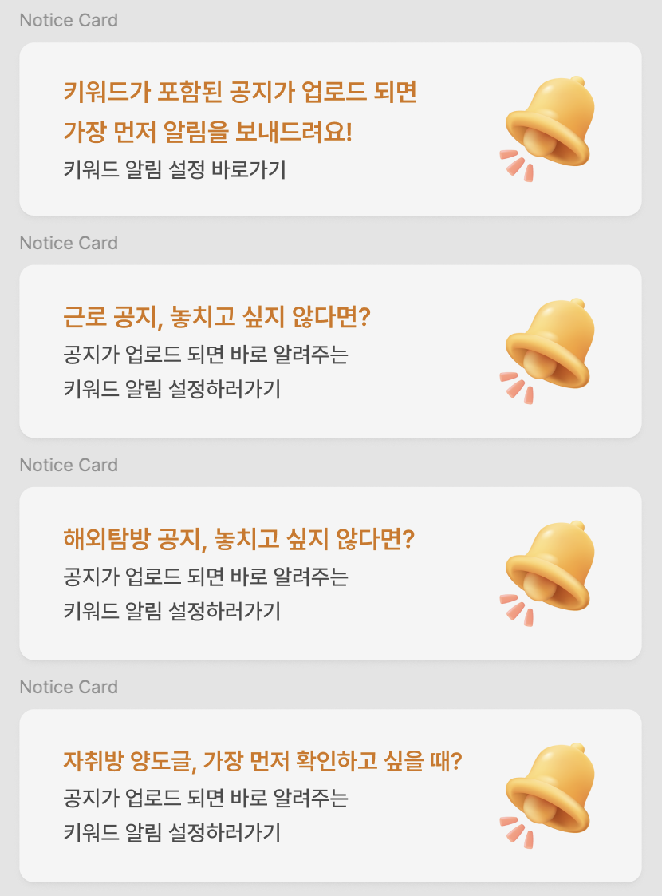

# 8-3. 키워드 관리 진입 배너_클릭

원문 페이지 ID: 4bf0221954bc83c78b7081fd636e4039

> 원문 스냅샷. 명세 확정·앱 배포·수집 완료를 뜻하지 않습니다.

## 원문 속성

```json
{
  "platform": [
    "ANDROID",
    "IOS"
  ],
  "url": "source-page-id:4bf0221954bc83c78b7081fd636e4039",
  "상태": "레거시",
  "이름": "8-3. 키워드 관리 진입 배너\\_클릭",
  "태그": [
    "8. 앱 메인(APP)"
  ]
}
```

<details>
<summary>이전 로깅</summary>

<ul>
<li>
설명 : 메인 배너에서 키워드 알림설정 바로가기 (A/B테스트용)

- 첫 배너에서 사용자당 업데이트 후 7일마다 변경됨
</li>
<li>
event\_label : “to\_manage\_keyword”
</li>
<li>
value : “안내글”<b>, “근로”, “해외탐방”, “자취방 양도”</b>
</li>
<li>
event\_category : “click” 
</li>
<li>
참고사진


</li>
</ul>
</details>

<details>
<summary>새 로깅 (26.10.05) — 초안</summary>

- 설명: 앱 메인 배너에서 키워드 알림 설정 바로가기 클릭.
- screen\_view:
- event\_name: <code>DA1</code>
- event\_label: <code>board__main__keyword_manage__banner_entry</code>
- value: “안내글” 또는 “근로” 또는 “해외탐방” 또는 “자취방 양도”
- event\_category: <code>click</code>
- 적용 플랫폼: ANDROID, IOS
- 참고사항
  - 기존 A/B 테스트용 배너 유형 구분과 사용자당 업데이트 후 7일마다 변경된다는 조건을 보존합니다. 현재 배너 노출 방식을 확인합니다.
  - value에는 클릭한 배너의 유형을 전달합니다.
- 참고사진: 이전 로깅의 참고사진 참조
</details>

레거시 사유 : AB 테스트 종료
