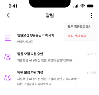

# 0-4. 알림 내부_모두 읽음으로 표시

원문 페이지 ID: 4c10221954bc8289810881a341c082dc

> 원문 스냅샷. 명세 확정·앱 배포·수집 완료를 뜻하지 않습니다.

## 원문 속성

```json
{
  "platform": [
    "ANDROID",
    "IOS",
    "WEB"
  ],
  "url": "source-page-id:4c10221954bc8289810881a341c082dc",
  "구분": "알림",
  "상태": "로깅 필요",
  "생성일": "2026-11-12T05:08:04.651Z",
  "이벤트 이름": "0-4. 알림 내부\\_모두 읽음으로 표시"
}
```

<details>
<summary>새 로깅 (26.11.11)</summary>

- 설명: 팀원 모집 전용 알림 목록 우측 상단 메뉴에서 모두 읽음으로 표시를 선택할 때 1회 기록한다. 메뉴를 여는 클릭·알림 항목의 자동 읽음 처리·API 성공 콜백에는 전송하지 않는다. 비활성 상태의 버튼은 제외한다.
- screen\_view: <code>team_notification</code>
- event\_name: <code>DA1</code>
- event\_label: <code>team_recruit__team_notification__notification_list__read_all__click</code>
- value: 모두 읽음으로 표시
- event\_category: <code>click</code>

<details>
<summary>검토사항</summary>

- 조회한 WEB 헤더 코드에 해당 메뉴와 읽음 처리 콜백이 있다. ANDROID·IOS의 팀원 모집 전용 알림함 지원은 별도 확인한다. 전송 시점은 사용자 메뉴 선택이며 처리 성공 지표로 사용하지 않는다.
- [WEB 화면 코드](https://github.com/BCSDLab/KOIN_WEB_RECODE/blob/9b6b7a2a29e70f59409bb1136cf2ec7bb9765ab6/src/pages/team/notifications/index.tsx) · [상단 메뉴 코드](https://github.com/BCSDLab/KOIN_WEB_RECODE/blob/9b6b7a2a29e70f59409bb1136cf2ec7bb9765ab6/src/components/Team/components/TeamNotificationHeader/index.tsx)
- 문서·기능 코드 대조이며 배포·단일 전송·실수집 완료는 미확인이다. Silver·Gold 매핑과 데이터는 이번 작업에서 변경하지 않는다.
- 기존 원문: 1-2 알림 클릭 내부 (원문 ID: 4010221954bc82a9b0b7819eafa98396)
</details>
</details>

### 참고사진 (모두 읽음으로 표시)

<b>웹</b>

<b>참고사진 · 웹 (모바일)</b>

웹 (모바일) — 알림 화면 기능은 코드에서 확인했다. 현재 모바일 웹 실제 화면 캡처는 미확보다. PC 웹 지원과 사진은 별도 미확인이다.

<b>모바일</b>

<b>참고사진 · 모바일 앱</b>

모바일 앱 — 아래 이미지는 기존 모바일 디자인·공용 알림 참고자료다. 현재 팀원 모집 앱의 실기기 캡처나 지원 완료 증거는 아니다.

웹 모바일 사진과 모바일 앱 참고사진을 분리한다. 같은 이미지를 두 플랫폼의 실제 화면으로 중복 표기하지 않는다.

기존 팀원 모집 알림 목록 디자인 참고사진. 우측 상단 열린 메뉴의 모두 읽음으로 표시가 대상이다. 공용 알림함의 동일 기능을 별도로 중복 전송하지 않는다.


