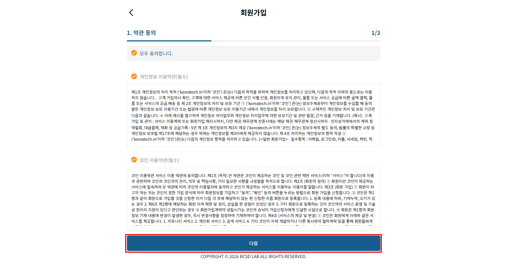
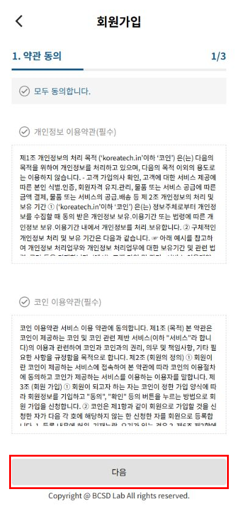

# 4-4 회원가입 - 다음 (클릭) - 추가된 로깅

원문 페이지 ID: 4c60221954bc83dfb137010a56504d5e

> 사용자 제공 ZIP 내보내기 보관본. 레거시·동결·검토 상태는 원문을 따르며 코드 생성 승인·앱 배포 완료를 뜻하지 않습니다.

생성일: 2026년 11월 8일 오후 7:51
platform: WEB
상태: 로깅 필요

- 이전 로깅
    - 없음 (새로 추가한 로깅)
- 새 로깅 (26.10.17)
    - 설명: 사장님 회원가입 화면(/signup)의 각 단계(약관동의 등)에서 다음 버튼을 클릭해 다음 단계로 넘어가는 경우 (단계별 이탈 확인용)
    - screen_view: `owner_signup`
    - event_name: `DA1`
    - event_label: `owner__owner_signup__sign_up__next__click`
    - value: {단계} (예: 약관동의)
    - event_category: `click`
    - 검토사항
        - 통합 가이드: [로깅 통합 가이드](3c30221954bc8214b1c481c5bbb6fba5.md)
        - 모바일: 반응형 웹(390px) 참고사진 있음, 네이티브 앱 캡처 아님
        - label DA2 기준 정렬 (2026-10-27): `owner__owner_signup__next__click` → `owner__owner_signup__sign_up__next__click`
    
    ### 참고사진 (다음 버튼)
    
    **웹**
    
    - 참고사진 · 웹
        
        웹 — 회원가입 다음 (출처: stage 실제 캡처, 빨간 네모 = 클릭 위치)
        
        
        
    
    **모바일**
    
    - 참고사진 · 모바일
        
        
        
        모바일 웹 · 빨간 네모: 사장님 회원가입 다음 버튼 · 약관 동의 전 비활성 상태. 가로 390px 반응형 stage 실제 화면. Android/iOS 앱 캡처와 구분.
