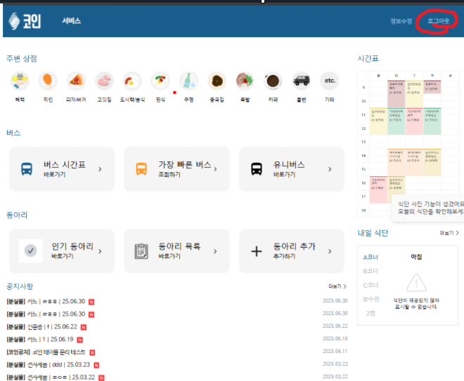
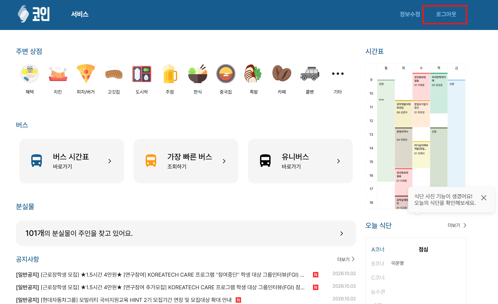

# 4-1 로그아웃(클릭)

원문 페이지 ID: 4c70221954bc8228850881c90ff85e64

> 원문 스냅샷. 명세 확정·앱 배포·수집 완료를 뜻하지 않습니다.

## 원문 속성

```json
{
  "platform": [
    "WEB"
  ],
  "url": "source-page-id:4c70221954bc8228850881c90ff85e64",
  "구분": "로그아웃",
  "상태": "로깅 필요",
  "생성일": "2026-11-08T10:51:29.744Z",
  "이벤트 이름": "4-1 로그아웃(클릭)",
  "태그": [
    "로그아웃"
  ]
}
```

<details>
<summary>이전 로깅</summary>

- event\_label : “header”
- value : “로그아웃<b>”</b>
- event\_category : “click”

웹




<details>
<summary>이전 WEB 참고사진 · 리디자인 전</summary>

<details>
<summary>참고사진 · 웹</summary>

<b>웹</b>


</details>
</details>
</details>

<details>
<summary>새 로깅 (26.10.04)</summary>

- 설명: 로그인한 WEB 공통 헤더의 로그아웃 버튼을 클릭할 때 기록한다. 로그아웃 처리 성공 이벤트와 구분한다.
- event\_name: <code>DA2</code>
- screen\_view: <code>header</code>
- event\_label: <code>account__header__logout__click</code>
- value: 로그아웃
- event\_category: <code>click</code>

<details>
<summary>검토사항</summary>

- WEB 리디자인 참고사진 (2026-11-04): 별도 로그인 후 헤더 상태 프레임의 로그아웃 버튼을 Figma 원본에서 확인하고 빨간 네모로 표시했다. [Figma 시안](https://www.figma.com/design/DPlcYuiFxhyT5ULbqec59i/KOIN-Web?node-id=17614-36124). 실제 SDK 동작·배포는 미확인이다.
- screen\_view 확정 (2026-10-30 상민 직접 지시): event\_label의 두 번째 구간과 같은 <code>header</code> 고정값을 사용한다. 이전 동적 화면명 표기안은 이 결정으로 대체한다. 라벨·category·value·발생 시점·플랫폼·사진은 유지하며 SDK 적용·실제 전송·한 번 전송은 미확인이다.
- 통합 가이드: [로깅 통합 가이드](3c30221954bc8214b1c481c5bbb6fba5.md)
</details>


### 참고사진 (로그아웃 버튼 클릭)

<b>웹</b>

<details>
<summary>참고사진 · 웹</summary>

WEB 리디자인 · [Figma 시안](https://www.figma.com/design/DPlcYuiFxhyT5ULbqec59i/KOIN-Web?node-id=17614-36124) · 2026-11-04. 빨간 네모 = 로그아웃 버튼 클릭 위치. 원본 캡처에 코드로 테두리만 표시했으며 실제 서비스 캡처·SDK 검증을 뜻하지 않는다.

<b>로그인 후 헤더 영역 · Figma 벡터 4배 캡처</b>

정보수정·로그아웃의 별도 상태 프레임을 그대로 캡처했다. 전체 홈 화면에 버튼을 합성하지 않았다.


</details>

<b>모바일</b>

<details>
<summary>참고사진 · 모바일</summary>

해당 없음 — 이 페이지는 WEB 헤더 전용 명세다. 앱 프로필 버튼은 기존 모바일 명세를 따른다.
</details>
</details>
