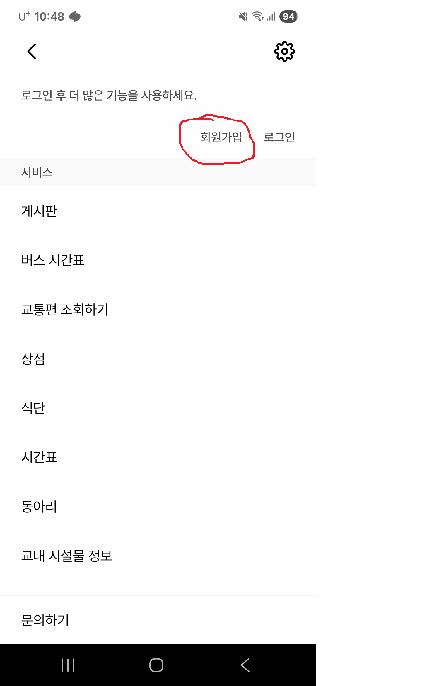
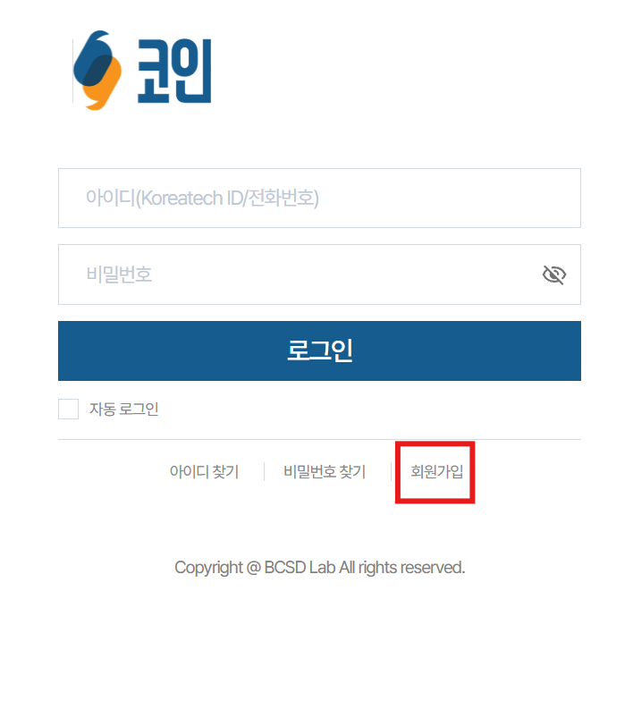
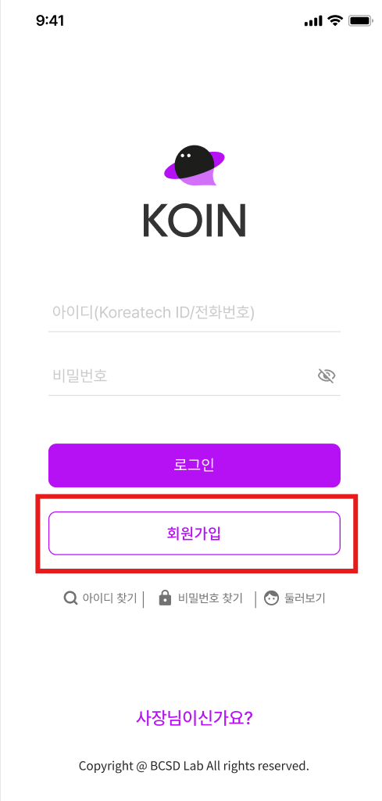

# 1-2 회원가입진입(클릭)

원문 페이지 ID: 4ca0221954bc83c3bf0201e216b1c272

> 원문 스냅샷. 명세 확정·앱 배포·수집 완료를 뜻하지 않습니다.

## 원문 속성

```json
{
  "platform": [
    "ANDROID",
    "IOS",
    "WEB"
  ],
  "url": "source-page-id:4ca0221954bc83c3bf0201e216b1c272",
  "구분": "회원가입진입",
  "상태": "로깅 필요",
  "생성일": "2026-11-08T10:51:23.697Z",
  "이벤트 이름": "1-2 회원가입진입(클릭)",
  "태그": [
    "회원가입"
  ]
}
```

<details>
<summary>이전 로깅</summary>

- event\_label : “hamburger”
- value : “회원가입 시작<b>”</b>
- event\_category : “click”
- custom\_session\_id : \{sign\_up\}\_\{0\}\_\{플랫폼\}\_\{세션시작시간\}\_\{랜덤값\}


</details>

<details>
<summary>새 로깅 (26.10.04)</summary>

- 설명: 메인 카테고리(햄버거) 화면에서 회원가입 메뉴를 클릭해 가입 화면으로 진입할 때 기록한다. 로그인 화면의 회원가입 진입과 구분한다.
- event\_name: <code>DA2</code>
- screen\_view: <code>main_category</code>
- event\_label: <code>account__main_category__sign_up__menu_entry__click</code>
- value: 회원가입 시작
- event\_category: <code>click</code>
- custom\_session\_id : \{sign\_up\}\_\{0\}\_\{플랫폼\}\_\{세션시작시간\}\_\{랜덤값\}

<details>
<summary>검토사항</summary>

- 진입점 구분: 문서 확정·구현 확인 대기 (2026-10-28): 메뉴 회원가입과 로그인 화면 회원가입 링크는 합치지 않는다. 후속 사용자 승인 (2026-11-01)으로 메뉴 내부 회원가입 진입의 screen\_view를 main\_category, event\_label을 account\_\_main\_category\_\_sign\_up\_\_menu\_entry\_\_click으로 확정했다. 로그인 화면 회원가입 진입(1-3)은 현행 유지하며 실제 호출 지점·플랫폼별 적용·SDK 전송 및 한 번 전송은 미확인이다. 대응 명세: [1-3 로그인 화면_회원가입진입(클릭)](47c0221954bc821e8c6e817fbbdf091f.md). 추가·중복 전송을 확정하지 않는다.
- label 통일 (2026-10-27): <code>main__login__sign_up__entry</code> → <code>account__login__sign_up__entry__click</code>
- 확인 필요: service 세그먼트가 main (다른 계정 페이지는 account). 규칙상 service 세그먼트는 변경하지 않음.
- 후속 수정 (2026-10-27): service 세그먼트 main → account (<code>main__login__sign_up__entry__click</code> → <code>account__login__sign_up__entry__click</code>), 위 확인 필요 메모 해소
</details>

<details>
<summary>참고사진 (기능 표시)</summary>

<b>웹</b>



<b>모바일</b>


</details>
</details>
