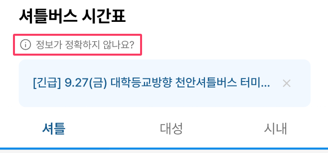
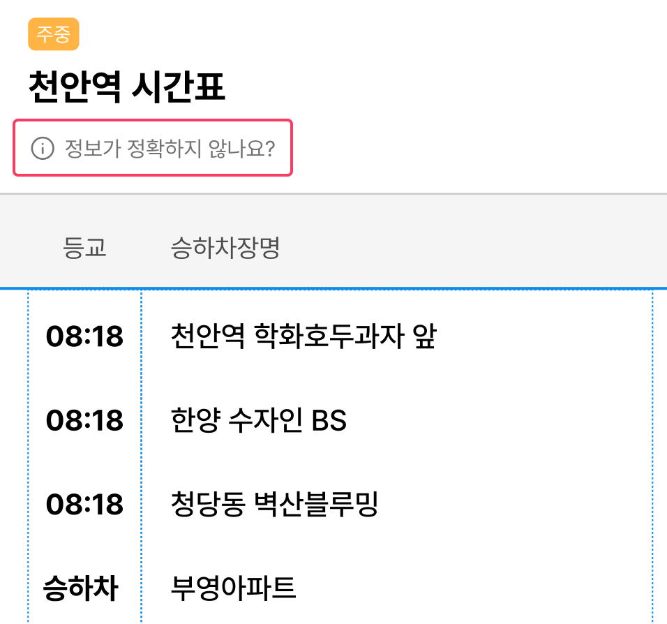
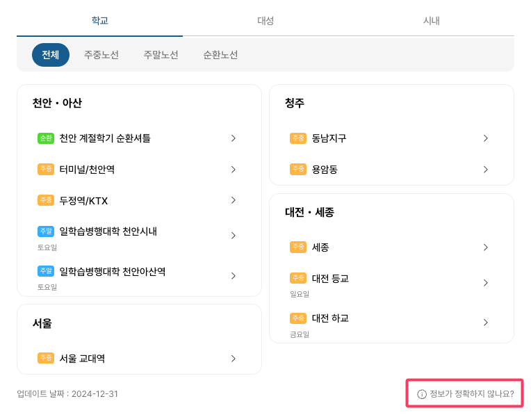
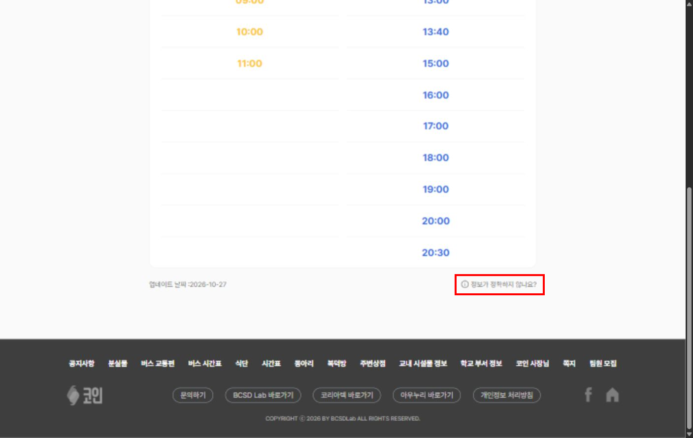
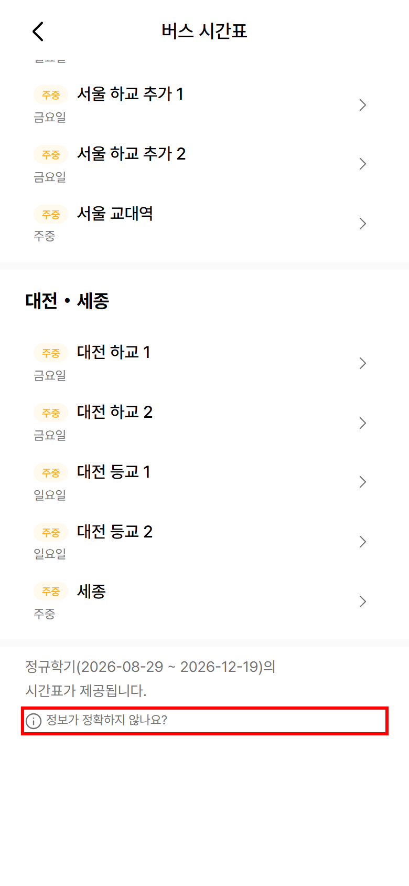
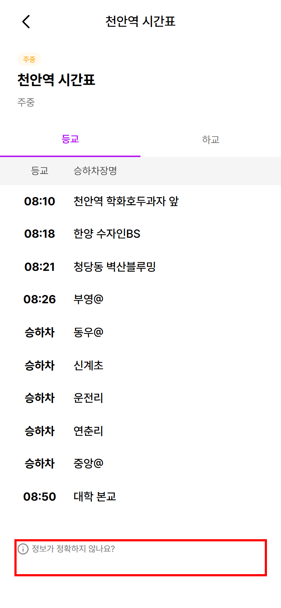

# 4-1. 정보가 정확하지 않나요?_클릭 (세부 노선 변경시 업데이트 필요)

원문 페이지 ID: 4cb0221954bc82dfbbfa019a617eed2a

> 원문 스냅샷. 명세 확정·앱 배포·수집 완료를 뜻하지 않습니다.

## 원문 속성

```json
{
  "platform": [
    "ANDROID",
    "IOS",
    "WEB"
  ],
  "url": "source-page-id:4cb0221954bc82dfbbfa019a617eed2a",
  "상태": "완료",
  "생성일": "2026-11-12T05:07:51.818Z",
  "이벤트 이름": "4-1. 정보가 정확하지 않나요?\\_클릭 (세부 노선 변경시 업데이트 필요)",
  "태그": [
    "4. 버스 시간표"
  ]
}
```

<details>
<summary>과거 로깅</summary>

- event\_label : “error\_feedback\_button”
- value : <b><span color="orange">이 버튼을 누른 위치 </span></b><span color="orange">(세부 노선 변경시 업데이트 필요)</span>
  - 1\) 셔틀버스 시간표, 대성버스 시간표, 시내버스 시간표
  - <b>2) \{노선\_세부 노선\} 형식</b>
    - “순환\_천안 계절학기 순환셔틀”, “주중\_터미널/천안역”, “주말\_일학습병행대학 천안시내” 등
- event\_category : “click”
- 참고사진







AND, IOS, WEB(Mobile view)





WEB

</details>

<details>
<summary>새 로깅</summary>

- 설명: 버스 시간표 화면 또는 셔틀 노선 상세 화면에서 "정보가 정확하지 않나요?"를 클릭하는 경우
- screen\_view: <code>bus_timetable</code>
- event\_name: <code>DA1</code>
- event\_label: <code>bus__bus_timetable__bus_feedback__entry__click</code>
- value: 셔틀 / 대성 / 시내 (시간표 화면, 보고 있던 탭, 예: 셔틀) · \{노선 구분\}\_\{세부 노선\} (노선 상세 화면, 예: 주중\_천안역)
- event\_category: <code>click</code>

### 참고사진 (기능 표시)

<columns>
<column ratio="50">
<b>웹</b>

<b>참고사진 · 웹</b>





WEB · 빨간 네모: 버스 오류제보 진입. stage 실제 화면 캡처에 위치 표시.

</column>
<column ratio="50">
<b>모바일</b>

<b>참고사진 · 모바일</b>

모바일 — 정보가 정확하지 않나요? 시간표 화면 (bus\_timetable) (출처: stage 실제 캡처, 빨간 네모 = 클릭 위치)



모바일 — 정보가 정확하지 않나요? 셔틀 노선 상세 화면 (bus\_timetable\_detail) (출처: stage 실제 캡처, 빨간 네모 = 클릭 위치)


</column>
</columns>
</details>
