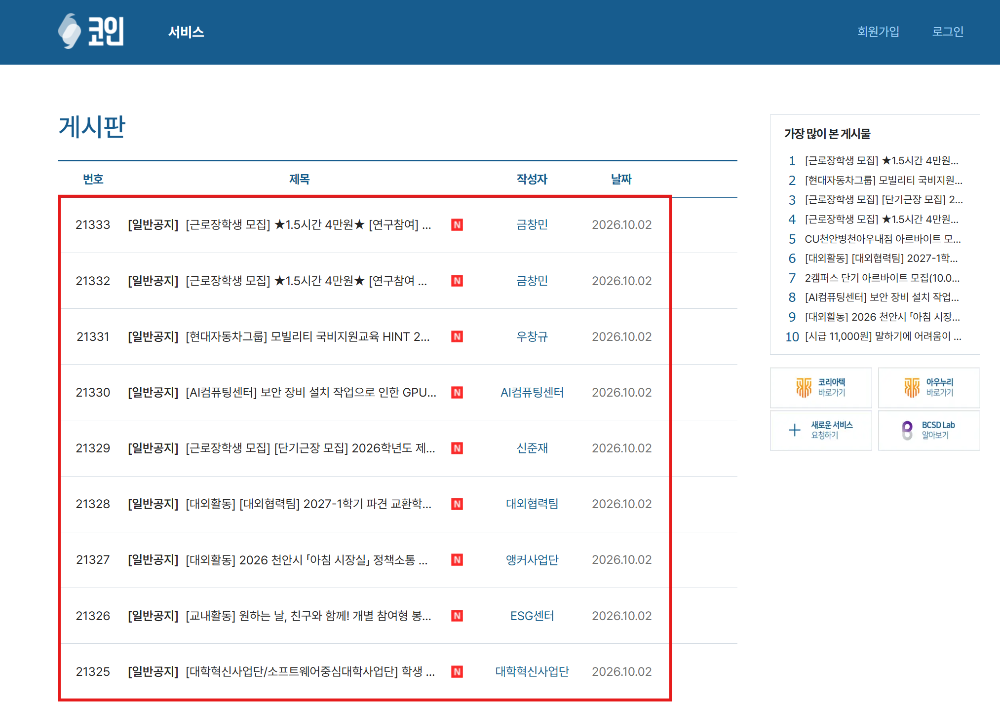
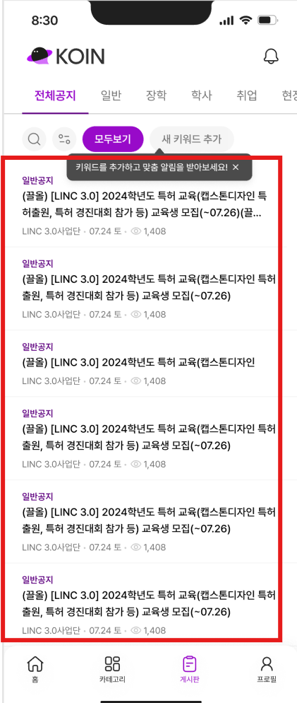

# 3-3·4-3. 공지사항_상세_클릭 (웹·앱)

원문 페이지 ID: 4e00221954bc822f87038164dd7f4415

> 원문 스냅샷. 명세 확정·앱 배포·수집 완료를 뜻하지 않습니다.

## 원문 속성

```json
{
  "platform": [
    "WEB",
    "ANDROID",
    "IOS"
  ],
  "url": "source-page-id:4e00221954bc822f87038164dd7f4415",
  "상태": "로깅 필요",
  "이름": "3-3·4-3. 공지사항\\_상세\\_클릭 (웹·앱)",
  "태그": [
    "3. 공지사항 상세 페이지",
    "4. 공지사항 상세 페이지(APP)"
  ]
}
```

이전 로깅 없음 (3-3 웹 / 4-3 앱 모두 없음)

<details>
<summary>새 로깅 (26.10.05) — 초안</summary>

- 설명: 공지사항 목록(화면)에서 공지 하나를 클릭/선택해 상세로 진입. 웹(3-3: 공지사항 화면의 공지 하나 클릭)과 앱(4-3: 공지사항 목록 중 공지 선택) 공통
- screen\_view: <code>main_notice</code> (웹·앱 동일)
- event\_name: <code>DA2</code>
- event\_label: <code>board__main_notice__notice_detail__entry__click</code>
- value: \{공지 ID\}
  - 공지 ID가 안되면 공지명으로 부탁드립니다! (조치결과 아래에 남겨주세요!)
- event\_category: <code>click</code>

<details>
<summary>검토사항</summary>

- label 통일 (2026-10-27): <code>board__main_notice__notice_detail__entry</code> → <code>board__main_notice__notice_detail__entry__click</code>
- 통합 (2026-10-27): 4-3. 공지사항\_상세\_클릭 (APP) 페이지를 이 페이지로 합침 (같은 label)
</details>

<columns>
<column ratio="50">
<b>웹 (3-3)</b>

<details>
<summary>참고사진 · 웹</summary>

웹 — 3-3 공지사항 화면


</details>
</column>
<column ratio="50">
<b>모바일 (4-3)</b>

<details>
<summary>참고사진 · 모바일</summary>

모바일 — 4-3 공지사항 목록 (APP)


</details>
</column>
</columns>
</details>


