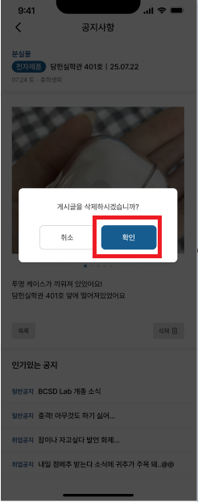
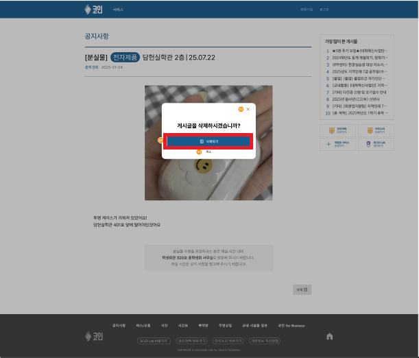
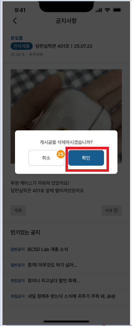

# 11-6.분실물_습득물신고_삭제확인_클릭

원문 페이지 ID: 4e90221954bc832cb85f81b714e29903

> 누락 원본 복구 스냅샷. 원본의 과거값·검토 기록을 보존하며 생성 계약으로 자동 승인하지 않습니다.

대조 기록: [87개 원본 복구 및 8개 차이 정리](../recovery-review.md)

관련 기존 보관본: [11-6.분실물_습득물신고_삭제확인_클릭](9170221954bc83f2851481fa2a35103c.md), [11-6.분실물_습득물신고_삭제확인_클릭](1bb0221954bc82a5969f811385bd96b5.md)

## 원문 속성

```json
{
  "platform": [
    "ANDROID",
    "IOS",
    "WEB"
  ],
  "url": "source-page-id:4e90221954bc832cb85f81b714e29903",
  "상태": "완료",
  "이름": "11-6.분실물\\_습득물신고\\_삭제확인\\_클릭"
}
```

- 설명:  글 작성자가 습득물 신고 게시물을 삭제버튼을 클릭하고, 나타나는 창에서 확인 버튼을 클릭
- event\_label : “find\_user\_delete\_confirm”
- value : “확인”
- event\_category : “click”
- 참고사진








WEB Mobile View



