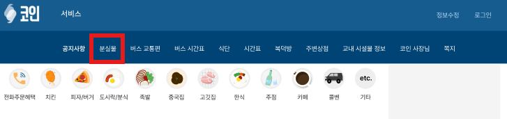

# 11-32. 헤더_분실물_클릭

원문 페이지 ID: 4eb0221954bc82f1a6d48131f2932aa0

> 원문 스냅샷. 명세 확정·앱 배포·수집 완료를 뜻하지 않습니다.

## 원문 속성

```json
{
  "platform": [
    "WEB"
  ],
  "url": "source-page-id:4eb0221954bc82f1a6d48131f2932aa0",
  "상태": "완료",
  "이름": "11-32. 헤더\\_분실물\\_클릭",
  "태그": [
    "11.분실물"
  ]
}
```

<details>
<summary>과거 로깅</summary>

<ul>
<li>
설명: 푸터의 분실물 클릭시 발생하는 로그입니다. 
</li>
<li>
event\_label : header
</li>
<li>
value : 분실물
</li>
<li>
event\_category : click
</li>
<li>
참고사진
</li>
</ul>


</details>

<details>
<summary>새 로깅</summary>

- 설명: 웹 헤더에서 분실물 항목을 클릭하여 목록으로 진입.
- screen\_view: <code>header</code>
- event\_name: <code>DA2</code>
- event\_label: <code>board__header__lost_item_entry__header_entry__click</code>
- value: 분실물
- event\_category: <code>click</code>

### 참고사진 (생활편의 → 분실물 · WEB 리디자인)

<b>웹</b>

<b>참고사진 · 웹</b>

생활편의 → 분실물. 출처: [Figma WEB 리디자인](https://www.figma.com/design/DPlcYuiFxhyT5ULbqec59i/KOIN-Web?node-id=11541-33352), 2026-11-04 원본 캡처에 코드로 빨간 네모만 추가. 빨간 네모는 기존 명세가 지칭하는 클릭 대상이다. 실제 클릭 가능 여부·SDK 적용·배포·수집은 미확인이다.


</details>
