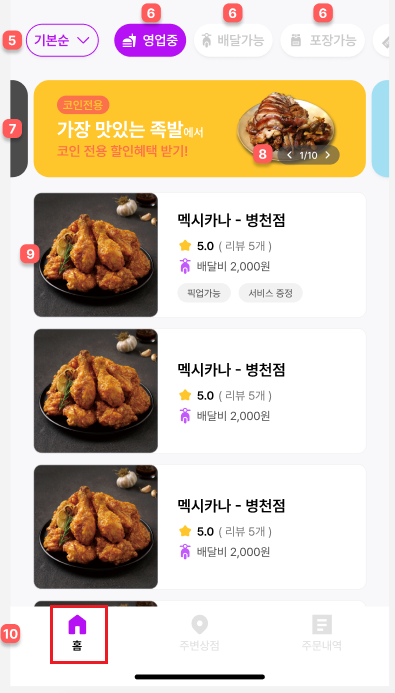

# 2-19 상점 카테고리 → 홈 - 레거시

원문 페이지 ID: 5000221954bc83628412014f70c3290f

> 원문 스냅샷. 명세 확정·앱 배포·수집 완료를 뜻하지 않습니다.

## 원문 속성

```json
{
  "platform": [
    "ANDROID",
    "IOS"
  ],
  "url": "source-page-id:5000221954bc83628412014f70c3290f",
  "상태": "로깅 필요",
  "생성일": "2026-11-12T05:07:35.347Z",
  "이벤트 이름": "2-19 상점 카테고리 → 홈 - 레거시",
  "태그": [
    "2. 상점 카테고리"
  ]
}
```

<details>
<summary>과거 로깅</summary>




<span color="orange">event\_params.key</span>

<ul>
<li>
event\_label : shop\_categories\_home
</li>
<li>
value :  \{카테고리\}
</li>
<li>
event\_category : click 
</li>
<li>
duration\_time : 이전 카테고리에서 현 카테고리로 이동하는 시간 
</li>
<li>
previous\_page : \{이전 카테고리\}
</li>
<li>
current\_page : \{현 카테고리\}
</li>
</ul>
</details>
