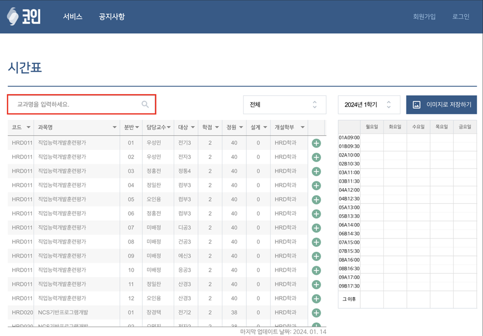
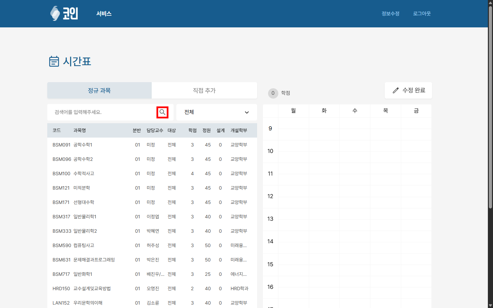

# 2-9. 시간표 검색_돋보기 (클릭)

원문 페이지 ID: 5090221954bc8355b95e81641094c7fb

> 원문 스냅샷. 명세 확정·앱 배포·수집 완료를 뜻하지 않습니다.

## 원문 속성

```json
{
  "platform": [
    "WEB"
  ],
  "url": "source-page-id:5090221954bc8355b95e81641094c7fb",
  "상태": "완료",
  "생성일": "2026-11-08T10:52:13.039Z",
  "이벤트 이름": "2-9. 시간표 검색\\_돋보기 (클릭)",
  "태그": [
    "시간표"
  ]
}
```

<details>
<summary>이전 로깅</summary>

- event\_label : “timetable”
- value : “search”
- event\_category : “click”
- 참고 이미지


</details>

<details>
<summary>새 로깅 (26.10.17)</summary>

- 설명: 웹 시간표 수정 화면(정규 과목 탭)의 과목 검색창에서 돋보기를 눌러(또는 엔터로) 과목을 검색하는 경우
- screen\_view: <code>timetable_edit</code>
- event\_name: <code>DA1</code>
- event\_label: <code>timetable__timetable_edit__search__click</code>
- value: 검색 (사용자가 입력한 검색어는 보내지 않는다)
- event\_category: <code>click</code>

<details>
<summary>검토사항</summary>

- label DA2 형식 검수 (2026-10-28): 현행 <code>timetable__timetable_edit__search__click</code>. 공용 기능 search와 기존 category click을 사용하는 4구간 형식으로 이미 정렬되어 있어 라벨을 유지한다. value=검색과 검색어 미수집 정책을 유지한다. 이 메모 추가로 라벨·value·사진은 변경하지 않는다. SDK/dbt 반영·실제 전송·한 번 전송은 미확인이다.
- 통합 가이드·후속: [로깅 통합 가이드](3c30221954bc8214b1c481c5bbb6fba5.md)
- 모바일: 없음 (모바일은 시간표 수정 시 'PC환경만 지원합니다' 안내만 뜸)
- 예전 기본 시간표 화면의 검색창은 없어지고 시간표 수정 화면으로 옮겨짐
</details>

### 참고사진 (기능 표시)

<columns>
<column ratio="50">
<b>웹</b>

<details>
<summary>참고사진 · 웹</summary>

웹 — 과목 검색 돋보기 (출처: stage 실제 캡처, 로그인 상태, 빨간 네모 = 클릭 위치)


</details>
</column>
<column ratio="50">
<b>모바일</b>

<details>
<summary>참고사진 · 모바일</summary>

해당 없음 (웹 전용)
</details>
</column>
</columns>
</details>
