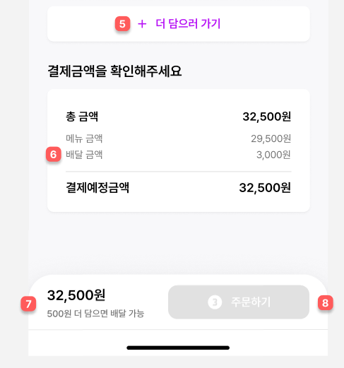

# 6-10 장바구니 더 담으러가기 

원문 페이지 ID: 50a0221954bc82f5b6ff01680446c82d

> 원문 스냅샷. 명세 확정·앱 배포·수집 완료를 뜻하지 않습니다.

## 원문 속성

```json
{
  "platform": [
    "ANDROID",
    "IOS"
  ],
  "url": "source-page-id:50a0221954bc82f5b6ff01680446c82d",
  "상태": "로깅 필요",
  "생성일": "2026-11-12T05:07:42.263Z",
  "이벤트 이름": "<p>\n6-10 장바구니 더 담으러가기 \n</p>"
}
```




5번 더 담으러 가기 버튼 클릭 로깅입니다.


<span color="orange">event\_params.key</span>

<ul>
<li>
event\_label : cart\_extraFood
</li>
<li>
value : \{상점이름\}
</li>
<li>
event\_category : 

<ul>
<li>
click 
</li>
</ul>
</li>
</ul>


