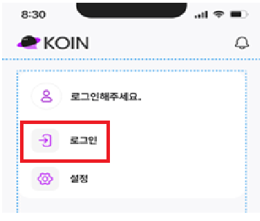
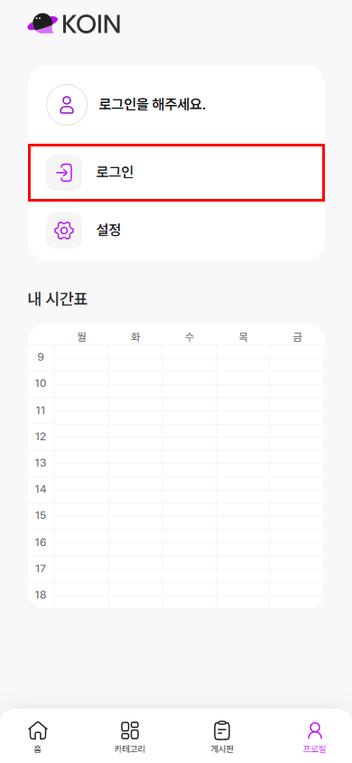

# 4-2 로그인 클릭

원문 페이지 ID: 50c0221954bc8211862701c53ee682cd

> 원문 스냅샷. 명세 확정·앱 배포·수집 완료를 뜻하지 않습니다.

## 원문 속성

```json
{
  "platform": [
    "ANDROID",
    "IOS"
  ],
  "url": "source-page-id:50c0221954bc8211862701c53ee682cd",
  "구분": "프로필",
  "상태": "완료",
  "생성일": "2026-11-12T05:08:03.166Z",
  "이벤트 이름": "4-2 로그인 클릭"
}
```

<details>
<summary>과거 로깅</summary>

- event\_label : home\_login
- value : 로그인
- event\_category : click



</details>

<details>
<summary>새 로깅</summary>

- screen\_view: <code>main_profile</code>
- event\_name: <code>DA2</code>
- event\_label: <code>account__main_profile__login__entry__click</code>
- value: 로그인
- event\_category: <code>click</code>
- 설명: 프로필 화면의 로그인 버튼을 클릭하여 로그인 화면으로 이동할 때 전송한다. 로그인 성공 이벤트가 아니다.

### 참고사진 (로그인 버튼 클릭)

<b>웹</b>

<b>참고사진 · 웹 — 대표 명세 참조</b>

WEB 헤더 사진은 [2-1 헤더_로그인 진입(클릭)](0720221954bc82e1a235819b683cf85e.md)의 참고사진에서 확인한다. 이 페이지는 APP 프로필 main\_profile 명세이며 WEB 헤더와 구분한다. 동일 WEB 사진의 중복 첨부를 정리했고 모바일 사진과 기존 필드는 유지했다.

<b>모바일</b>

<b>참고사진 · 모바일</b>





모바일 웹 · 2026-10-30 운영 [koreatech.in/profile의](http://koreatech.in/profile%EC%9D%98) 보라색 실제 프로필 화면. 빨간 테두리=로그인 버튼. 로그인 실행 전 위치 참고사진이며 네이티브 앱과 SDK 발화는 미확인이다.

</details>
