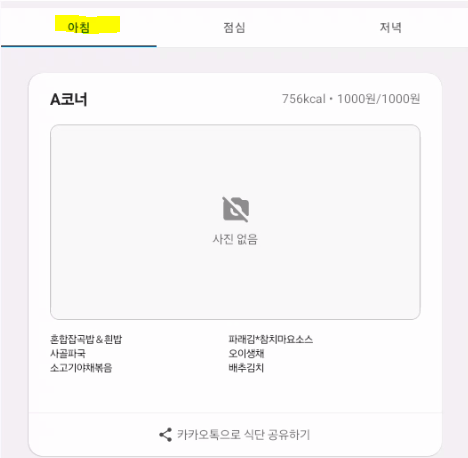
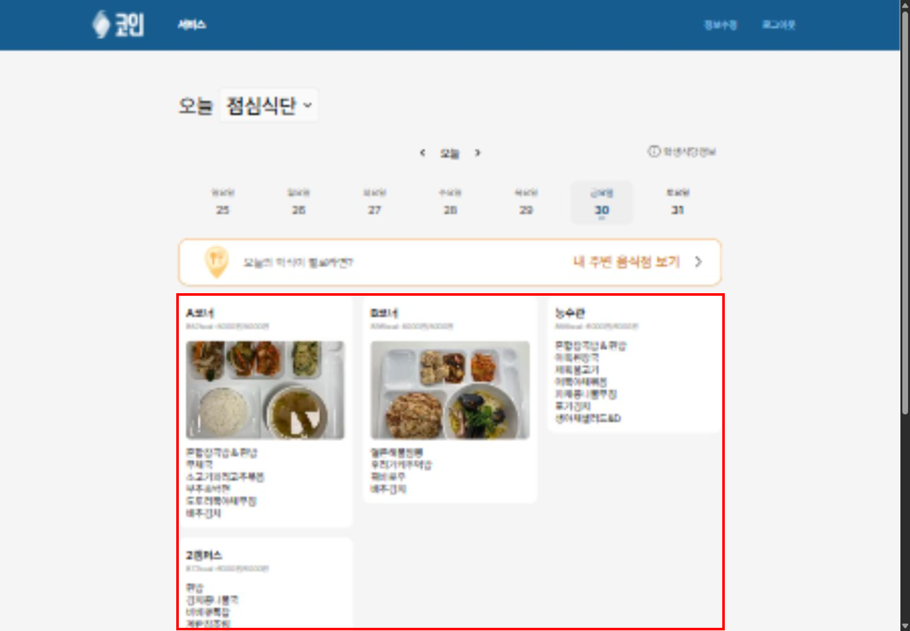
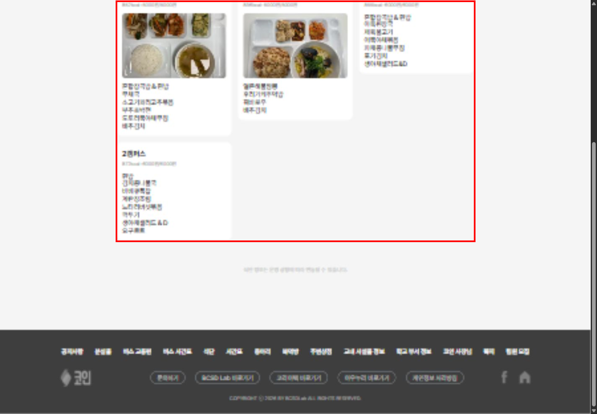
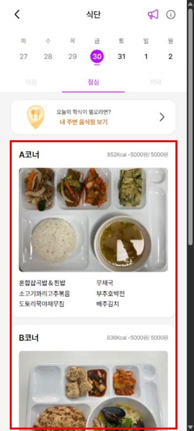
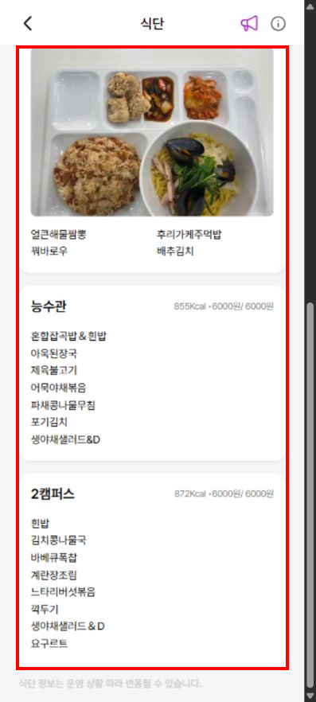

# 3-4. 식단_아침_스크롤

> 원본 복구 대조: [별도 원본 ID dc00221954bc83f5923e01ff8270898e](dc00221954bc83f5923e01ff8270898e.md)와 [차이 정리](../recovery-review.md)를 참고하세요. 기존 값은 과거 기록으로 유지합니다.

원문 페이지 ID: 51f0221954bc821cb2648147bef8d890

> 원문 스냅샷. 명세 확정·앱 배포·수집 완료를 뜻하지 않습니다.

## 원문 속성

```json
{
  "platform": [
    "ANDROID",
    "IOS",
    "WEB"
  ],
  "url": "source-page-id:51f0221954bc821cb2648147bef8d890",
  "상태": "완료",
  "생성일": "2026-11-12T05:07:48.628Z",
  "이름": "3-4. 식단\\_아침\\_스크롤",
  "태그": [
    "3. 식단 상세페이지"
  ]
}
```

<details>
<summary>과거 로깅</summary>

- 설명 : 식단 페이지에서 아침 식사 부분에서 스크롤
- event\_label : “menu\_time”
- value : “아침<b>”</b>
- event\_category : “scroll”
- 참고사진



- 웹
</details>

<details>
<summary>새 로깅</summary>

- 설명: 식단 화면에서 선택된 식사 시간(아침 / 점심 / 저녁)의 식단 목록을 스크롤하는 경우 (기존 3-4·3-5·3-6을 하나로 통합)
- screen\_view: <code>cafeteria</code>
- event\_name: <code>DA1</code>
- event\_label: <code>cafeteria__cafeteria__meal_time__scroll</code>
- value: \{식사 시간\} (예: 점심)
- event\_category: <code>scroll</code>

### 참고사진 (식단 스크롤)

<columns>
<column ratio="50">
<b>웹</b>

<b>스크롤 전후 · 운영 WEB (2026-10-30)</b>

출처: [koreatech.in](http://koreatech.in) 실제 점심 식단 목록 화면. 빨간 테두리=목록 영역. 실제 스크롤 후 화면 위치를 비교하는 참고자료이며 SDK 이벤트 대상·발화·중복 전송은 미확인이다.





WEB · 스크롤 전 · 2026-10-30.





WEB · 스크롤 후 · 2026-10-30.

</column>
<column ratio="50">
<b>모바일</b>

<b>스크롤 전후 · 운영 모바일 웹 (2026-10-30)</b>

출처: [koreatech.in](http://koreatech.in) 실제 점심 식단 목록 화면. 빨간 테두리=목록 영역. 실제 스크롤 후 화면 위치를 비교하는 참고자료이며 SDK 이벤트 대상·발화·중복 전송은 미확인이다. 네이티브 Android/iOS 앱 캡처와 구분한다.





모바일 웹 · 스크롤 전 · 2026-10-30.





모바일 웹 · 스크롤 후 · 2026-10-30.

</column>
</columns>
</details>
