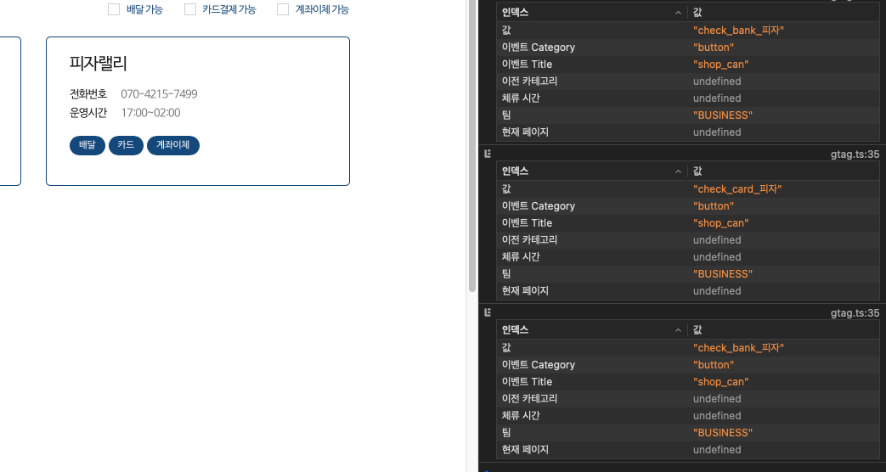
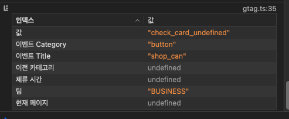

# 해결 (1)

원문 페이지 ID: 5330221954bc8207bf0c01c26c46f23d

> 원문 스냅샷. 명세 확정·앱 배포·수집 완료를 뜻하지 않습니다.

## 원문 속성

```json
{
  "title": "해결 (1)"
}
```


<p>
웹 
</p>

<ol>
<li>
체크 표시를 풀때 이벤트가 발생 
</li>
</ol>



<p>
→ 토글을 누를때 바로 이벤트가 생성되게 해주시면 되겠습니다. 
</p>

<p>
추가로 토글을 해제할때는 이벤트가 생성 되지 않아도 됩니다. 
</p>


<ol start="2">
<li>
헤더나 푸터를 통해 들어올때 이슈 발생 
</li>
</ol>



<p>
→ 전체보기 값으로 들어오면 될거 같습니다! 
</p>


<ol start="3">
<li>
반응형 웹 이슈 
</li>
</ol>

<p>
반응형 웹에서는 토글 자체를 이벤트를 측정하지 못하고 있습니다. 
</p>

추가해주시면 감사하겠습니다! → 신규 이벤트로 넣어주시면 되겠습니다!


