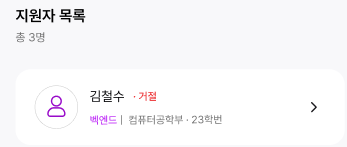
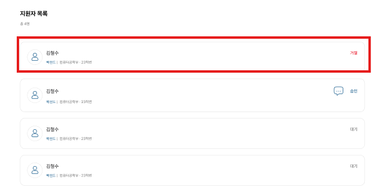
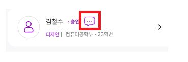
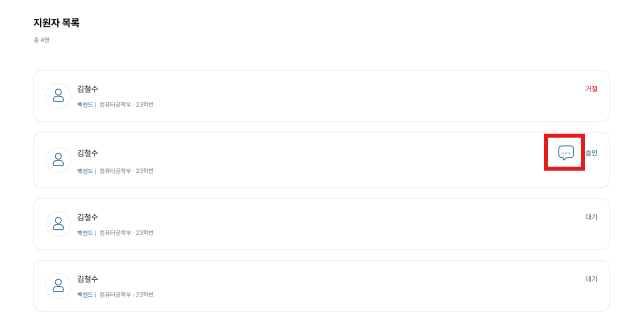
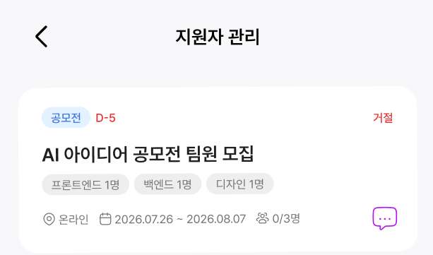
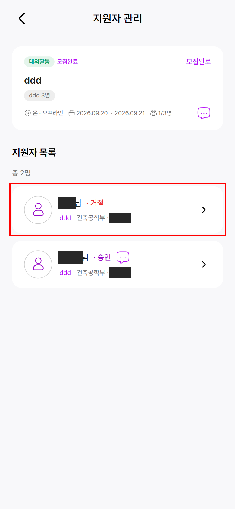
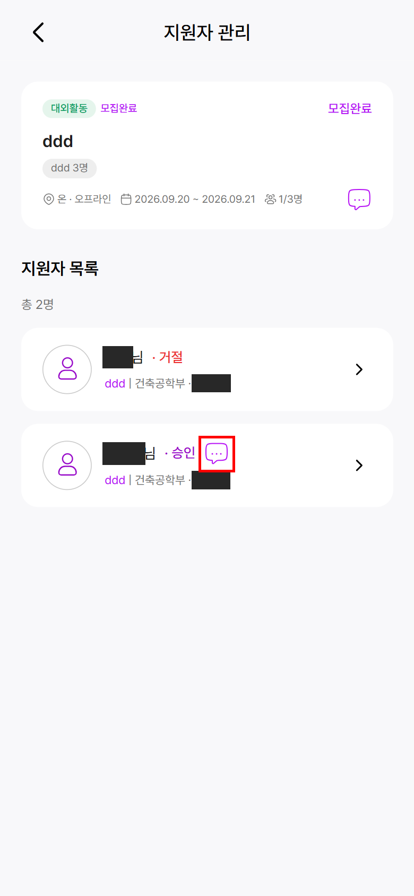
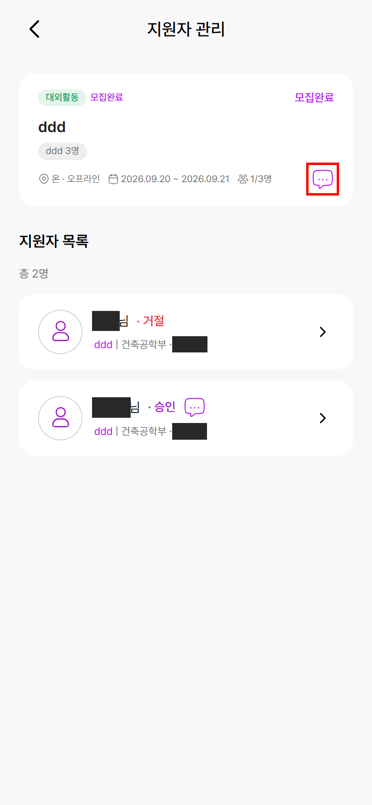

# 10. 지원자 관리

원문 페이지 ID: 5530221954bc82f9bb02018a885195ca

> 원문 스냅샷. 명세 확정·앱 배포·수집 완료를 뜻하지 않습니다.

## 원문 속성

```json
{
  "platform": [
    "WEB",
    "ANDROID",
    "IOS"
  ],
  "url": "source-page-id:5530221954bc82f9bb02018a885195ca",
  "구분": "내가 작성한 모집글 -> 지원자 관리",
  "상태": "로깅 필요",
  "생성일": "2026-11-08T10:52:07.353Z",
  "이벤트 이름": "10\\. 지원자 관리"
}
```

<details>
<summary>이전 로깅</summary>

① 지원자 선택

- event\_label : team\_recruitment\_created\_post\_applicant\_select
- value : 지원자 선택
- event\_category : click





② 지원자 채팅 클릭

- event\_label : team\_recruitment\_created\_post\_applicant\_chat
- value : 채팅
- event\_category : click






1. 채팅 클릭

- event\_label : team\_recruitment\_created\_post\_chat
- value : 채팅
- event\_category : click


</details>

<details>
<summary>새 로깅 (26.10.17)</summary>

① 지원자 선택

- 설명: 지원자 관리 화면에서 지원자 카드를 클릭해 지원자 상세 화면으로 들어가는 경우
- screen\_view: <code>team_applicant</code>
- event\_name: <code>DA1</code>
- event\_label: <code>team_recruit__team_applicant__team_applicant_detail__entry__click</code>
- value: 지원자 선택
- event\_category: <code>click</code>

② 지원자 채팅 클릭

- 설명: 지원자 관리 화면에서 지원자 카드의 채팅 버튼을 클릭해 그 지원자와의 1:1 채팅방으로 들어가는 경우
- screen\_view: <code>team_applicant</code>
- event\_name: <code>DA1</code>
- event\_label: <code>team_recruit__team_applicant__chat_entry__applicant_entry__click</code>
- value: 채팅
- event\_category: <code>click</code>

1. 채팅 클릭

- 설명: 지원자 관리 화면에서 지원자 카드가 아닌 모집글 단위 채팅 버튼을 클릭해 팀 단체 채팅방으로 들어가는 경우 (확인 필요)
- screen\_view: <code>team_applicant</code>
- event\_name: <code>DA1</code>
- event\_label: <code>team_recruit__team_applicant__chat_entry__group_entry__click</code>
- value: 채팅
- event\_category: <code>click</code>

<details>
<summary>검토사항</summary>

<ul>
<li>
label DA2 기준 정렬 (2026-10-27): <code>team_recruit__team_applicant__applicant__click</code> → <code>team_recruit__team_applicant__team_applicant_detail__entry__click</code> / label DA2 기준 정렬 (2026-10-27): <code>team_recruit__team_applicant__applicant_chat__click</code> → <code>team_recruit__team_applicant__chat_entry__applicant_entry__click</code> / label DA2 기준 정렬 (2026-10-27): <code>team_recruit__team_applicant__group_chat__click</code> → <code>team_recruit__team_applicant__chat_entry__group_entry__click</code> / 통합 가이드·후속: [로깅 통합 가이드](3c30221954bc8214b1c481c5bbb6fba5.md)
</li>
<li>


1. 채팅 클릭: 과거 라벨 team\_recruitment\_created\_post\_chat이 9. 내가 작성한 모집글 ⑤ 채팅과 같은 라벨이라 분리했다. 09.12 검수에서 명세에 없던 team\_recruitment\_group\_chat이 로컬에서 찍혀 이 버튼과 같은지 구현 확인 필요.
</li>
<li>
사진은 stage 로그인 상태 캡처 (①은 지원자 이름·학번을 가림, ②는 승인된 지원자 카드에만 보임, 1. 채팅은 상단 모집글 카드의 '모집글 그룹 채팅방으로 이동' 아이콘). 사진 플랫폼 확인 완료 (이미지 비율 기준: 모바일, 780x1688). 웹 사진 추가 필요
</li>
</ul>
</details>

### 참고사진 (지원자 관리)

웹 사진은 전 이벤트 없음 (추가 필요).

① 지원자 선택

<columns>
<column ratio="50">
<b>웹</b>

<details>
<summary>참고사진 · 웹</summary>

웹 — 사진 없음 (추가 필요)
</details>
</column>
<column ratio="50">
<b>모바일</b>

<details>
<summary>참고사진 · 모바일</summary>

모바일 — 지원자 선택 (출처: stage 실제 캡처, 빨간 네모 = 클릭 위치)


</details>
</column>
</columns>

② 지원자 채팅 클릭

<columns>
<column ratio="50">
<b>웹</b>

<details>
<summary>참고사진 · 웹</summary>

웹 — 사진 없음 (추가 필요)
</details>
</column>
<column ratio="50">
<b>모바일</b>

<details>
<summary>참고사진 · 모바일</summary>

모바일 — 지원자 채팅 (출처: stage 실제 캡처, 빨간 네모 = 클릭 위치)


</details>
</column>
</columns>

1. 채팅 클릭

<columns>
<column ratio="50">
<b>웹</b>

<details>
<summary>참고사진 · 웹</summary>

웹 — 사진 없음 (추가 필요)
</details>
</column>
<column ratio="50">
<b>모바일</b>

<details>
<summary>참고사진 · 모바일</summary>

모바일 — 모집글 그룹 채팅 (출처: stage 실제 캡처, 빨간 네모 = 클릭 위치)


</details>
</column>
</columns>
</details>
