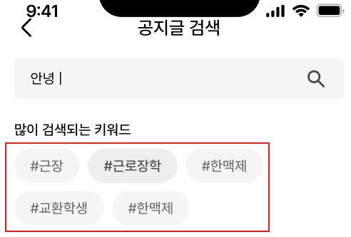
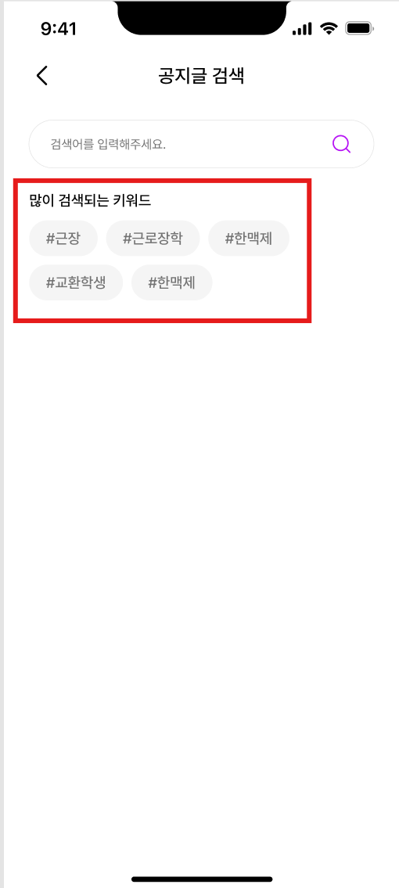

# 6-2. 많이 검색되는 키워드_클릭

원문 페이지 ID: 5570221954bc8242ad13016e7163ad53

> 원문 스냅샷. 명세 확정·앱 배포·수집 완료를 뜻하지 않습니다.

## 원문 속성

```json
{
  "platform": [
    "ANDROID",
    "IOS"
  ],
  "url": "source-page-id:5570221954bc8242ad13016e7163ad53",
  "상태": "로깅 필요",
  "이름": "6-2. 많이 검색되는 키워드\\_클릭",
  "태그": [
    "6. 공지글 검색(APP)"
  ]
}
```

<details>
<summary>이전 로깅</summary>





키워드를 value값으로 추가


</details>

<details>
<summary>새 로깅 (26.10.05)</summary>

<callout icon="☝" color="gray_bg">
<p>
키워드 선택 시 자동으로 검색됩니다. 6-3과 중복 트리거 되지 않는지 체크해야 할 것 같습니다 
</p>
</callout>

- 설명: 공지글 검색 화면에서 많이 검색되는 키워드 선택.
- screen\_view: <code>notice_search</code>
- event\_name: <code>DA2</code>
- event\_label: <code>board__notice_search__search__popular_keyword__select</code>
- value: \{선택한 키워드\}
- event\_category: <code>select</code>

<details>
<summary>검토사항</summary>

- label 통일 (2026-10-27): <code>board__notice_search__search__popular_keyword_select</code> → <code>board__notice_search__search__popular_keyword__select</code>
</details>

<details>
<summary>참고사진 · 모바일</summary>

<b>모바일</b>


</details>
</details>
