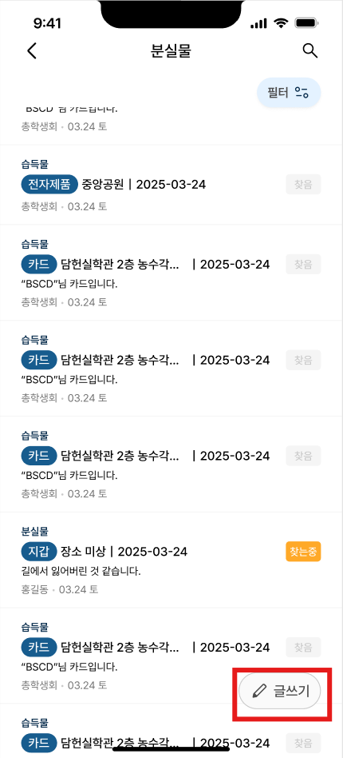
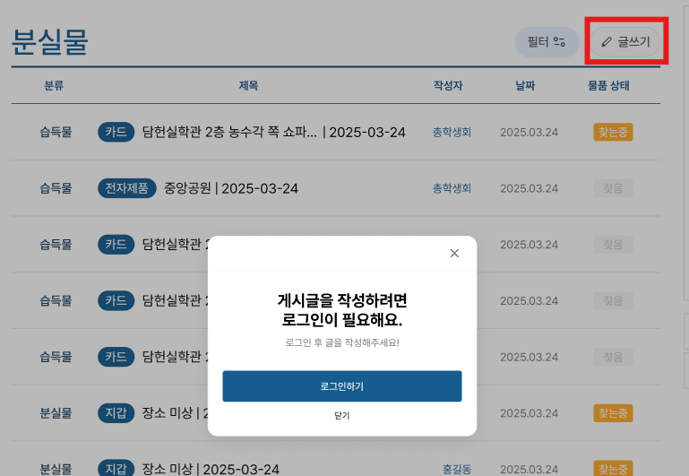
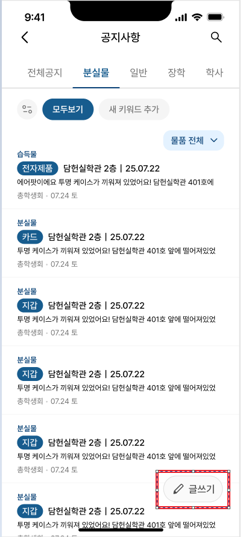
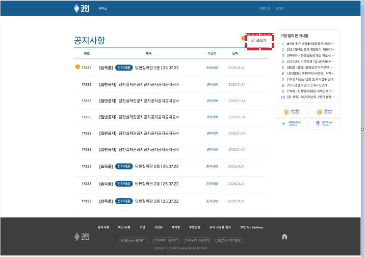
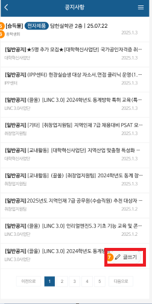
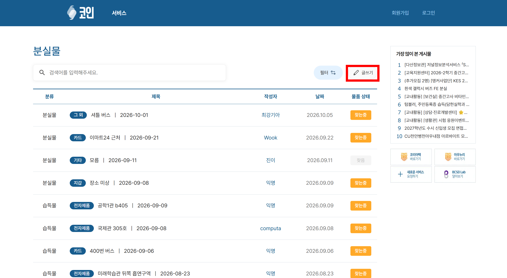
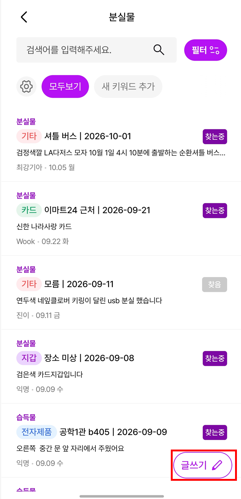

# 11-1.분실물_글쓰기_클릭

원문 페이지 ID: 57d0221954bc83f4b9d601b04f6c3eab

> 원문 스냅샷. 명세 확정·앱 배포·수집 완료를 뜻하지 않습니다.

## 원문 속성

```json
{
  "platform": [
    "ANDROID",
    "IOS",
    "WEB"
  ],
  "url": "source-page-id:57d0221954bc83f4b9d601b04f6c3eab",
  "상태": "완료",
  "이름": "11-1.분실물\\_글쓰기\\_클릭",
  "태그": [
    "11.분실물"
  ]
}
```

<details>
<summary>과거 로깅</summary>

- 설명: 분실물 페이지 에서 글쓰기 버튼 클릭(모바일)
- event\_label : “item\_write”
- value : “글쓰기”
- event\_category : “click”
- 참고사진





<b>이전 참고사진</b>






WEB Mobile View




</details>

<details>
<summary>새 로깅</summary>

- 설명: 분실물 목록에서 글쓰기 버튼을 눌러 글 작성 흐름으로 진입.
- screen\_view: <code>lost_item_list</code>
- event\_name: <code>DA2</code>
- event\_label: <code>board__lost_item_list__lost_item_write__entry__click</code>
- value: 글쓰기
- event\_category: <code>click</code>

<b>참고사진 (기능 표시)</b>

<columns>
<column ratio="50">
<b>웹</b>

웹 — 글쓰기


</column>
<column ratio="50">
<b>모바일</b>

모바일 — 글쓰기


</column>
</columns>
</details>
