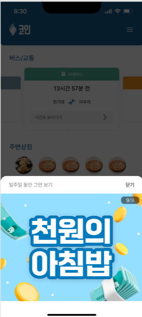
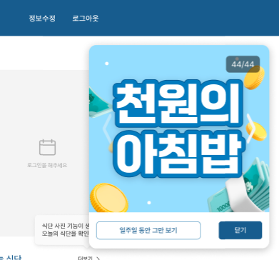
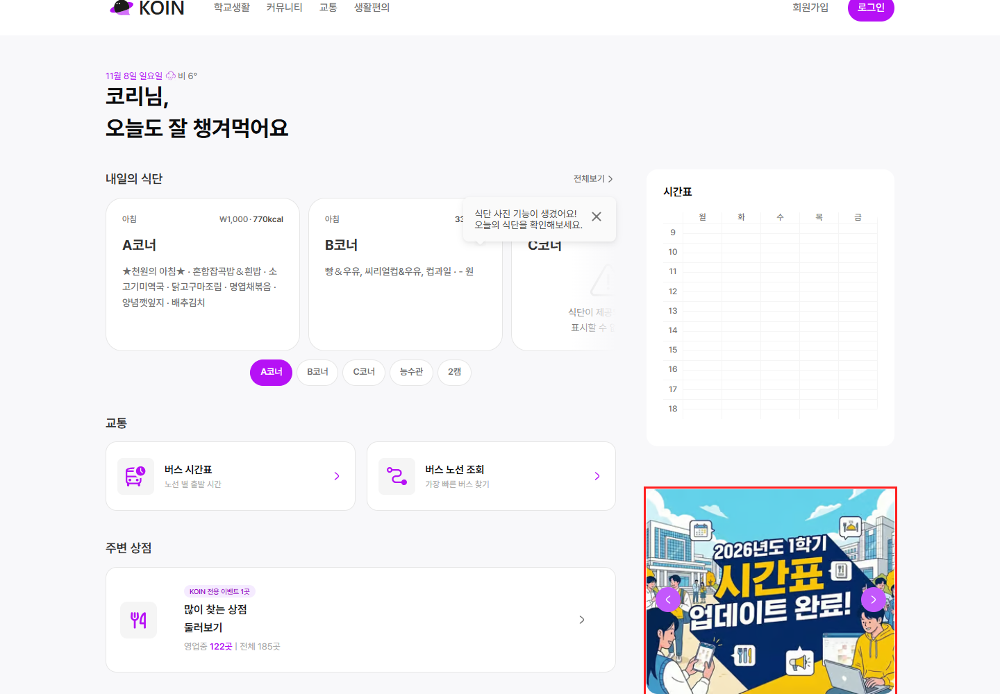

# 1-1. 메인_모달진입

원문 페이지 ID: 5830221954bc837d86a8018acdb24641

> 원문 스냅샷. 명세 확정·앱 배포·수집 완료를 뜻하지 않습니다.

## 원문 속성

```json
{
  "platform": [
    "ANDROID",
    "IOS"
  ],
  "url": "source-page-id:5830221954bc837d86a8018acdb24641",
  "상태": "로깅 필요",
  "이름": "1-1. 메인\\_모달진입",
  "태그": [
    "1. 메인_모달"
  ]
}
```

<details>
<summary>과거 로깅</summary>

<ul>
<li>
설명: 메인화면 모달이 사용자에게 뜨는 순간 찍히는 로깅
</li>
<li>
event\_name : “CAMPUS”
</li>
<li>
event\_label : “main\_modal\_entry”
</li>
<li>
value : \{title값\}
</li>
<li>
event\_category : “entry” 
</li>
<li>
참고사진
</li>
</ul>



- 웹 참고사진


</details>

<details>
<summary>새 로깅</summary>

- 설명: 메인 화면의 배너 모달이 사용자에게 실제로 표시되는 순간 기록.
- screen\_view: main
- event\_name: <code>DA2</code>
- event\_label: <code>banner__main__modal__exposure</code>
- value: \{배너 ID\}
- event\_category: <code>exposure</code>

<b>참고사진 · 웹</b>

### 참고사진 (메인 모달 노출 · 기존 캡처 참조 사본)

<columns>
<column ratio="50">
웹





Stage 실제 화면 · 빨간 네모가 해당 클릭 대상

</column>
<column ratio="50">
모바일

<b>참고사진 · 모바일</b>


</column>
</columns>
</details>
