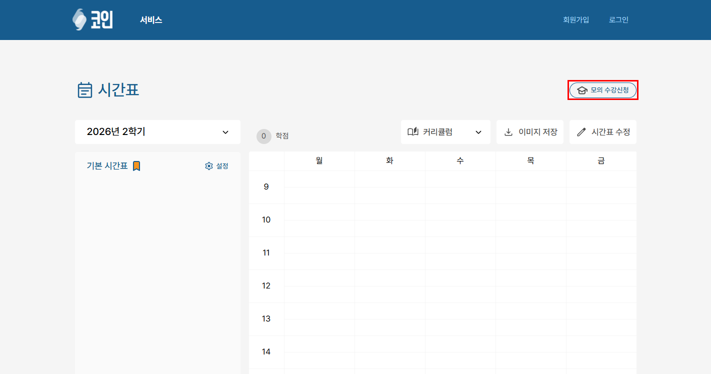

# [레거시·중복 명세] 2-22. (웹) 시간표_모의 수강신청 (클릭)

원문 페이지 ID: 5870221954bc82288d3601374bdd7083

> 원문 스냅샷. 명세 확정·앱 배포·수집 완료를 뜻하지 않습니다.

## 원문 속성

```json
{
  "platform": [
    "WEB"
  ],
  "url": "source-page-id:5870221954bc82288d3601374bdd7083",
  "상태": "로깅 필요",
  "생성일": "2026-11-12T05:08:11.354Z",
  "이벤트 이름": "\\[레거시·중복 명세\\] 2-22. (웹) 시간표\\_모의 수강신청 (클릭)",
  "태그": [
    "시간표"
  ]
}
```

<callout icon="📁" color="gray_bg">
<b>레거시 · 같은 버튼의 중복 명세</b>

2026-11-08 시간표 우측 상단 ‘모의 수강신청’ 버튼의 대표 계약은 [0. (웹) 모의수강신청 진입](c9f0221954bc82b4ac6e01b7a1309c0f.md) 하나로 확정했다. 구현 기준은 DA2 / <code>course_practice__timetable__course_application__entry__click</code> / screen\_view=<code>timetable</code> / category=<code>click</code> / value 기존 미기재다. 이 페이지를 이유로 DA1·별도 라벨·‘모의 수강신청’ value를 추가 전송하지 않는다.

아래 초안·사진·WEB 범위·원문은 이력으로 보존한다. 레거시는 중복 문서·계약에 대한 구분이며 모의수강신청 기능 자체의 중단을 뜻하지 않는다. 실제 SDK 배포·수집 검수 상태는 별도다.
</callout>

<details>
<summary>이전 로깅</summary>

- 없음 (새로 추가한 로깅)
</details>

<details>
<summary>이전 새 로깅 초안 (26.10.17) — 중복 명세·현행 적용 제외</summary>

- 설명: 웹 시간표 화면 오른쪽 위 모의 수강신청 버튼을 클릭해 모의 수강신청 화면(/course)으로 들어가는 경우
- screen\_view: <code>timetable</code>
- event\_name: <code>DA1</code>
- event\_label: <code>timetable__timetable__course_application__entry__click</code>
- value: 모의 수강신청
- event\_category: <code>click</code>

<details>
<summary>검토사항</summary>

- 통합 가이드·후속: 원문 (원문 ID: 4129ae650b598060bb4bdf347b7d4c7a)
- 모바일: 없음
- label DA2 기준 정렬 (2026-10-27): <code>timetable__timetable__course_practice__click</code> → <code>timetable__timetable__course_application__entry__click</code>
</details>

### 참고사진 (기능 표시)

<columns>
<column ratio="50">
<b>웹</b>

<details>
<summary>참고사진 · 웹</summary>

웹 — 모의 수강신청 (출처: stage 실제 캡처, 빨간 네모 = 클릭 위치)


</details>
</column>
<column ratio="50">
<b>모바일</b>

<details>
<summary>참고사진 · 모바일</summary>

해당 없음 (웹 전용)
</details>
</column>
</columns>
</details>
