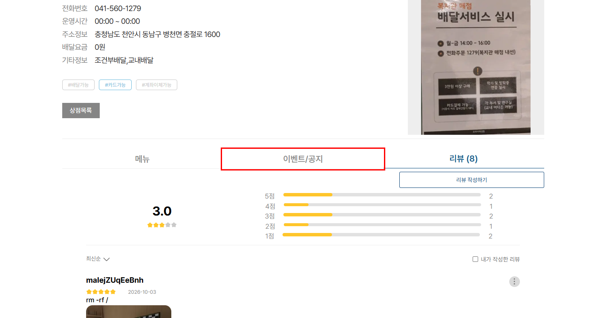
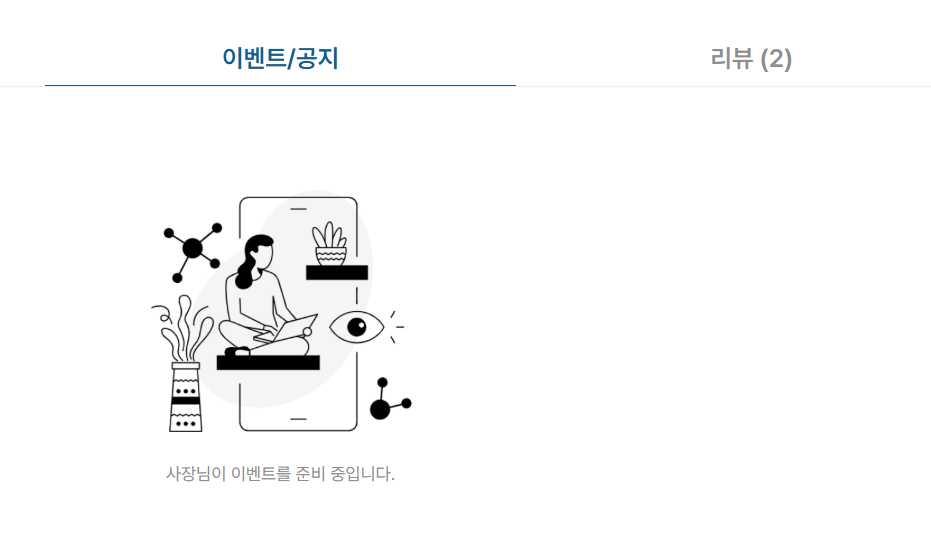
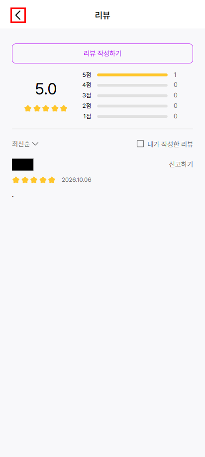

# 3-16~18 상점상세 리뷰 탭 탈출 (클릭) 

원문 페이지 ID: 5870221954bc823faaa8812d3a038ff3

> 원문 스냅샷. 명세 확정·앱 배포·수집 완료를 뜻하지 않습니다.

## 원문 속성

```json
{
  "platform": [
    "WEB",
    "ANDROID",
    "IOS"
  ],
  "url": "source-page-id:5870221954bc823faaa8812d3a038ff3",
  "상태": "완료",
  "생성일": "2026-11-08T10:51:46.824Z",
  "이벤트 이름": "<p>\n3-16\\~18 상점상세 리뷰 탭 탈출 (클릭) \n</p>",
  "태그": [
    "3. 상점 상세 페이지"
  ]
}
```

<details>
<summary>이전 로깅</summary>

<span color="orange">event\_params.key</span>

<ul>
<li>
event\_label : shop\_detail\_view\_review\_back
</li>
<li>
value : \{상점이름\} 
</li>
<li>
event\_category : 

- click
- click
- click<br />
</li>
<li>
previous\_page : 리뷰
</li>
<li>
current\_page : 

<ul>
<li>
\{탭\} (메뉴, 이벤트/공지) 
</li>
<li>
전화
</li>
<li>
\{카테고리\}
</li>
</ul>
</li>
<li>
duration\_time : 리뷰페이지에서 머무르는 시간  
</li>
</ul>


---


<h3>
문제 
</h3>


<p>
ios : 시간이 겹쳐서 찍히고 있는시점. 
</p>
</details>

<details>
<summary>새 로깅 (26.10.17)</summary>

- 설명: 상점 상세의 리뷰 탭에서 다른 탭·전화·상점 목록 버튼을 클릭해 이동할 때 리뷰 이탈을 1회 기록한다. 이 click 계약에 OS 뒤로가기 스와이프를 포함하지 않는다.
- screen\_view: <code>shop_detail</code>
- event\_name: <code>DA1</code>
- event\_label: <code>shop__shop_detail__navigation__review_exit__click</code>
- value: \{이동한 곳\} → 메뉴 / 이벤트·공지 / 전화 / 상점 목록 (예: 메뉴)
- event\_category: <code>click</code>

<details>
<summary>검토사항</summary>

- 리뷰 이탈과 목적 버튼 측정 구분 (2026-11-05): WEB 코드는 리뷰에서 전화·목록·메뉴·이벤트로 이동할 때 이탈 이벤트와 목적 버튼 이벤트를 별도로 전송한다. 리뷰 이탈은 이탈·체류 측정, 목적 버튼은 해당 행동 측정으로 구분하며 같은 라벨을 두 번 보내는 지시가 아니다. 각 계약은 동작당 1회만 전송하고 총 클릭 수에 두 이벤트를 단순 합산하지 않는다. 대응 명세: [3-4, 4.5 상점상세 메뉴 (클릭,스크롤) ](36d0221954bc8351905b01b7a103bd60.md). 근거: [WEB 리뷰 이탈·목적 버튼 핸들러](https://github.com/BCSDLab/KOIN_WEB_RECODE/blob/13f1a5d3c315a913b32b51a87e6700ea5b12d8d4/src/pages/store/%5Bid%5D.tsx#L171).
- 독립 리뷰 화면과 스와이프 (2026-11-05): 모바일 독립 리뷰 화면을 데스크톱 탭 전환으로 해석하지 않는다. Android는 상단 뒤로가기 click 호출이 있고 iOS는 click/swipe 구분 호출이 있다. 기존 iOS swipe를 이 click 라벨로 일괄 치환하지 않는다. 독립 화면의 screen\_view·목적지 value 매핑은 해당 화면 계약 확인 후 적용하며 현재 필드와 사진은 유지한다.
- 통합 모바일웹 누락 후보 (2026-11-05): 별도 주문웹 Header에는 review\_back 기록이 있으나 통합 WEB의 새 리뷰 경로는 MobilePageHeader→PageHeader→useGoBack으로 이동하며 확인한 경로에 이탈 로깅이 없다. 이식 누락 여부와 실제 배포 경로 확인이 필요하다. 근거: [통합 리뷰 화면](https://github.com/BCSDLab/KOIN_WEB_RECODE/blob/13f1a5d3c315a913b32b51a87e6700ea5b12d8d4/src/pages/store/%5Bid%5D/reviews.tsx#L53), [별도 주문웹](https://github.com/BCSDLab/KOIN_ORDER_WEBVIEW/blob/d412d0afecad3b9cbf2c727cd295187aa2c1f55e/src/components/Layout/Header/index.tsx#L52). 추가 전송·SDK 수정·운영 배포는 이번 문서 수정에 포함하지 않았다.
- 이전 검토 기록 (아래 현재 기준으로 대체) (2026-11-04): 리뷰 이탈 조건은 메뉴·이벤트/공지·전화·목록 이동 클릭과 함께 충족될 수 있다. 이탈 측정과 대상 버튼 측정을 둘 다 의도한 것인지, 플랫폼별 독립 리뷰 화면에서 어떤 호출을 사용하는지 확인하기 전 별도 로그를 추가하거나 임의로 병합하지 않는다. 기존 두 측정 목적의 계약·조건을 유지하며 실제 한 번 전송은 미확인이다. 대응 명세: [3-4, 4.5 상점상세 메뉴 (클릭,스크롤) ](36d0221954bc8351905b01b7a103bd60.md).
- 모바일 웹 실화면 확인 (2026-10-30): 파란색 모바일 사진을 제거하고 현행 리뷰 화면의 뒤로가기를 촬영했다. 현행 UI는 독립 리뷰 화면이므로 과거 3개 탭 전환과 실제 수집 대상이 일치하는지는 구현 확인이 필요하다. 기존 라벨·value·발생 조건은 유지한다.
- 통합 가이드: [로깅 통합 가이드](3c30221954bc8214b1c481c5bbb6fba5.md)
- 모바일 웹: 리뷰 탭 이탈 UI 확인. 가로 390px 반응형 stage 캡처를 아래 모바일 참고사진에 추가함. Android/iOS 앱 동작은 별도 확인.
- label DA2 기준 정렬 (2026-10-27): <code>shop__shop_detail__review_exit__click</code> → <code>shop__shop_detail__navigation__review_exit__click</code>
</details>

### 참고사진 (리뷰 탭 이탈)

<columns>
<column ratio="50">
<b>웹</b>

<details>
<summary>참고사진 · 웹</summary>

웹 — 리뷰 탭에서 이벤트/공지로 이동 예시 (출처: stage 실제 캡처, 빨간 네모 = 클릭 위치)




</details>
</column>
<column ratio="50">
<b>모바일</b>

<details>
<summary>참고사진 · 모바일</summary>





모바일 웹 · 운영 왕십리야식 보라색 리디자인 리뷰 화면. 빨간 테두리=뒤로가기. 현행 UI는 독립 리뷰 화면이며 과거 탭 전환 UI와 구분한다. 닉네임 검은색 마스킹.


구버전 모바일 사진을 제거하고 현행 보라색 모바일 웹 사진으로 보완했다.
</details>
</column>
</columns>
</details>
