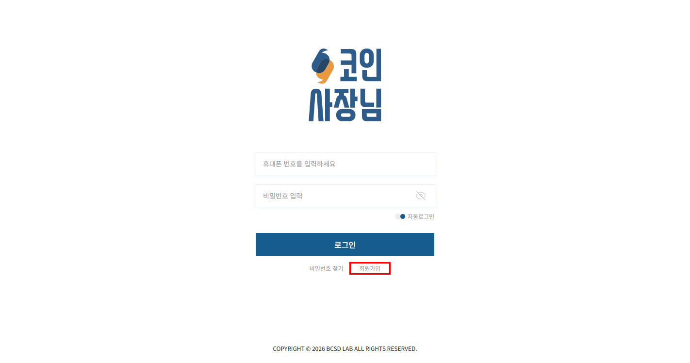

# 4-3 로그인 - 회원가입 (클릭) - 추가된 로깅

원문 페이지 ID: 58e0221954bc8218b01b8140ddedf626

> 사용자 제공 ZIP 내보내기 보관본. 레거시·동결·검토 상태는 원문을 따르며 코드 생성 승인·앱 배포 완료를 뜻하지 않습니다.

생성일: 2026년 11월 8일 오후 7:51
platform: WEB
상태: 로깅 필요

- 이전 로깅
    - 없음 (새로 추가한 로깅)
- 새 로깅 (26.10.17)
    - 설명: 사장님 로그인 화면(/login) 하단의 회원가입을 클릭해 회원가입 화면(/signup)으로 들어가는 경우
    - screen_view: `owner_login`
    - event_name: `DA1`
    - event_label: `owner__owner_login__sign_up__entry__click`
    - value: 회원가입
    - event_category: `click`
    - 검토사항
        - 통합 가이드: [로깅 통합 가이드](3c30221954bc8214b1c481c5bbb6fba5.md)
        - 이 페이지의 적용 플랫폼은 WEB이다. 기존 파란색 모바일 참고사진은 2026년 10월 30일 제거되어 현재 모바일 칸에 사진이 없다. 현재 WEB 사진을 기준으로 확인하며, 네이티브 앱 지원이나 앱 캡처 완료를 뜻하지 않는다.
        - label DA2 기준 정렬 (2026-10-27): `owner__owner_login__signup__click` → `owner__owner_login__sign_up__entry__click`
    
    ### 참고사진 (회원가입)
    
    **웹**
    
    - 참고사진 · 웹
        
        웹 — 회원가입 (출처: stage 실제 캡처, 빨간 네모 = 클릭 위치)
        
        
        
    
    **모바일**
    
    - 참고사진 · 모바일
        
        파란색 구버전 모바일 사진 제거 (2026년 10월 30일).
