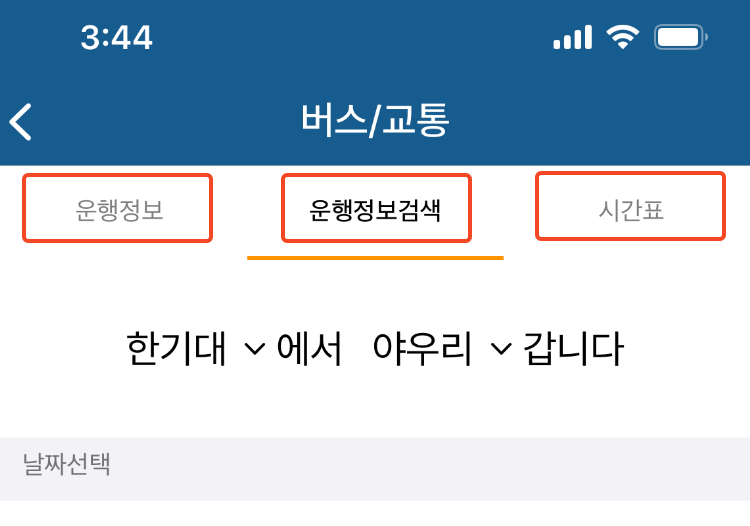

# 3-1. (Android / iOS) 버스_탭 메뉴_클릭

원문 페이지 ID: 5900221954bc82479c75814d52776614

> 원문 스냅샷. 명세 확정·앱 배포·수집 완료를 뜻하지 않습니다.

## 원문 속성

```json
{
  "platform": [
    "ANDROID",
    "IOS"
  ],
  "url": "source-page-id:5900221954bc82479c75814d52776614",
  "상태": "레거시",
  "생성일": "2026-11-08T10:51:38.744Z",
  "이벤트 이름": "3-1.<b> (Android / iOS)</b> 버스\\_탭 메뉴\\_클릭",
  "태그": [
    "3. 버스/교통 상세 페이지"
  ]
}
```

<details>
<summary>이전 로깅</summary>

- event\_label : “bus\_tab\_menu”
- value : “운행정보 / 운행정보검색 / 시간표<b>”</b>
- event\_category : “click”
- 참고사진


</details>

<details>
<summary>새 로깅 (26.10.17)</summary>

- 레거시: 현재 앱에 운행정보 / 운행정보검색 / 시간표 탭이 없어 새 로깅을 만들지 않는다. 셔틀/대성/시내 탭은 4-4. 버스 종류 탭\_클릭에서 다룬다.

<details>
<summary>검토사항</summary>

- 통합 가이드: [로깅 통합 가이드](3c30221954bc8214b1c481c5bbb6fba5.md)
- 레거시 항목이라 새 로깅·참고사진 없음.
</details>

### 참고사진 (기능 표시)

<columns>
<column ratio="50">
<b>웹</b>

<details>
<summary>참고사진 · 웹</summary>

웹 — 해당 없음 (레거시)
</details>
</column>
<column ratio="50">
<b>모바일</b>

<details>
<summary>참고사진 · 모바일</summary>

모바일 — 해당 없음 (레거시)
</details>
</column>
</columns>
</details>
