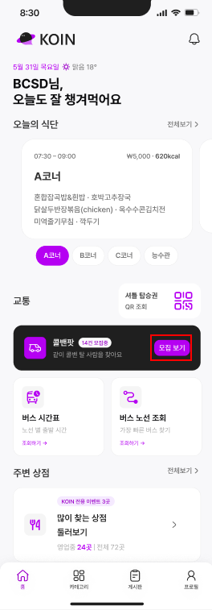

# 1-6 콜벤팟 모집 보기 클릭

원문 페이지 ID: 59d0221954bc82cdbbbe81dc5b0cb4ee

> 원문 스냅샷. 명세 확정·앱 배포·수집 완료를 뜻하지 않습니다.

## 원문 속성

```json
{
  "platform": [
    "ANDROID",
    "IOS"
  ],
  "url": "source-page-id:59d0221954bc82cdbbbe81dc5b0cb4ee",
  "구분": "홈화면",
  "상태": "완료",
  "생성일": "2026-11-12T05:08:00.355Z",
  "이벤트 이름": "1-6 콜벤팟 모집 보기 클릭"
}
```

<details>
<summary>과거 로깅</summary>

- event\_label : callvanpot
- value : 콜밴팟 모집보기
- event\_category : click


</details>

<details>
<summary>새 로깅</summary>

- 설명: 메인 교통 영역에서 콜밴팟 모집 보기를 클릭한다.
- screen\_view: <code>main</code>
- event\_label: <code>callvan__main__callvan_entry__recruitment_list_entry__click</code>
- event\_name: <code>DA2</code>
- value: 콜밴팟 모집보기
- event\_category: <code>click</code>

### 참고사진 (기능 표시)

<b>모바일 (ANDROID, IOS) / 캡처 출처는 아래 참조</b>

<b>참고사진 · 모바일</b>

화면 정의에 제공된 메인 캡처. 실제 Android 캡처 출처 미확인; 버튼 위치 참고.


</details>
