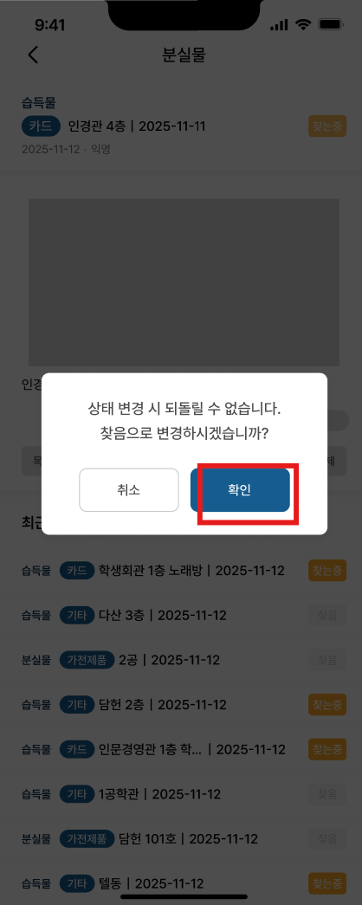
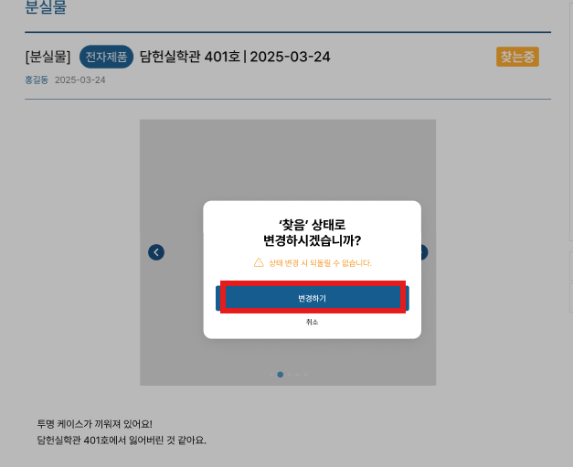

# 11-28. 분실물_찾음_버튼_클릭 

원문 페이지 ID: 5bc0221954bc82df9a99017a9032a524

> 원문 스냅샷. 명세 확정·앱 배포·수집 완료를 뜻하지 않습니다.

## 원문 속성

```json
{
  "platform": [
    "ANDROID",
    "IOS",
    "WEB"
  ],
  "url": "source-page-id:5bc0221954bc82df9a99017a9032a524",
  "상태": "완료",
  "이름": "<p>\n11-28. 분실물\\_찾음\\_버튼\\_클릭 \n</p>",
  "태그": [
    "11.분실물"
  ]
}
```

<details>
<summary>이전 로깅</summary>

- 설명: 분실물 글에서 ‘찾는중’ 상태를 ‘찾음’ 상태로 변경하는 모달의 클릭 이벤트입니다. 확인버튼을 눌렀을 때만 로그가 찍히는 구조입니다.
- event\_label : lost\_item\_found
- value : ‘분실물’ or ‘습득물’
- event\_category : click
- 참고사진




</details>

<details>
<summary>새 로깅 (26.10.12) — 초안</summary>

- 설명: 분실물 글에서 ‘찾는중’ 상태를 ‘찾음’ 상태로 변경하는 모달의 클릭 이벤트입니다. 확인버튼을 눌렀을 때만 로그가 찍히는 구조입니다.
- screen\_view: <code>lost_item_detail</code>
- event\_name: <code>DA2</code>
- event\_label: <code>board__lost_item_detail__lost_item_status__found_confirm__click</code>
- value: 분실물 / 습득물
- event\_category: <code>click</code>

<details>
<summary>검토사항</summary>

- label 통일 (2026-10-27): <code>board__lost_item_detail__lost_item_status__found_confirm</code> → <code>board__lost_item_detail__lost_item_status__found_confirm__click</code>
</details>

- 발생 시점 확정: 상태 변경 확인 모달의 확인 버튼 클릭 시 전송한다. 11-27의 변경 진입과 별도 이벤트로 유지하며, 모달 취소와 서버 저장 성공 응답에서는 이 이벤트를 추가 전송하지 않는다.

### 참고사진 (기능 표시)

<columns>
<column ratio="50">
<b>웹</b>

<details>
<summary>참고사진 · 웹</summary>

웹 — 찾음 상태 변경 확인 (기존 로깅 캡처)


</details>
</column>
<column ratio="50">
<b>모바일</b>

<details>
<summary>참고사진 · 모바일</summary>

모바일 — 찾음 상태 변경 확인 (기존 로깅 캡처)

파란색 구버전 모바일 사진 제거 (2026-10-30).
</details>
</column>
</columns>
</details>
