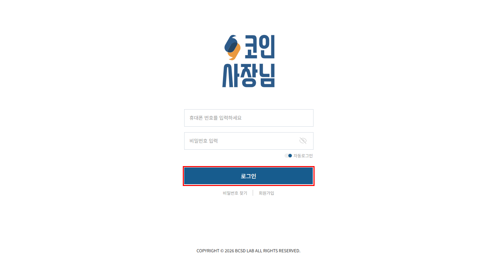

# 4-1 로그인 (클릭) - 추가된 로깅

원문 페이지 ID: 5bc0221954bc8350b342016ae4af8ade

> 사용자 제공 ZIP 내보내기 보관본. 레거시·동결·검토 상태는 원문을 따르며 코드 생성 승인·앱 배포 완료를 뜻하지 않습니다.

생성일: 2026년 11월 8일 오후 7:51
platform: WEB
상태: 로깅 필요

- 이전 로깅
    - 없음 (새로 추가한 로깅)
- 새 로깅 (26.10.17)
    - 설명: 사장님 로그인 화면(/login)에서 휴대폰 번호·비밀번호를 입력한 뒤 로그인 버튼을 클릭하는 경우
    - screen_view: `owner_login`
    - event_name: `DA1`
    - event_label: `owner__owner_login__login__entry__click`
    - value: 로그인
    - event_category: `click`
    - 검토사항
        - label DA2 기준 정렬 (2026년 10월 28일 사용자 요청 A-5): `owner__owner_login__login__click` → `owner__owner_login__login__entry__click`. 4-2~4-4와 같은 기능·세부 구간 형식으로 진입 동작 entry를 명시한다. 기존 로그인 버튼 클릭 시점·event_name=DA1·value=로그인·category=click·screen_view·플랫폼·사진은 유지한다. entry 추가는 로그인 성공 시점 전송이나 신규 이벤트 추가를 뜻하지 않는다. SDK/dbt 반영·실제 전송·한 번 전송은 미확인이다.
        - 통합 가이드: [로깅 통합 가이드](3c30221954bc8214b1c481c5bbb6fba5.md)
        - 이 페이지의 적용 플랫폼은 WEB이다. 기존 파란색 모바일 참고사진은 2026년 10월 30일 제거되어 현재 모바일 칸에 사진이 없다. 현재 WEB 사진을 기준으로 확인하며, 네이티브 앱 지원이나 앱 캡처 완료를 뜻하지 않는다.
    
    ### 참고사진 (로그인 버튼)
    
    **웹**
    
    - 참고사진 · 웹
        
        웹 — 로그인 (출처: stage 실제 캡처, 빨간 네모 = 클릭 위치)
        
        
        
    
    **모바일**
    
    - 참고사진 · 모바일
        
        파란색 구버전 모바일 사진 제거 (2026년 10월 30일).
