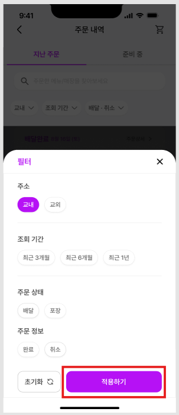

# 9-5 주문내역 필터 적용하기

원문 페이지 ID: 5e40221954bc83278c3e01f299094e58

> 원문 스냅샷. 명세 확정·앱 배포·수집 완료를 뜻하지 않습니다.

## 원문 속성

```json
{
  "platform": [
    "ANDROID",
    "IOS"
  ],
  "url": "source-page-id:5e40221954bc83278c3e01f299094e58",
  "상태": "로깅 필요",
  "생성일": "2026-11-08T10:51:56.241Z",
  "이벤트 이름": "9-5 주문내역 필터 적용하기"
}
```





<p>
필터를 누르고 적용하기 버튼까지 클릭했을 때 발생되는 로깅입니다. 
</p>


<span color="orange">event\_params.key</span>

<ul>
<li>
event\_label : orderHistory\_filter
</li>
<li>
value : 

<ul>
<li>
예시: 

- 교내, 최근 3개월, 배달, 완료
</li>
</ul>
</li>
<li>
event\_category : click
</li>
<li>
previous\_page :
</li>
<li>
current\_page :
</li>
<li>
duration\_time :
</li>
</ul>
