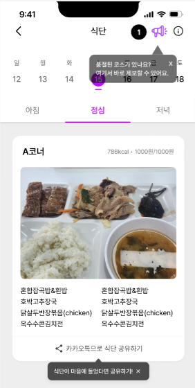
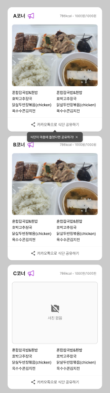

# 1. 품절 제보 버튼_식단 진입

원문 페이지 ID: 5e60221954bc8320a3430138485b58bf

> 원문 스냅샷. 명세 확정·앱 배포·수집 완료를 뜻하지 않습니다.

## 원문 속성

```json
{
  "platform": [
    "ANDROID",
    "IOS",
    "WEB"
  ],
  "url": "source-page-id:5e60221954bc8320a3430138485b58bf",
  "상태": "로깅 필요",
  "생성일": "2026-11-12T05:07:49.702Z",
  "이름": "1\\. 품절 제보 버튼\\_식단 진입",
  "태그": [
    "0. A/B TEST"
  ]
}
```

<details>
<summary>과거 로깅</summary>

없음 (새로 추가한 로깅)
</details>

<details>
<summary>새 로깅</summary>

- 설명: 사용자가 식단 화면에 진입(홈화면에서 식단으로 진입 or 카테고리에서 식단으로 진입) 하는 순간 생성되는 이벤트입니다.
- screen\_view: <code>cafeteria</code>
- event\_name: <code>DA1</code>
- event\_label: <code>cafeteria__dining__abtest__exposure</code>
- value: A안 / B안
- event\_category: <code>exposure</code>

### 참고사진 (품절 제보 버튼 A/B 식단 진입)

<columns>
<column ratio="50">
<b>웹</b>

<b>참고사진 · 웹</b>

웹 — 사진 없음 (추가 필요)
</column>
<column ratio="50">
<b>모바일</b>

<b>참고사진 · 모바일</b>

모바일 — A안 시안



모바일 — B안 시안


</column>
</columns>
</details>
