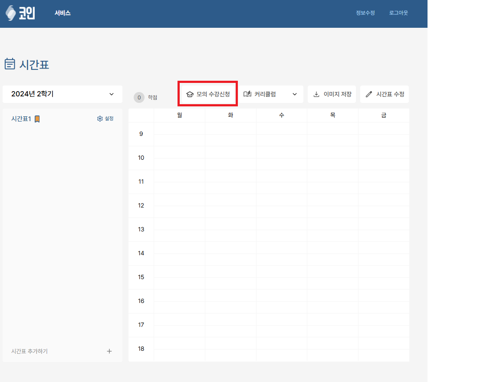
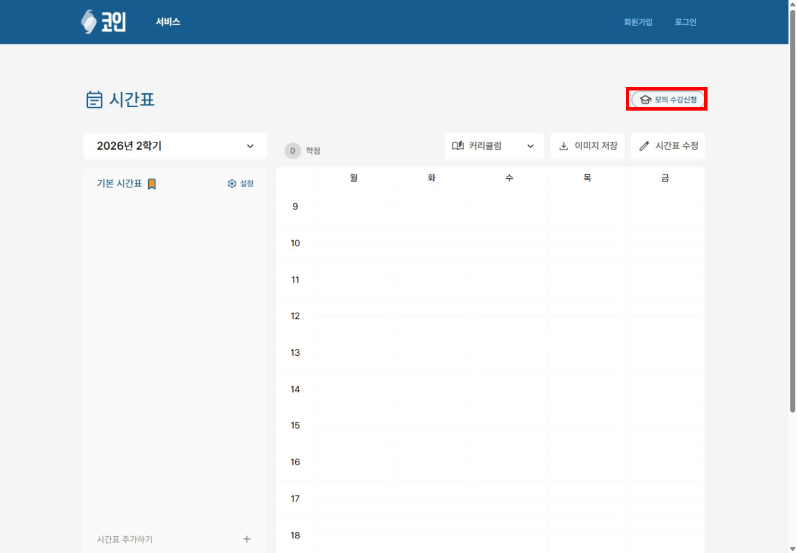

# 0. (웹) 모의수강신청 진입

원문 페이지 ID: 5ef0221954bc82fa8b88014a42d2ae01

> 원문 스냅샷. 명세 확정·앱 배포·수집 완료를 뜻하지 않습니다.

## 원문 속성

```json
{
  "platform": [
    "WEB"
  ],
  "url": "source-page-id:5ef0221954bc82fa8b88014a42d2ae01",
  "상태": "로깅 필요",
  "이름": "0\\. (웹) 모의수강신청 진입",
  "태그": [
    "0. 코인 메인화면_모의수강신청"
  ]
}
```

<details>
<summary>이전 로깅</summary>

<ul>
<li>
event\_label : “application\_training”
</li>
<li>
value : 
</li>
<li>
event\_category : “click”
</li>
<li>
참고 이미지
</li>
</ul>


</details>

<details>
<summary>새 로깅 (2026-10-15) — 수정 초안</summary>

- 설명: 웹 시간표 화면 우측 상단 ‘모의 수강신청’ 버튼을 클릭한다.
- screen\_view: <code>timetable</code>
- event\_label: <code>course_practice__timetable__course_application__entry__click</code>
- event\_name: <code>DA2</code>
- event\_category: <code>click</code>
- value: 기존 미기재 유지

<details>
<summary>검토사항</summary>

- 통합 가이드·후속: [로깅 통합 가이드](3c30221954bc8214b1c481c5bbb6fba5.md)
- 주 진입 경로: /timetable → 우측 상단 모의 수강신청 → /course. 실제 웹 이동 확인일 2026-10-15.
- 메인 배너 진입은 이 항목의 트리거에서 제외. 이번 요청은 시간표의 진입 버튼 기준이다.
- label 통일 (2026-10-27): <code>course_practice__timetable__course_application__entry</code> → <code>course_practice__timetable__course_application__entry__click</code>
</details>

### 참고사진 (기능 표시)

<details>
<summary>참고사진 · 웹</summary>

실제 데스크톱 웹 시간표 캡처(2026-10-15, 1425×990). 빨간 박스는 우측 상단 진입 버튼.


</details>
</details>
