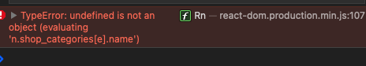

# 해결 (1)

원문 페이지 ID: 5f30221954bc8354a9e101857507e7f2

> 원문 스냅샷. 명세 확정·앱 배포·수집 완료를 뜻하지 않습니다.

## 원문 속성

```json
{
  "title": "해결 (1)"
}
```

<p>
웹: 
</p>

<ol>
<li>
헤더나 푸터를 이용하여 주변상점을 들어온뒤 검색 버튼을 누르면 에러가 남. 
</li>
</ol>



<p>
→ 전체 보기값 을  넣어서 처리해주시면 될 거 같습니다. 
</p>


