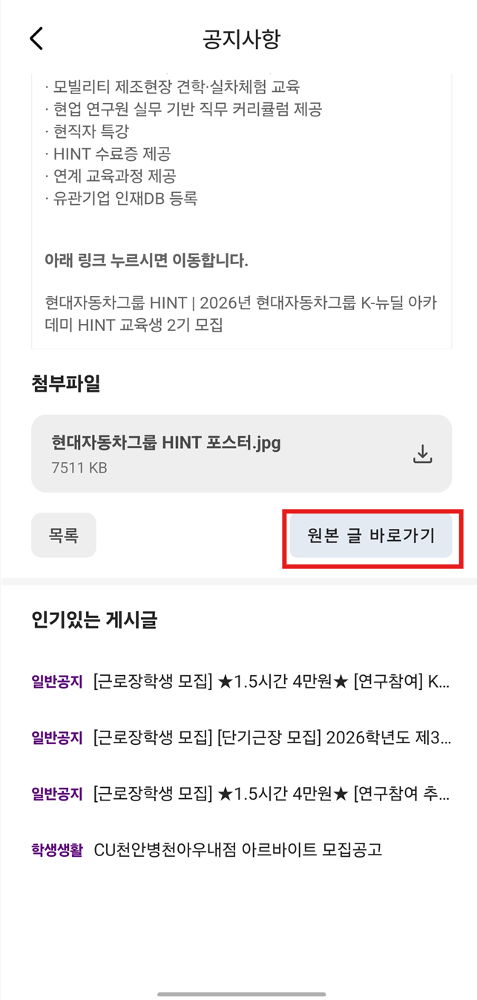

# 5-3. 공지 원본 바로가기_클릭

원문 페이지 ID: 6010221954bc83d88650811c9b177501

> 원문 스냅샷. 명세 확정·앱 배포·수집 완료를 뜻하지 않습니다.

## 원문 속성

```json
{
  "platform": [
    "ANDROID",
    "IOS"
  ],
  "url": "source-page-id:6010221954bc83d88650811c9b177501",
  "상태": "로깅 필요",
  "이름": "5-3. 공지 원본 바로가기\\_클릭",
  "태그": [
    "5. 공지사항 내용(APP)"
  ]
}
```

<details>
<summary>이전 로깅</summary>

<ul>
<li>
설명 : 공지 상세페이지의 ‘바로가기’ 버튼들 로깅
</li>
<li>
event\_label : “notice\_original\_shortcut”
</li>
<li>
value : “<b>원본 글 바로가기”, “아우누리 바로가기”, “학생종합경력개발 바로가기”</b>
</li>
<li>
event\_category : “click” 
</li>
<li>
참고사항

- 원본 글 바로가기 - <span color="orange"><u>아래 탭들 + ‘코인’</u></span> 공지사항 제외 나머지 공지사항들
- 아우누리 바로가기 - ‘<span color="orange">현장실습</span>’, ‘<span color="orange">학생생활</span>’ 탭 공지사항들
- 학생종합경력개발 바로가기 - ‘<span color="orange">취업</span>’ 탭 공지사항들
</li>
<li>
참고사진


</li>
</ul>
</details>

<details>
<summary>새 로깅 (26.10.05)</summary>

- 설명: 공지 상세 화면에서 외부 원본 또는 관련 사이트 바로가기 클릭.
- screen\_view: <code>notice_detail</code>
- event\_name: <code>DA2</code>
- event\_label: <code>board__notice_detail__external_link__original_entry__click</code>
- value: 원본 글 바로가기 또는 아우누리 바로가기 또는 학생종합경력개발 바로가기
- event\_category: <code>click</code>

<details>
<summary>검토사항</summary>

- 통합 가이드·후속: [로깅 통합 가이드](3c30221954bc8214b1c481c5bbb6fba5.md)
- 참고사항
  - 클릭한 버튼의 실제 한글 표시명을 value로 전달합니다.
  - 현장실습·학생생활 탭은 아우누리 바로가기, 취업 탭은 학생종합경력개발 바로가기, 코인 탭을 제외한 나머지 공지는 원본 글 바로가기라는 기존 조건을 유지합니다.
- label 통일 (2026-10-27): <code>board__notice_detail__external_link__original_entry</code> → <code>board__notice_detail__external_link__original_entry__click</code>
</details>

<details>
<summary>참고사진 · 모바일</summary>

<b>모바일</b>


</details>
</details>
