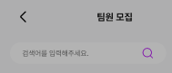
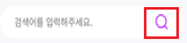
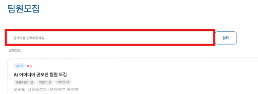
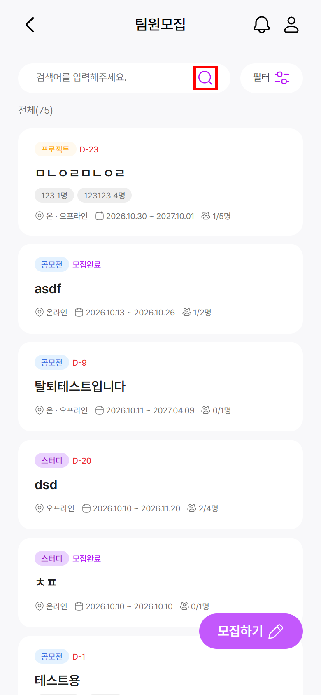

# 1. 검색 클릭

원문 페이지 ID: 6050221954bc8306bcf981ec13e04651

> 원문 스냅샷. 명세 확정·앱 배포·수집 완료를 뜻하지 않습니다.

## 원문 속성

```json
{
  "platform": [
    "WEB",
    "ANDROID",
    "IOS"
  ],
  "url": "source-page-id:6050221954bc8306bcf981ec13e04651",
  "구분": "모집글 검색 및 필터",
  "상태": "로깅 필요",
  "생성일": "2026-11-08T10:52:07.468Z",
  "이벤트 이름": "1\\. 검색 클릭"
}
```

<details>
<summary>이전 로깅</summary>

- event\_label : team\_recruitment\_search
- value : \{사용자가 입력한 검색어대로 나오게 해주세요!!\}
- event\_category : “click”


<ul>
<li>
mobile 
</li>
</ul>






- web


</details>

<details>
<summary>새 로깅 (26.10.17)</summary>

- 설명: 팀원 모집 목록 화면의 검색창에 검색어를 입력하고 검색(돋보기 버튼 클릭, web은 Enter)하면 같은 화면에 검색 결과 목록이 나오는 경우
- screen\_view: <code>team_list</code>
- event\_name: <code>DA1</code>
- event\_label: <code>team_recruit__team_list__search__click</code>
- value: 검색
- event\_category: <code>click</code>

<details>
<summary>검토사항</summary>

- 통합 가이드·후속: [로깅 통합 가이드](3c30221954bc8214b1c481c5bbb6fba5.md)
- 사용자가 입력한 검색어 원문은 value로 보내지 않고 고정값 검색을 보낸다(네이밍 룰: 사용자 입력 원문 금지). 과거 명세의 검색어 value와 다름.
- 사진 플랫폼 확인 완료 (이미지 비율 기준: 모바일, 780x1688). 웹 사진 추가 필요
</details>

### 참고사진 (검색 클릭)

<columns>
<column ratio="50">
<b>웹</b>

<details>
<summary>참고사진 · 웹</summary>

웹 — 사진 없음 (추가 필요)
</details>
</column>
<column ratio="50">
<b>모바일</b>

<details>
<summary>참고사진 · 모바일</summary>

모바일 — 검색 클릭 (출처: stage 실제 캡처, 빨간 네모 = 클릭 위치)


</details>
</column>
</columns>
</details>
