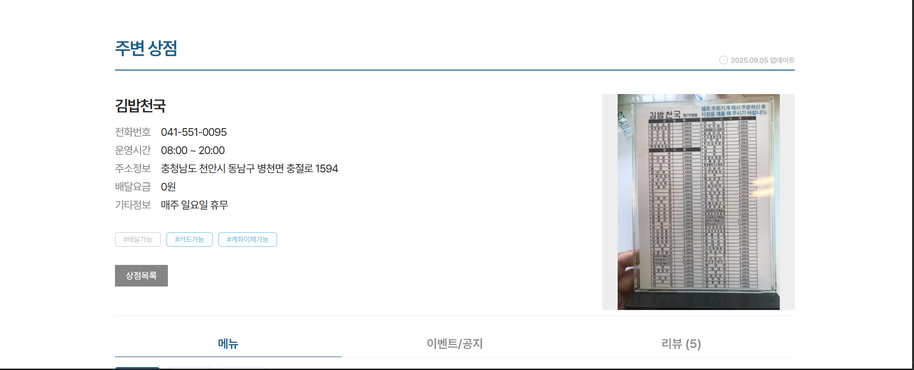
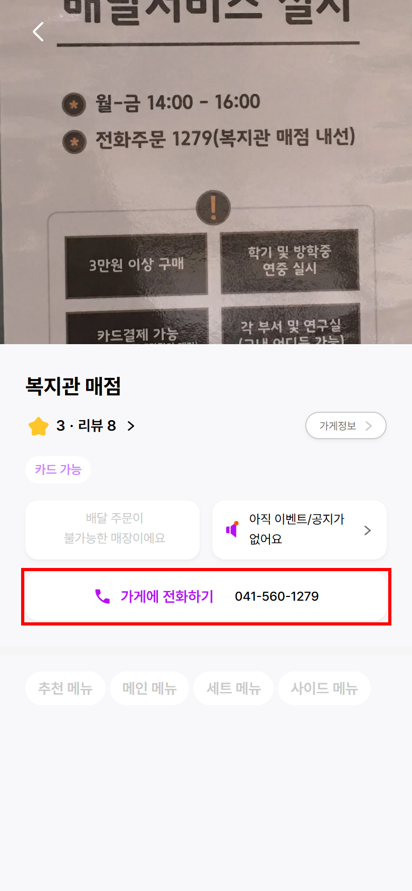

# 3-2 상점상세 전화 (클릭) 

원문 페이지 ID: 6110221954bc8330b51681c2b1af25c8

> 원문 스냅샷. 명세 확정·앱 배포·수집 완료를 뜻하지 않습니다.

## 원문 속성

```json
{
  "platform": [
    "WEB",
    "ANDROID",
    "IOS"
  ],
  "url": "source-page-id:6110221954bc8330b51681c2b1af25c8",
  "상태": "완료",
  "생성일": "2026-11-12T05:07:36.173Z",
  "이벤트 이름": "<p>\n3-2 상점상세 전화 (클릭) \n</p>",
  "태그": [
    "3. 상점 상세 페이지"
  ]
}
```

<details>
<summary>과거 로깅</summary>

<span color="orange">event\_params.key</span>

<ul>
<li>
event\_label : shop\_call
</li>
<li>
value : \{상점이름\} 
</li>
<li>
event\_category : click
</li>
</ul>


<ul>
<li>
duration\_time : 상점 상세페이지로 들어와서 전화를 하기까지 걸린시간. 
</li>
</ul>


---

<p>
시간 측정시 주의 사항 : 
</p>

<ol>
<li>
상점 상세페이지에서 어떤 행위를 하던 상관 없음. (스크롤, 사진누르기 등) 
</li>
<li>
첫번째 전화후 두번째 전화는 어떻게 측정하나요? <br />→ 두번째 전화도 상점 상세페이지 부터 전화 버튼 누른 시간까지 측정하면 됩니다.
</li>
</ol>


---

<h3>
오류사항 
</h3>

---

<p>
안드로이드 
</p>

<ol>
<li>
로그인 찍히는 이슈 
</li>
</ol>


[해결 (1)](9ac0221954bc82049f8081e542ce12eb.md)
</details>

<details>
<summary>새 로깅</summary>

- 설명: 상점 상세 화면에서 전화 버튼을 클릭하는 경우
- screen\_view: <code>shop_detail</code>
- event\_name: <code>DA1</code>
- event\_label: <code>shop__shop_detail__contact__phone__click</code>
- value: \{상점이름\} → ex) OO치킨, OO피자 등등 (예: 복지관 매점)
- event\_category: <code>click</code>

### 참고사진 (전화 버튼 클릭)

<columns>
<column ratio="50">
<b>웹</b>

<b>참고사진 · 웹</b>

웹 — 전화 버튼 클릭 (출처: 기존 캡처)


</column>
<column ratio="50">
<b>모바일</b>

<b>참고사진 · 모바일</b>

모바일 — 전화 버튼 클릭 (출처: stage 실제 캡처, 빨간 네모 = 클릭 위치)


</column>
</columns>
</details>
