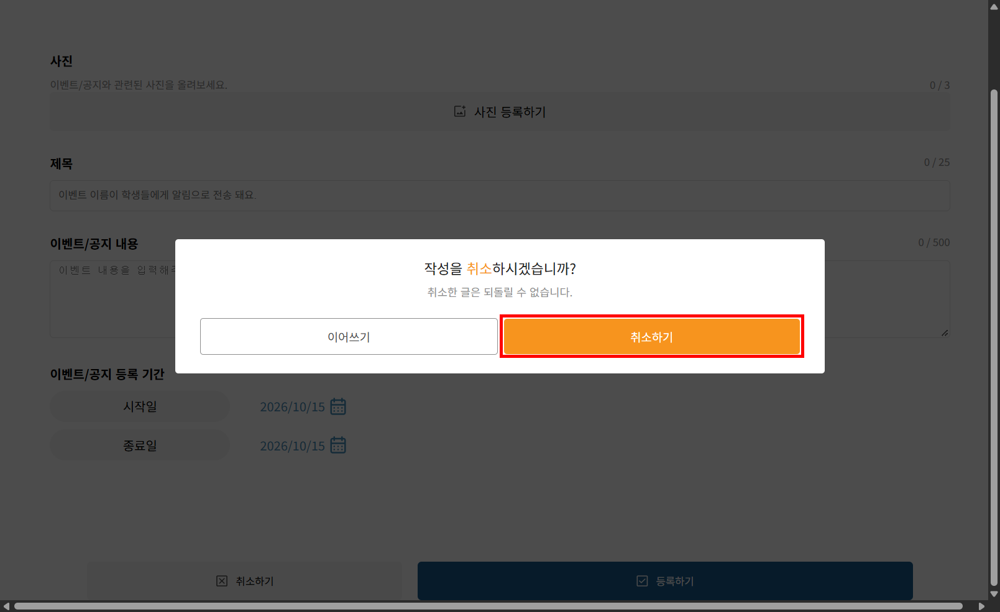

# 1-3 이벤트 추가 - 취소하기 

원문 페이지 ID: 61d0221954bc821abf030137f9b272e5

> 원문 스냅샷. 명세 확정·앱 배포·수집 완료를 뜻하지 않습니다.

## 원문 속성

```json
{
  "platform": [
    "WEB"
  ],
  "url": "source-page-id:61d0221954bc821abf030137f9b272e5",
  "상태": "완료",
  "생성일": "2026-11-08T10:51:52.568Z",
  "이벤트 이름": "<p>\n1-3 이벤트 추가 - 취소하기 \n</p>",
  "태그": [
    "1. 이벤트 추가"
  ]
}
```

<details>
<summary>이전 로깅</summary>

<span color="orange">event\_params.key</span>

- event\_label : add\_event\_cancel
- value : 이벤트 추가 취소
- event\_category : click
</details>

<details>
<summary>새 로깅 (26.10.17)</summary>

- 설명: 사장님 이벤트 추가 화면에서 취소하기를 누른 뒤 뜨는 확인 팝업(작성을 취소하시겠습니까?)에서 취소하기를 클릭해 작성을 그만두고 메인으로 나가는 경우
- screen\_view: <code>owner_event_add</code>
- event\_name: <code>DA1</code>
- event\_label: <code>owner__owner_event_add__shop_event_manage__add_cancel__click</code>
- value: 이벤트 추가 취소
- event\_category: <code>click</code>

<details>
<summary>검토사항</summary>

- 통합 가이드: [로깅 통합 가이드](3c30221954bc8214b1c481c5bbb6fba5.md)
- 모바일: 없음 (사장님 사이트는 웹 전용, 모바일 브라우저로 열어도 같은 웹 로깅)
- label DA2 기준 정렬 (2026-10-27): <code>owner__owner_event_add__cancel__click</code> → <code>owner__owner_event_add__shop_event_manage__add_cancel__click</code>
- 개발 참고 : 지금 코드는 공용 확인 팝업이 이 로깅을 보내서 이벤트 삭제 확인·이벤트 수정 취소 때도 add\_event\_cancel이 찍힌다. 이벤트 추가 화면에서만 보내도록 고쳐야 한다.
</details>

### 참고사진 (작성 취소 확인 팝업의 취소하기)

<columns>
<column ratio="50">
<b>웹</b>

<details>
<summary>참고사진 · 웹</summary>

웹 — 작성 취소 확인 팝업 (출처: stage 실제 캡처, 빨간 네모 = 클릭 위치)


</details>
</column>
<column ratio="50">
<b>모바일</b>

<details>
<summary>참고사진 · 모바일</summary>

모바일 — 해당 없음 (웹 전용)
</details>
</column>
</columns>
</details>
