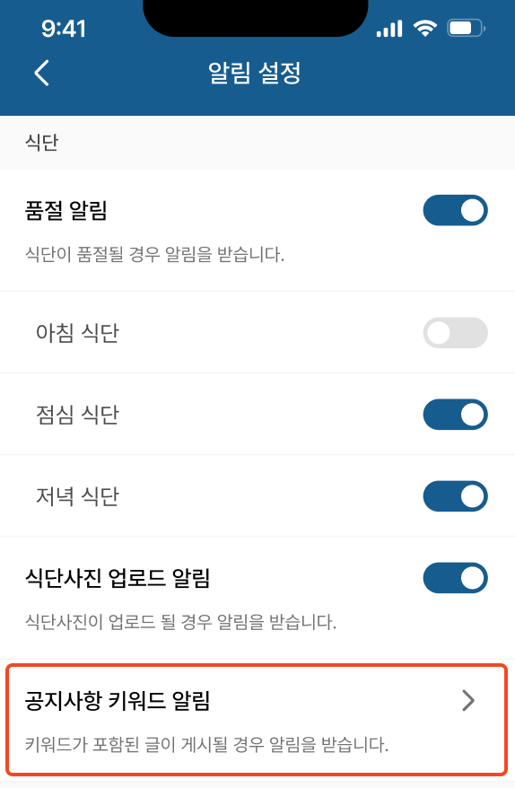

# 7-9. 알림설정_공지사항 키워드 알림_클릭

원문 페이지 ID: 6310221954bc837d983301ae45759690

> 사용자 제공 ZIP 내보내기 보관본. 레거시·동결·검토 상태는 원문을 따르며 코드 생성 승인·앱 배포 완료를 뜻하지 않습니다.

platform: ANDROID, IOS
상태: 완료

- 설명 : <u>공지사항/키워드</u> 관리 페이지로 이동
- 주의사항 : 클릭 가능한 모든 요소(텍스트, 화살표) 로깅
- event_label : “notification_manage_keyword”
- value : “공지사항 키워드 알림**”**
- event_category : “click”
- 참고사진
    
    
