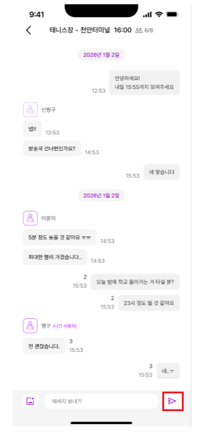
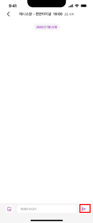

# 2-7  콜밴팟 채팅 전송

원문 페이지 ID: 63a0221954bc8363af3401d652190fee

> 원문 스냅샷. 명세 확정·앱 배포·수집 완료를 뜻하지 않습니다.

## 원문 속성

```json
{
  "platform": [
    "ANDROID",
    "IOS"
  ],
  "url": "source-page-id:63a0221954bc8363af3401d652190fee",
  "상태": "로깅 필요",
  "이름": "2-7  콜밴팟 채팅 전송",
  "태그": [
    "2. 콜밴팟 찾기"
  ]
}
```

<details>
<summary>이전 로깅</summary>

개인정보정책상? 이건 될지 안 될지 모르겠네여


<ul>
<li>
event\_name : CAMPUS
</li>
<li>
event\_category : click
</li>
<li>
event\_label : callvan\_chat\_send
</li>
<li>
value : 
</li>
</ul>





</details>

<details>
<summary>새 로깅 (2026-10-14) — 초안</summary>

- 설명: 콜밴팟 단체채팅 화면에서 메시지 전송 버튼을 클릭한다.
- screen\_view: <code>callvan_chat</code>
- event\_label: <code>callvan__callvan_chat__callvan_chat__message_send__click</code>
- event\_name: <code>DA2</code>
- value: 기존 미기재 유지
- event\_category: <code>click</code>

<details>
<summary>검토사항</summary>

- 통합 가이드·후속: [로깅 통합 가이드](3c30221954bc8214b1c481c5bbb6fba5.md)
- label 통일 (2026-10-27): callvan\_\_callvan\_chat\_\_callvan\_chat\_\_message\_send → callvan\_\_callvan\_chat\_\_callvan\_chat\_\_message\_send\_\_click
- 확정: 메시지 본문을 수집하지 않고 전송 버튼 클릭 행동 로그만 유지한다. value는 기존 미기재를 유지한다. 이전 로깅의 정책 메모는 이력이며 미결 검토사항이 아니다.
</details>

### 참고사진 (기능 표시)

<b>모바일 (ANDROID, IOS) / 캡처 출처는 아래 참조</b>

<details>
<summary>참고사진 · 모바일</summary>

Figma 참고 / 실제 화면 미확인. 사용자 확정에 따라 기존 사진을 유지하며 실제 캡처 교체를 대기 조건으로 두지 않는다. 앱 프레임 48921-195643.


</details>
</details>
