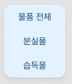
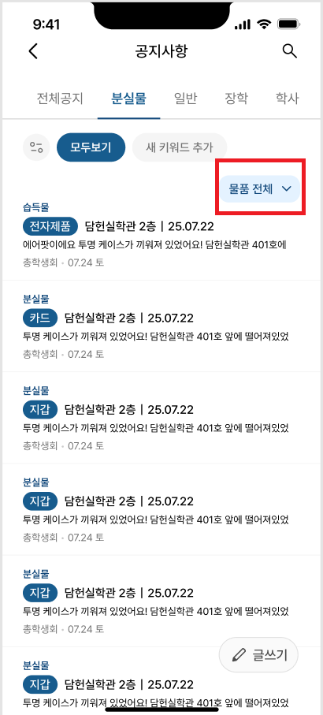

# 11-18.분실물_게시물종류_클릭

원문 페이지 ID: 6430221954bc8341a8ba0189b9643a3e

> 사용자 제공 ZIP 내보내기 보관본. 레거시·동결·검토 상태는 원문을 따르며 코드 생성 승인·앱 배포 완료를 뜻하지 않습니다.

platform: ANDROID, IOS
상태: 완료

- 설명 : 분실물 게시글 목록에서 첨부파일에 표시된 버튼을 클릭하여 3개의 버튼중 1개의 버튼을 클릭
- event_label : “item_post_type”
- value : “물품 전체**”, “분실물”, “습득물”**
- event_category : “click”
- 참고사진
- WEB, MOBILE_WEB_VIEW는 디자인 에서 해당 기능이 없었습니다.

