# 화면 정의 및 로깅 검수

원문 페이지 ID: 6510221954bc83c380f90140afd0f4a7

> 원문 스냅샷. 명세 확정·앱 배포·수집 완료를 뜻하지 않습니다.

## 원문 속성

```json
{
  "title": "화면 정의 및 로깅 검수"
}
```

### 서비스 목록

- [x] 계정, 로그인
- [x] 게시판

<todo checked="true">
주변상점 
</todo>

- [x] 식단
- [x] 배너
- [x] 분실물
- [ ] 버스
- [x] 콜밴팟
- [x] 쪽지, 채팅
- [x] 모의수강신청
- [x] 학교 부서 정보
- [x] 교내 시설물
- [ ] 복덕방
- [ ] 사장님
- [ ] 팀원모집
- [ ] 시간표
- [x] 새 주변상점, 미래의 주변상점

---

<p>
창윤: 
</p>

계정, 로그인, 게시판, 배너, 분실물

콜밴팟, 쪽지, 채팅, 모의수강신청, 학교 부서 정보, 교내 시설물


<p>
상민: 
</p>

복덕방

사장님

팀원모집

시간표

담당 미확인: 주변상점, 식단, 버스

기존 event\_name DA1은 유지한다. 새 주변상점·미래의 주변상점·동아리·홈화면 리디자인·졸업학점 계산기 5개도 담당 미확인이다. 배정표의 단일 출처는 [로깅 통합 가이드](2910221954bc8254bb2d81c0774e7755.md)다.


## 공통 기준과 관련 문서

- 공통 기준·작성·문서 검수: [로깅 통합 가이드](2910221954bc8254bb2d81c0774e7755.md)
- 확정 사항·남은 후속·문제 해결: [로깅 통합 가이드](2910221954bc8254bb2d81c0774e7755.md)

화면별 이름·플랫폼·진입점·이미지는 아래 화면 정의에서 관리한다.

- 기능명·행동 사전: [event_label 기능·행동 네이밍 사전](b7e0221954bc83608b1f8102fb3d2911.md)


## 검수 논의 (기존 댓글)

검수 범위와 체크리스트는 공통 가이드로 통합했다. 아래는 기존 screen\_view 논의의 댓글 위치다.

<p>
screen\_view 
</p>


# 화면 정의(screen\_view, page\_view)

## DA1 고정 화면명 등록 (2026-10-27)

DA1 7개 서비스의 새 로깅에 쓰는 고정 논리 화면명이다. screen\_view는 event\_label을 <code>__</code>로 나눈 두 번째 구간과 정확히 같은 고정 문자열이다. 공용 헤더·푸터는 각각 <code>header</code>·<code>footer</code>, 카테고리·메뉴는 <code>main_category</code>, 외부 진입은 <code>from_external</code>이다. 시간표의 웹 <code>timetable</code> / 모바일 <code>timetable_list</code>도 해당 플랫폼의 label 두 번째 구간과 각각 일치시킨다. 2026-10-30 상민 직접 지시로 확정했다. 품절 관련 동결 명세는 변경 제외이며 실제 SDK 전송값·수집 검수 완료를 뜻하지 않는다.

| 범위 | screen\_view |
| --- | --- |
| 공통 | <code>main</code>, <code>main_category</code>, <code>header</code>, <code>footer</code>. screen\_view는 label 두 번째 구간과 같은 고정값. |
| 주변상점 | <code>shop_list</code>, <code>shop_detail</code>, <code>shop_review_write</code>, <code>shop_benefit</code> |
| 식단 | <code>cafeteria</code>, <code>account_config</code>, <code>notification_config</code>, <code>from_external</code> |
| 버스 | <code>bus_search</code>, <code>bus_search_result</code>, <code>bus_timetable</code>, <code>bus_timetable_detail</code> |
| 복덕방 | <code>room_list</code>, <code>room_detail</code> |
| 사장님 | <code>owner_shop</code>, <code>owner_shop_edit</code>, <code>owner_menu_add</code>, <code>owner_event_add</code>, <code>owner_event_modify</code>, <code>owner_login</code>, <code>owner_signup</code> |
| 팀원 모집 | <code>team_list</code>, <code>team_detail</code>, <code>team_write</code>, <code>team_edit</code>, <code>team_apply</code>, <code>team_applied</code>, <code>team_created</code>, <code>team_profile</code>, <code>team_profile_write</code>, <code>team_profile_edit</code>, <code>team_applicant</code>, <code>team_applicant_detail</code> |
| 시간표 | <code>timetable</code>, <code>timetable_list</code>, <code>timetable_edit</code> |

## 공통화면

- 공용 헤더·푸터의 label page와 screen\_view는 각각 <code>header</code> / <code>footer</code>로 일치시킨다. 별도 UI 페이지를 새로 만든다는 뜻은 아니며 SDK 적용 확인은 별도다.

<details>
<summary>화면정의</summary>

<toggle heading="h3">
외부 화면 (web, mobile)

- 플랫폼 : web, mobile
- 주 진입점: 알림과 같은 이벤트로 인해 KOIN 앱으로 들어오는 경우
- 화면 이름: from\_external

<columns>
<column ratio="50">
- web


</column>
<column ratio="50">
- mobile
</column>
</columns>
</details>

<toggle heading="h3">
메인 화면 (web, mobile)

- 플랫폼 : web, mobile
- 주 진입점: 시작 페이지임
- 화면 이름: main

<columns>
<column ratio="50">
- web

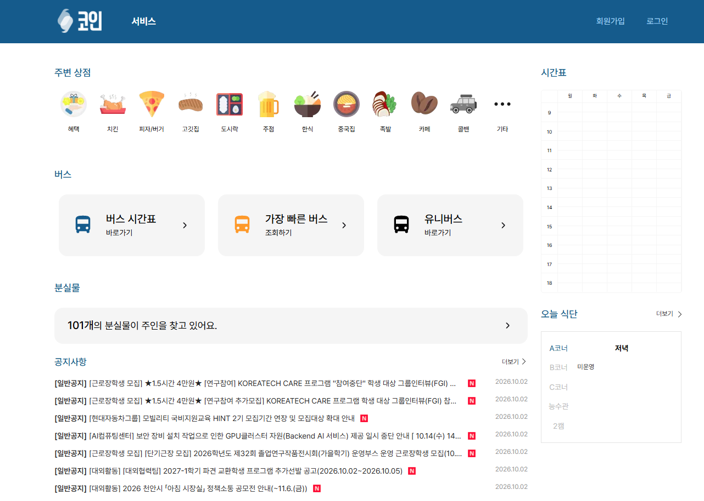


</column>
<column ratio="50">
- mobile

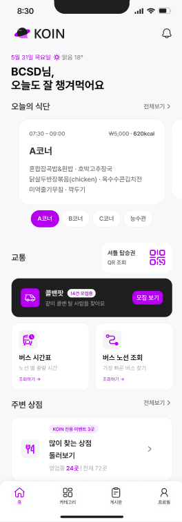
</column>
</columns>
</details>

<toggle heading="h3">
메인 카테고리 화면 (mobile)

- 플랫폼 : mobile (ANDROID, IOS)
- 화면 이름: main\_category

<columns>
<column ratio="50">
- web: 없음


</column>
<column ratio="50">
- mobile
- 주 진입점: 메인화면 → 하단 네비게이션바 카테고리 클릭

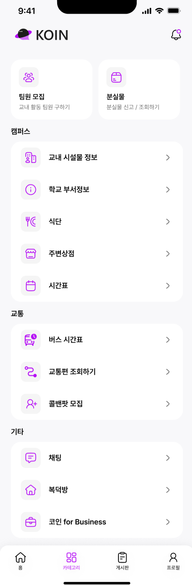
</column>
</columns>
</details>

<toggle heading="h3">
메인 프로필 화면 (mobile)

- 플랫폼 : mobile
- 주 진입점: 메인화면 → 프로필 클릭
- 화면 이름: main\_profile

<columns>
<column ratio="50">
- web : 없음


</column>
<column ratio="50">
- mobile

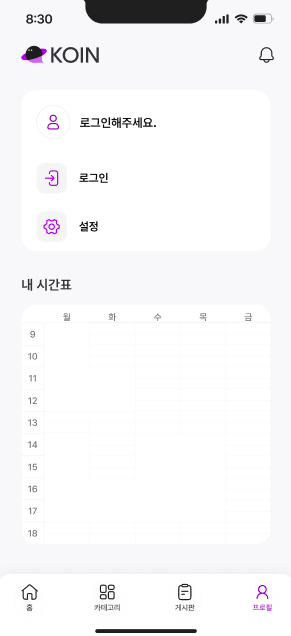
</column>
</columns>
</details>

<toggle heading="h3">
메인 설정 화면 (mobile)

<ul>
<li>
플랫폼 : mobile
</li>
<li>
주 진입점: 메인화면 → 메인 프로필화면 → 설정클릭
</li>
<li>
화면 이름: account\_config 
</li>
</ul>

<columns>
<column ratio="50">
- web : 없음


</column>
<column ratio="50">
- mobile

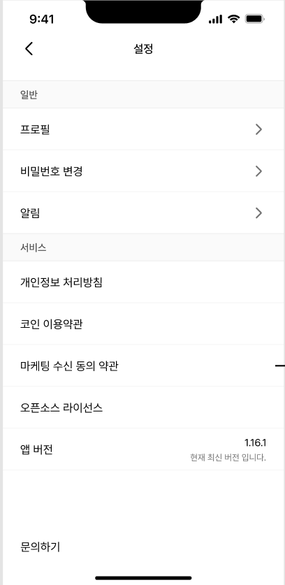
</column>
</columns>
</details>

<toggle heading="h3">
알림 설정 화면 (mobile)

- 플랫폼 : mobile
- 화면 이름: <code>notification_config</code>

<columns>
<column ratio="50">
- web: 없음


</column>
<column ratio="50">
- mobile
- 주 진입점: 메인화면 → 메인 프로필 화면 → 메인 설정 화면 → 알림 클릭

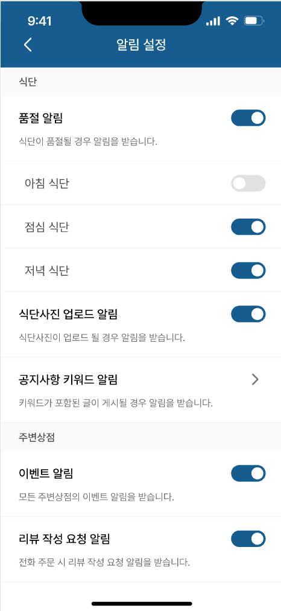
</column>
</columns>
</details>
</details>

---

### 계정, 로그인

<details>
<summary>화면 정의</summary>

<toggle heading="h3">
로그인 화면 (web, mobile)

- 플랫폼: web, mobile
- 화면 이름: login

<columns>
<column ratio="43.75">
<ul>
<li>
web 
</li>
<li>
주 진입점: 메인화면 → 로그인 클릭
</li>
</ul>

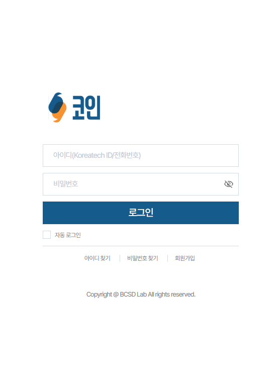


</column>
<column ratio="56.25">
<ul>
<li>
mobile
</li>
<li>
주 진입점: 메인화면 →  메인 프로필화면 → 로그인클릭 
</li>
</ul>

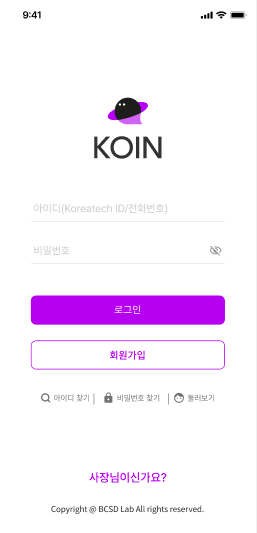
</column>
</columns>
</details>

<toggle heading="h3">
약관동의 화면 (web, mobile), (회원가입 1)

- 플랫폼 : web, mobile
- 화면 이름: sign\_up\_policy


<columns>
<column ratio="50">
- web
- 주 진입점:  메인화면 → 회원가입 클릭

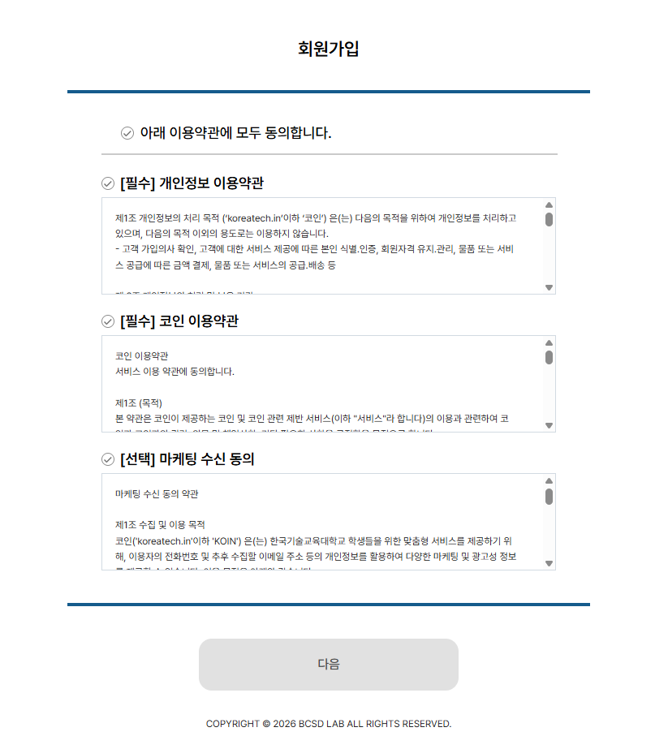


</column>
<column ratio="50">
- mobile
- 주 진입점:  메인화면 → 메인 프로필화면 → 로그인 화면 → 회원가입클릭

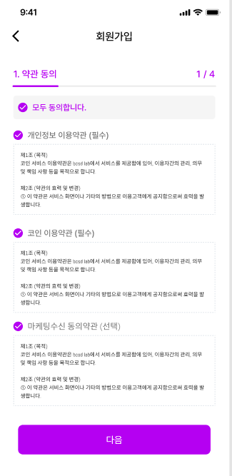
</column>
</columns>


</details>

<toggle heading="h3">
본인인증 화면 (web, mobile), (회원가입 2)

- 플랫폼 : web, mobile
- 화면 이름: identity\_verification

<columns>
<column ratio="50">
- web
- 주 진입점: 메인화면 →  약관동의화면 → 다음 클릭

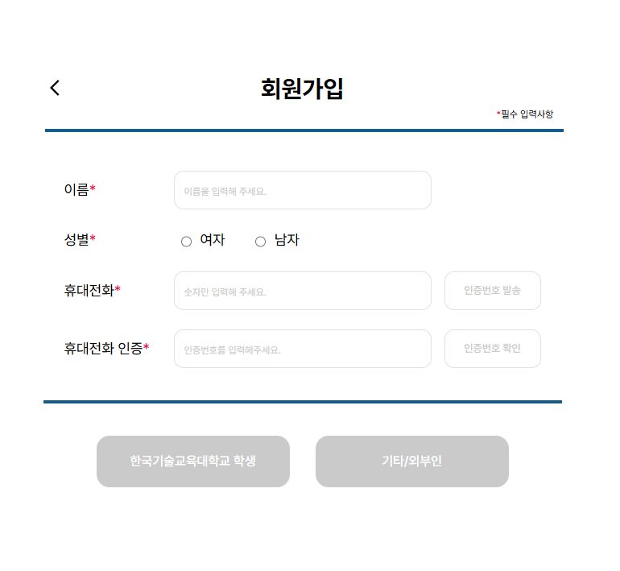
</column>
<column ratio="50">
- mobile
- 주 진입점: 메인화면 → 메인 프로필화면 → 로그인 화면 → 약관동의화면 → 다음 클릭

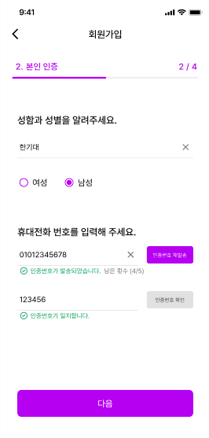
</column>
</columns>
</details>

<toggle heading="h3">
회원유형선택 화면 (mobile), (회원가입 3)

- 플랫폼 : mobile
- 화면 이름: user\_type\_selection

<columns>
<column ratio="50">
- web: 본인인증 화면에 포함되어 있음.
</column>
<column ratio="50">
- mobile
- 주 진입점:  메인화면 → 메인 프로필화면 → 로그인 화면 → 약관동의화면 → 본인인증 화면 → 다음 클릭

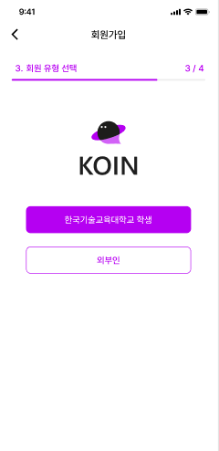
</column>
</columns>
</details>

<toggle heading="h3">
정보입력 화면 (web, mobile), (회원가입 4)

- 플랫폼 : web, mobile
- 화면 이름: input\_user\_info

<columns>
<column ratio="50">
- web
- 주 진입점: 메인화면 →  약관동의화면 → 본인인증화면 → 외부인 클릭

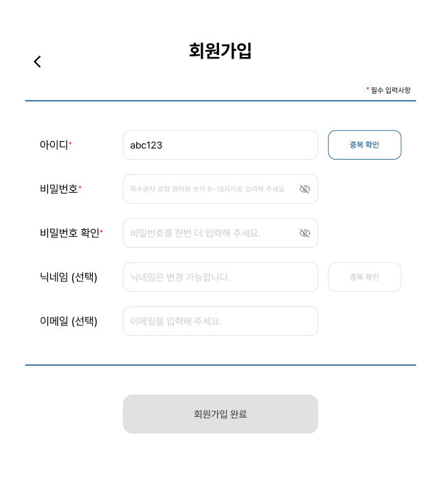
</column>
<column ratio="50">
- mobile
- 주 진입점:  메인화면 → 메인 프로필화면 → 로그인 화면 → 약관동의화면 → 본인인증 화면 → 외부인 클릭

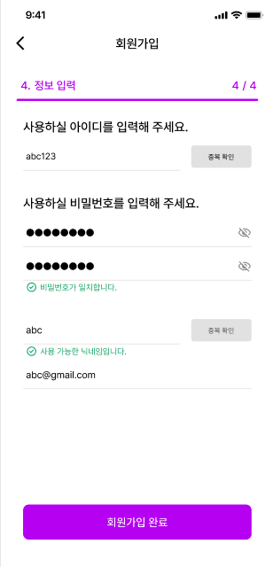
</column>
</columns>
</details>

<toggle heading="h3">
프로필 변경 화면(web, mobile)

- 플랫폼 : web, mobile
- 화면 이름: edit\_profile

<columns>
<column ratio="50">
- web
- 주 진입점: 메인화면(로그인 후) → 정보수정 클릭

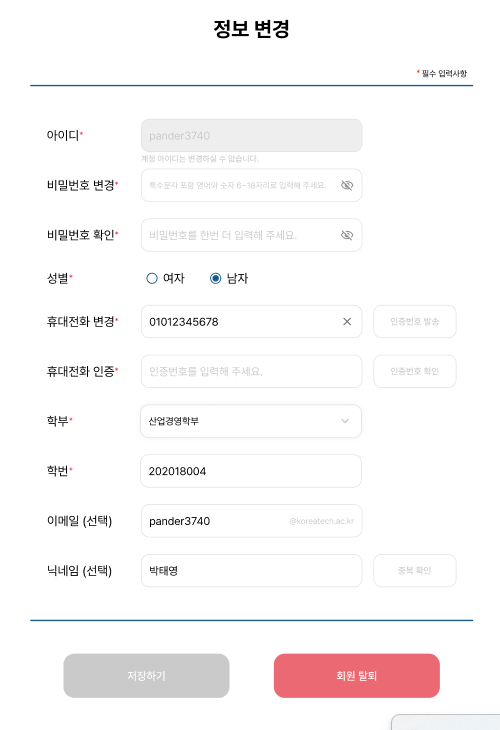
</column>
<column ratio="50">
- mobile
- 주 진입점: 메인화면 → 메인 프로필 화면 → 프로필 클

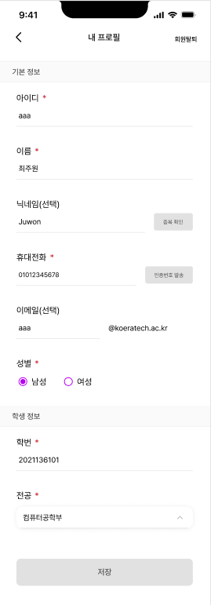
</column>
</columns>
</details>

<toggle heading="h3">
정보수정 → 비밀번호 변경 화면(web, mobile)

- 플랫폼 : mobile
- 화면 이름: password\_change

<columns>
<column ratio="50">
- web : ‘프로필 변경 화면’에서 수행


</column>
<column ratio="50">
<ul>
<li>
mobile
</li>
<li>
주 진입점: 메인 화면 → 메인 프로필 화면 → 설정 화면 → 비밀번호 변경 클릭 → 계정인증 다음 
</li>
</ul>

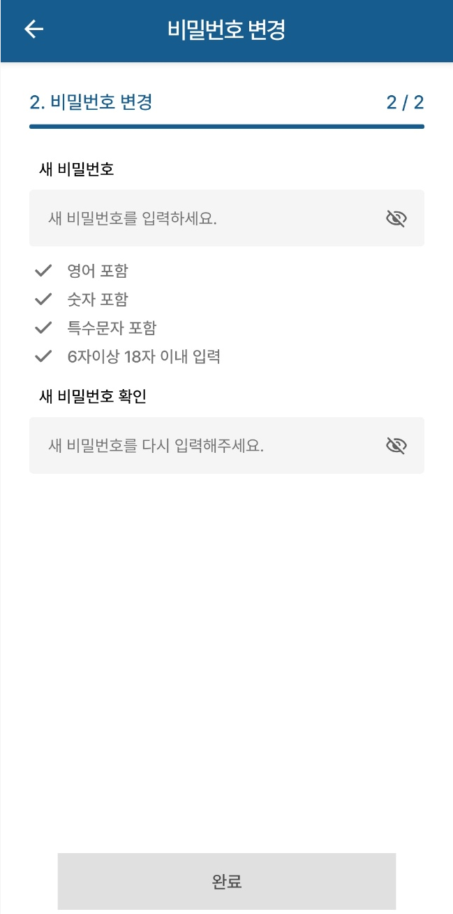
</column>
</columns>
</details>


---

<toggle heading="h3">
복붙용

<ul>
<li>
플랫폼 : mobile
</li>
<li>
화면 이름: 
</li>
</ul>

<columns>
<column ratio="50">
<ul>
<li>
web
</li>
<li>
주 진입점: 
</li>
</ul>
</column>
<column ratio="50">
<ul>
<li>
mobile
</li>
<li>
주 진입점: 
</li>
</ul>
</column>
</columns>
</details>
</details>

---

### 게시판

<details>
<summary>화면 정의</summary>

<toggle heading="h3">
메인 공지사항(게시판) 화면 (web, mobile)

- 플랫폼 : web, mobile
- 화면 이름: main\_notice

<columns>
<column ratio="50">
- web
- 주 진입점: 메인화면 → 공지사항 클릭

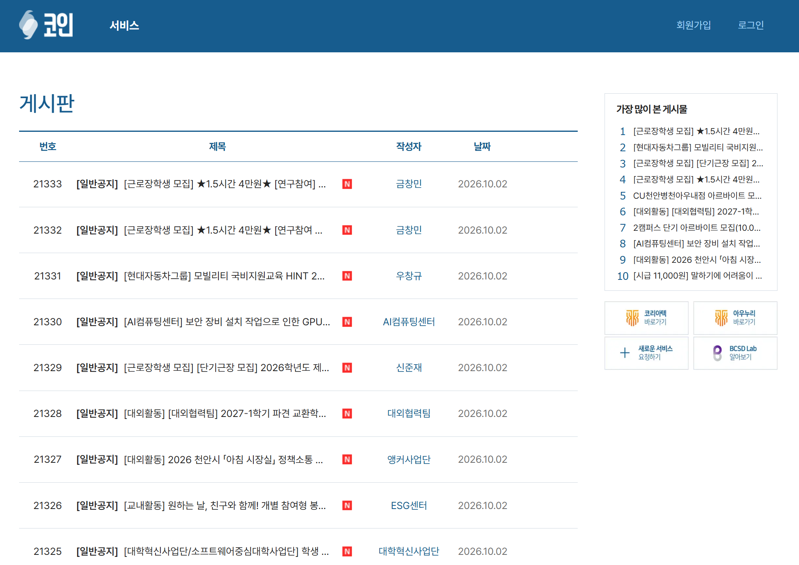
</column>
<column ratio="50">
- mobile
- 주 진입점: 메인화면 → 하단 네비게이션바의 게시판 클릭

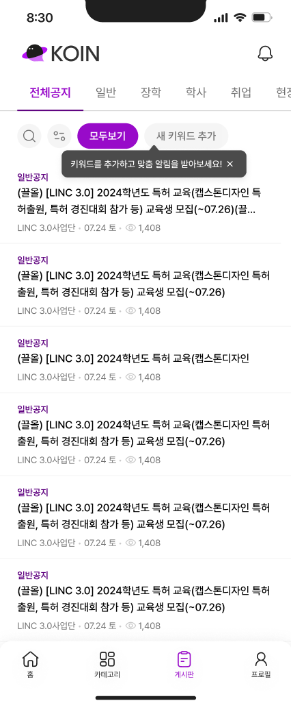
</column>
</columns>
</details>

<toggle heading="h3">
공지 상세 화면 (web, mobile)

- 플랫폼 : web, mobile
- 화면 이름: notice\_detail

<columns>
<column ratio="50">
- web
- 주 진입점: 메인 → 공지사항 화면 → 공지 클릭

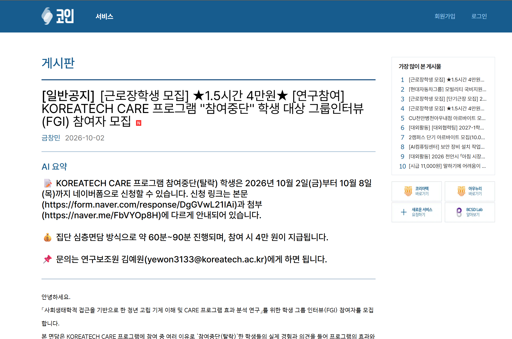
</column>
<column ratio="50">
- mobile
- 주 진입점: 메인 → 공지사항 화면 → 공지 클릭

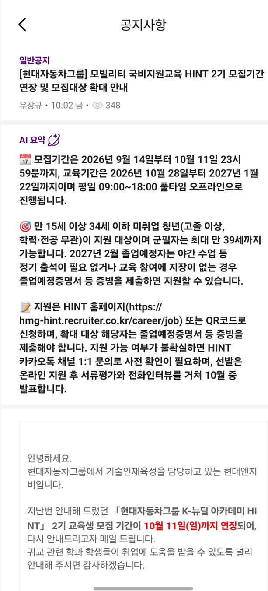
</column>
</columns>
</details>

<toggle heading="h3">
공지 검색 화면 (mobile)

- 플랫폼 : mobile
- 화면 이름: notice\_search

<columns>
<column ratio="50">
- web : 없음
</column>
<column ratio="50">
- mobile
- 주 진입점: 메인 → 공지사항 화면 → 돋보기 클릭

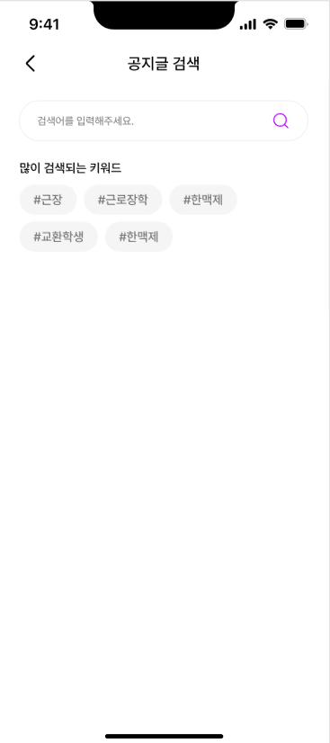
</column>
</columns>
</details>

<toggle heading="h3">
키워드 관리 화면 (mobile)

- 플랫폼 : mobile
- 화면 이름: <code>notice_keyword_manage</code>

<columns>
<column ratio="50">
<ul>
<li>
web : 없음 
</li>
</ul>
</column>
<column ratio="50">
- mobile
- 주 진입점: 메인 → 공지사항 화면 → 새 키워드 추가 클릭

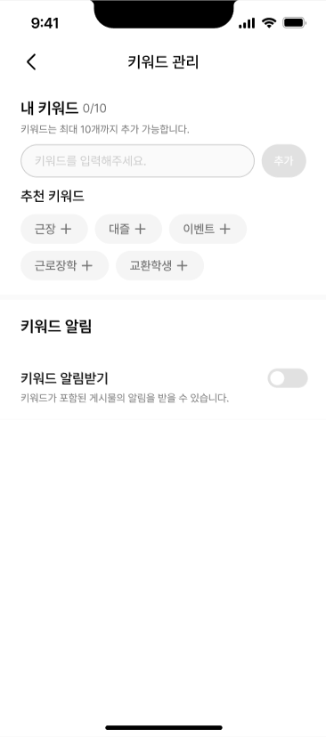
</column>
</columns>
</details>


---

<toggle heading="h3">
복붙용

<ul>
<li>
플랫폼 : mobile
</li>
<li>
화면 이름: 
</li>
</ul>

<columns>
<column ratio="50">
<ul>
<li>
web
</li>
<li>
주 진입점: 
</li>
</ul>
</column>
<column ratio="50">
<ul>
<li>
mobile
</li>
<li>
주 진입점: 
</li>
</ul>
</column>
</columns>
</details>
</details>

---

### 주변상점

<details>
<summary>화면 정의</summary>

- 주변 상점 진입
  <ul>
  <li>
  주 진입점 

  - 메인 → 주변 상점 진입
    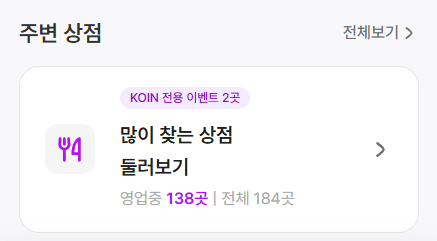
  - 메인 → 카테고리 진입 → 주변 상점 진입
    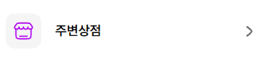
  </li>
  <li>
  화면 이름 : 
  </li>
  </ul>
</details>

---

### 분실물

<details>
<summary>화면 정의</summary>

<toggle heading="h3">
분실물 리스트 화면(web, mobile)

- 플랫폼 : web, mobile
- 화면 이름: lost\_item\_list

<columns>
<column ratio="50">
- web
- 주 진입점: 메인화면 → 분실물 클릭

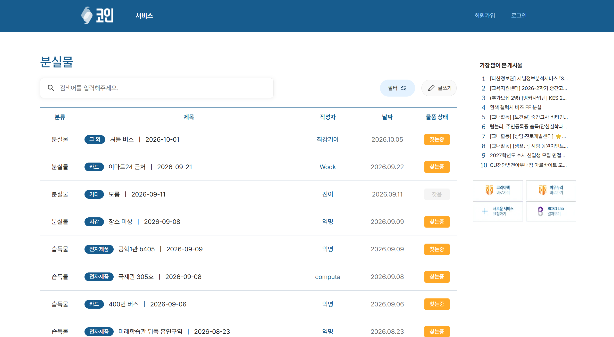
</column>
<column ratio="50">
- mobile
- 주 진입점: 메인화면 → 카테고리 화면 → 분실물 클릭

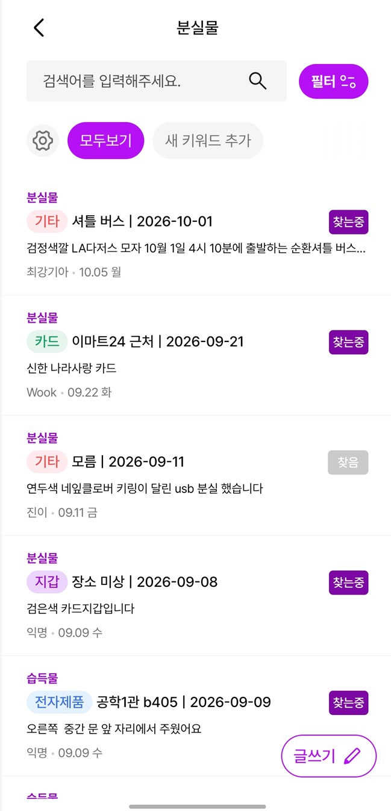
</column>
</columns>
</details>

<toggle heading="h3">
습득물 신고 작성 화면(web, mobile)

- 플랫폼 : web, mobile
- 화면 이름: found\_item\_write

<columns>
<column ratio="50">
- web
- 주 진입점: 메인 → 분실물 리스트 → 주인을 찾아요 클릭

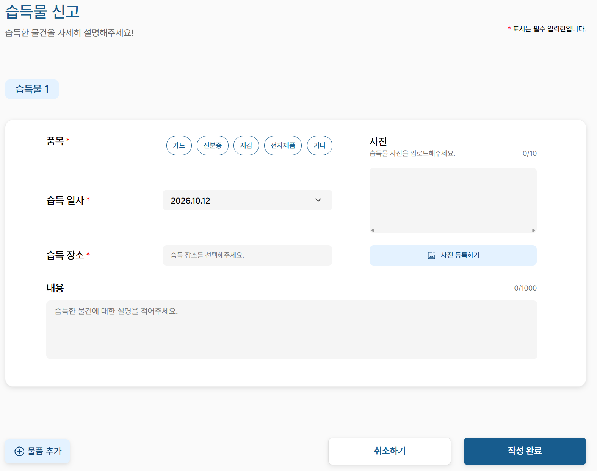
</column>
<column ratio="50">
- mobile
- 주 진입점: 메인 → 카테고리 → 분실물 리스트 → 주인을 찾아요 클릭

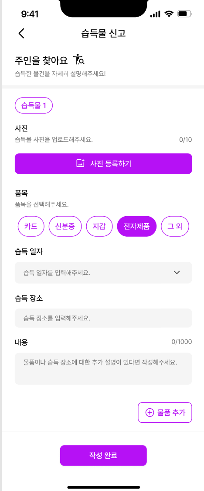
</column>
</columns>
</details>

<toggle heading="h3">
분실물 신고 작성 화면(web, mobile)

- 플랫폼 : web, mobile
- 화면 이름: lost\_item\_write

<columns>
<column ratio="50">
- web
- 주 진입점: 메인 → 분실물 리스트 → 잃어버렸어요

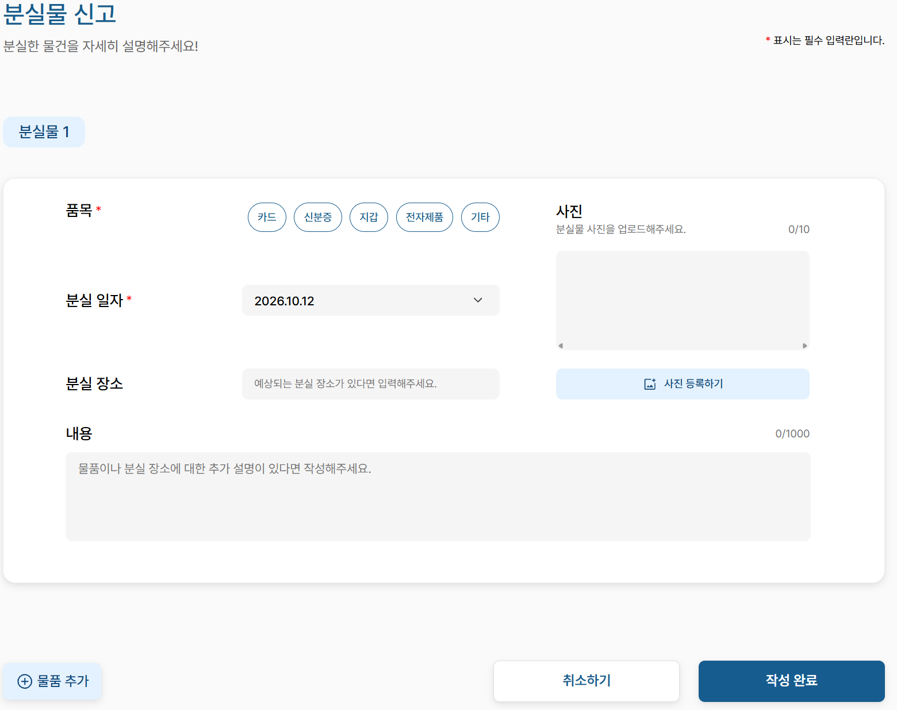
</column>
<column ratio="50">
- mobile
- 주 진입점: 메인 → 카테고리 → 분실물 리스트 → 잃어버렸어요 클릭

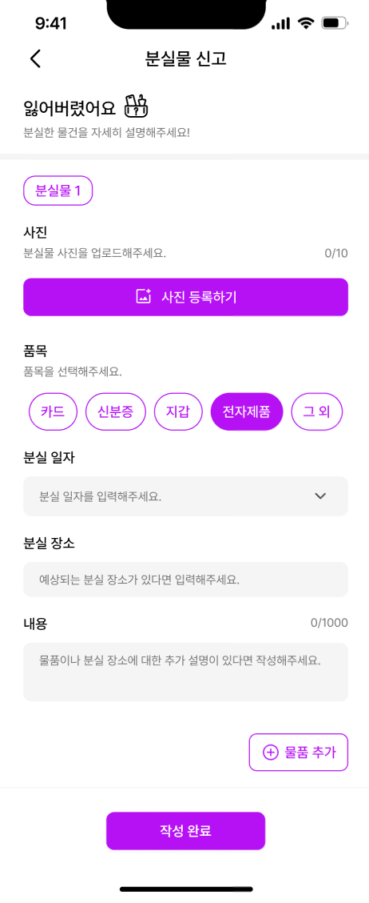
</column>
</columns>
</details>

<toggle heading="h3">
분실물(습득물) 게시물 화면(web, mobile)

- 플랫폼 : web, mobile
- 화면 이름: lost\_item\_detail

<columns>
<column ratio="50">
- web
- 주 진입점: 메인 → 분실물 리스트 → 게시물 중 하나 클릭

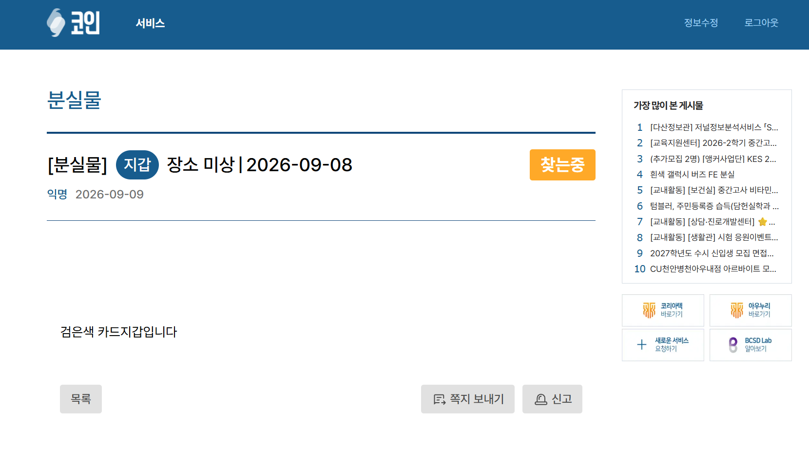
</column>
<column ratio="50">
- mobile
- 주 진입점: 메인 → 카테고리 → 분실물 리스트 → 게시물 중 하나 클릭

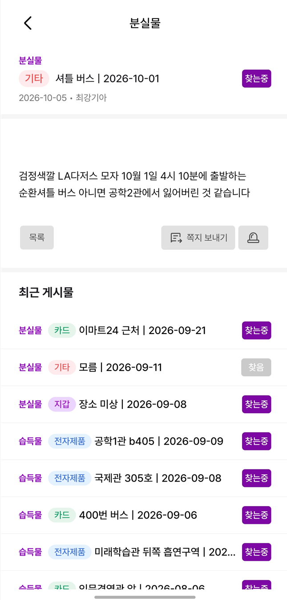
</column>
</columns>
</details>

<toggle heading="h3">
분실물 키워드 관리 화면(mobile)

- 플랫폼 : mobile
- 화면 이름: <code>lost_item_keyword_manage</code>

<columns>
<column ratio="50">
<ul>
<li>
web 없음 
</li>
</ul>
</column>
<column ratio="50">
- mobile
- 주 진입점: 메인 → 카테고리 → 분실물 리스트 → 설정 톱니바퀴 or 새 키워드 추가 클릭

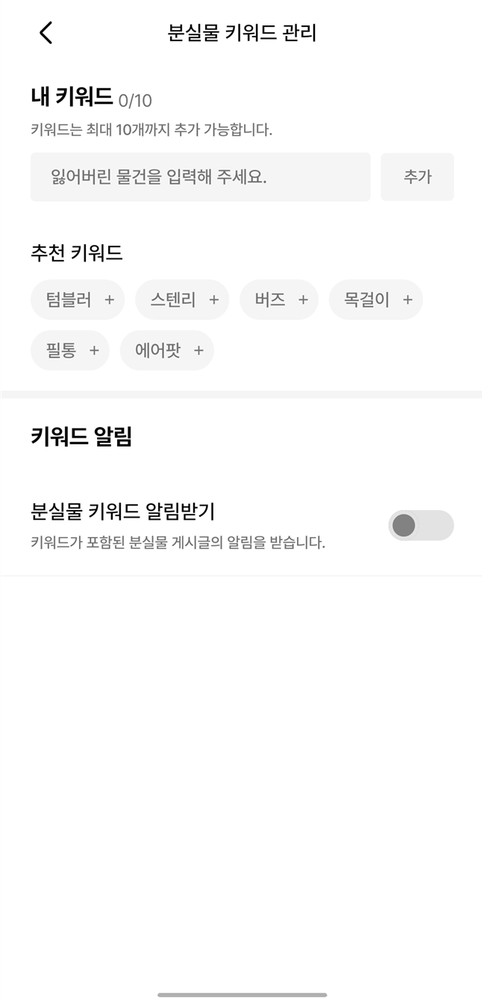
</column>
</columns>
</details>

<toggle heading="h3">
분실물 신고 화면(mobile)

- 플랫폼 : mobile
- 화면 이름: <code>lost_item_report</code>

<columns>
<column ratio="50">
<ul>
<li>
web 없음 
</li>
</ul>
</column>
<column ratio="50">
<ul>
<li>
mobile
</li>
<li>
주 진입점: 메인 → 카테고리 → 분실물 리스트 → 분실물 게시물 → 신고 아이콘 클릭 
</li>
</ul>

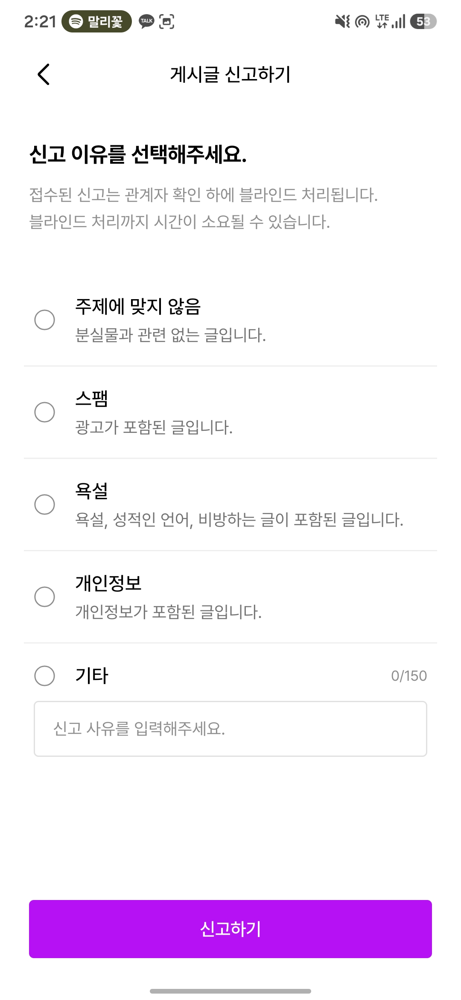
</column>
</columns>
</details>

<toggle heading="h3">
분실물 수정 화면(web, mobile)

- 플랫폼 : mobile
- 화면 이름: lost\_item\_edit

<columns>
<column ratio="50">
<ul>
<li>
web
</li>
<li>
주 진입점: 메인 → 분실물 리스트 → (본인이 작성한)분실물 게시물 → 수정 클릭 
</li>
</ul>

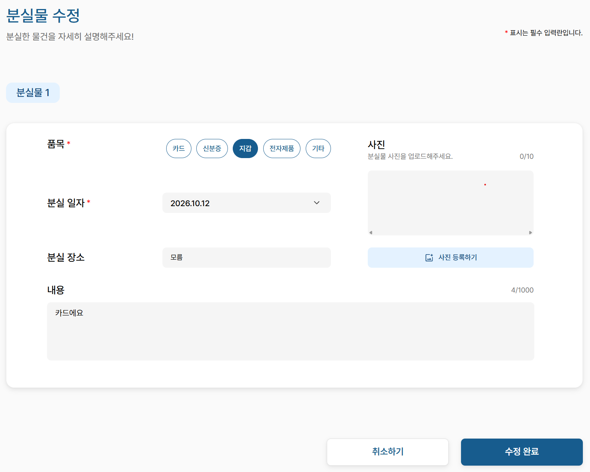


</column>
<column ratio="50">
<ul>
<li>
mobile
</li>
<li>
주 진입점: 메인 → 카테고리 → 분실물 리스트 → (본인이 작성한) 분실물 게시물 → 수정 클릭 
</li>
</ul>

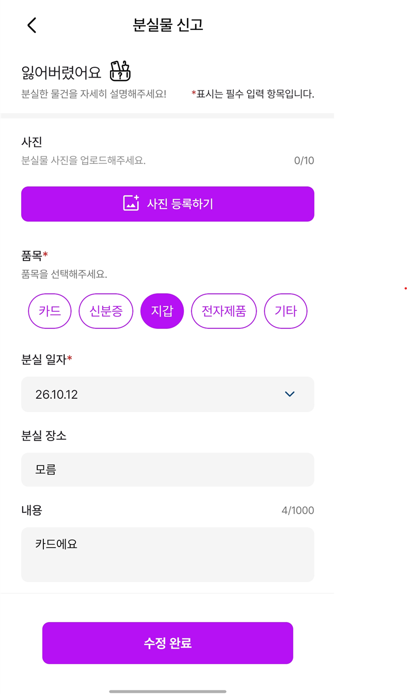
</column>
</columns>
</details>

<toggle heading="h3">
습득물 수정 화면(web, mobile)

- 플랫폼 : mobile
- 화면 이름: found\_item\_edit

<columns>
<column ratio="50">
<ul>
<li>
web
</li>
<li>
주 진입점: 메인 → 분실물 리스트 → (본인이 작성한)분실물 게시물 → 수정 클릭 
</li>
<li>
사진은 분실물 수정과 동일 상단 ‘분실물 수정’ → ‘습득물 수정’
</li>
</ul>


</column>
<column ratio="50">
<ul>
<li>
mobile
</li>
<li>
주 진입점: 메인 → 카테고리 → 분실물 리스트 → (본인이 작성한) 분실물 게시물 → 수정 클릭 
</li>
<li>
사진은 분실물 수정과 동일 상단 ‘분실물 신고’ → ‘습득물 신고’
</li>
</ul>


</column>
</columns>
</details>

<details>
<summary>추가 이미지</summary>

<details>
<summary>필터</summary>

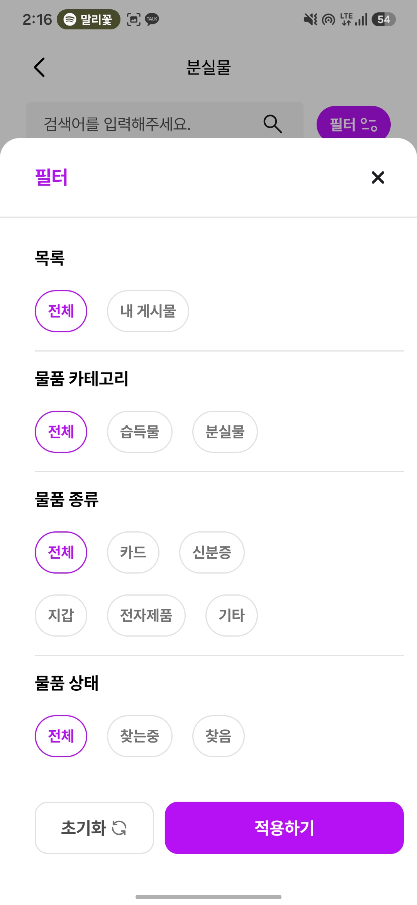

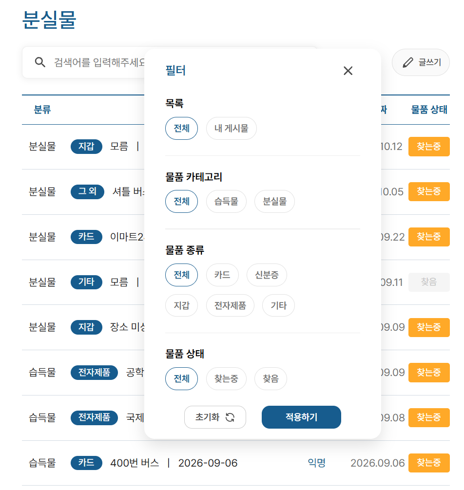
</details>

<details>
<summary>글쓰기</summary>

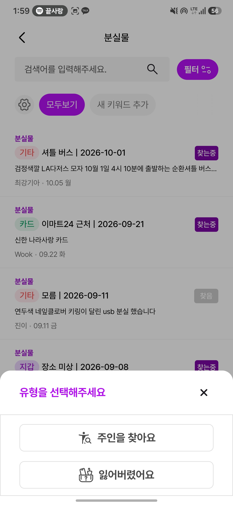

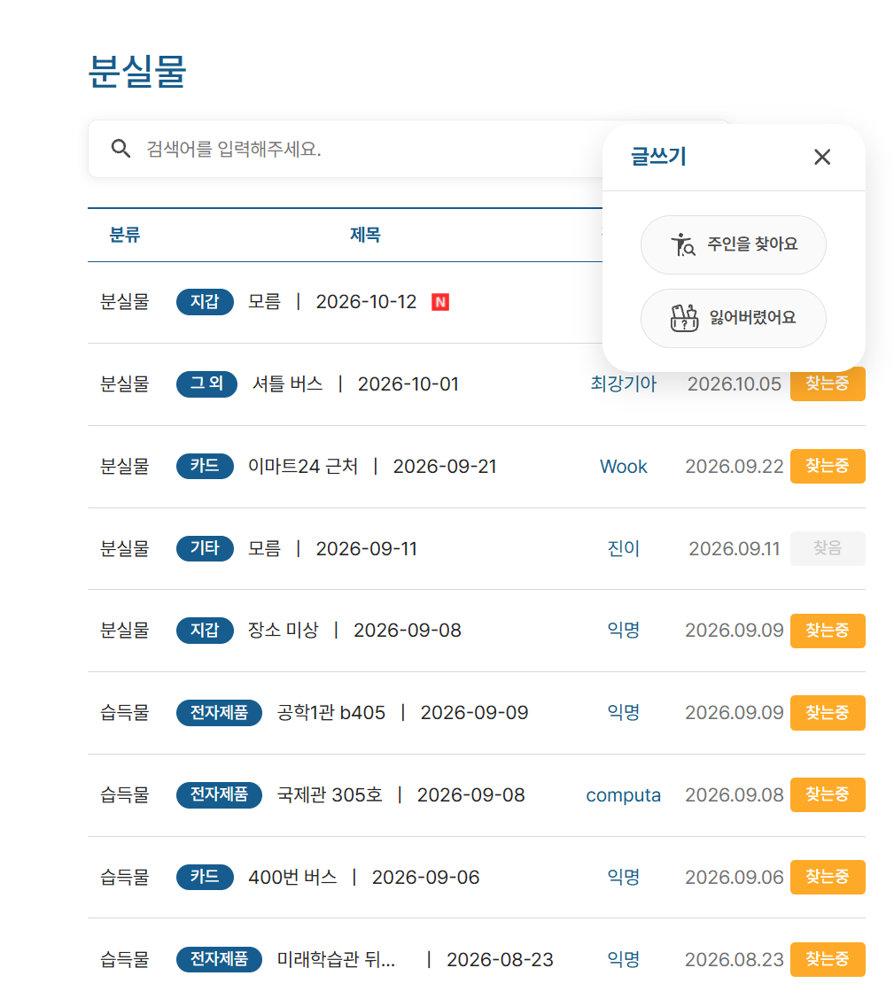
</details>

<details>
<summary>본인 게시물</summary>

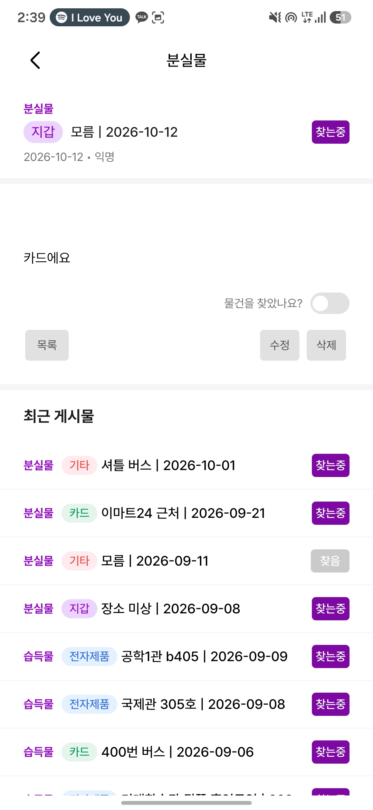

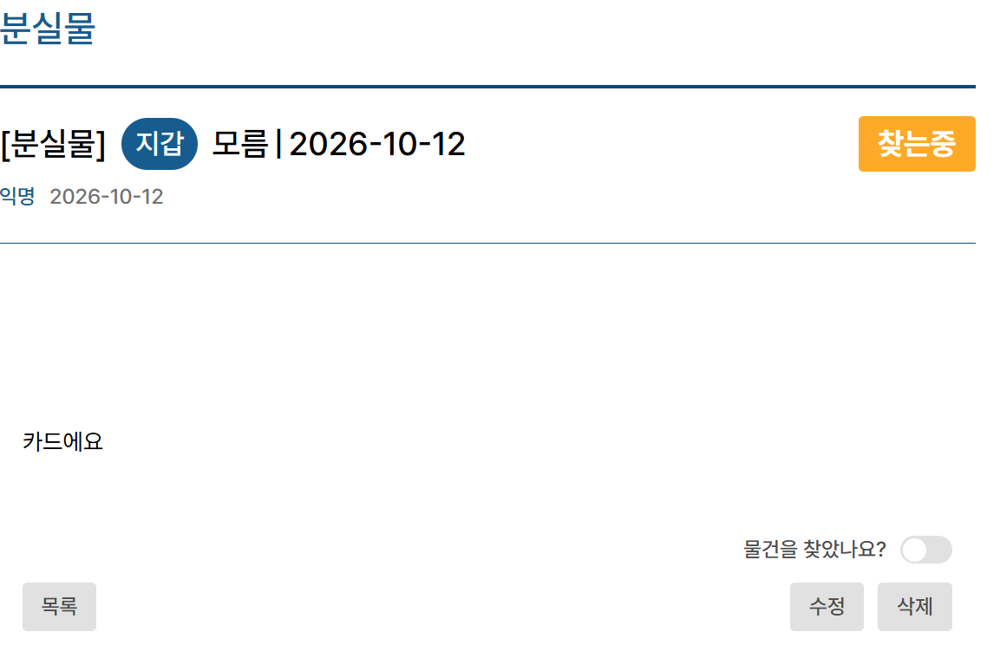
</details>
</details>


<toggle heading="h3">
복붙용

<ul>
<li>
플랫폼 : mobile
</li>
<li>
화면 이름: 
</li>
</ul>

<columns>
<column ratio="50">
<ul>
<li>
web
</li>
<li>
주 진입점: 
</li>
</ul>
</column>
<column ratio="50">
<ul>
<li>
mobile
</li>
<li>
주 진입점: 
</li>
</ul>
</column>
</columns>
</details>
</details>

---

### 콜밴팟

<details>
<summary>화면 정의</summary>

- 확인일: 2026-10-13
- 앱: Android. 실제 앱 캡처는 선명도 개선본을 사용한다.
- 2026-10-16: 참여자 목록·단체채팅·신고 사유·신고 내용 4개는 기존 Figma 이미지 사용으로 확정했다. 실제 화면·진입 경로 미확인 표시는 보존하며 캡처 교체 대기로 남기지 않는다. Android 재확인에서는 참여 중인 모집 마감 카드가 표시됐으나 인원·본문 클릭으로 참여자 목록이 열리지 않았다.

<toggle heading="h3">
콜밴팟 목록 화면 (mobile)

- 플랫폼: mobile
- 화면 이름: callvan\_list

<columns>
<column ratio="50">
- web(데스크톱): 서비스 없음 — 적용 대상 제외
</column>
<column ratio="50">
- mobile
- 주 진입점: 메인 화면 → 콜밴팟 ‘모집 보기’ 클릭

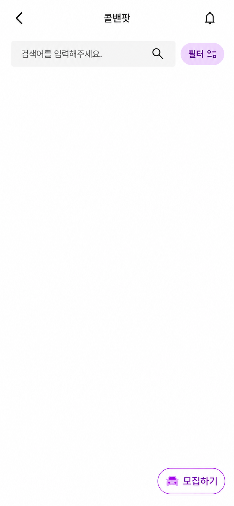
</column>
</columns>
</details>

<toggle heading="h3">
콜밴팟 모집글 작성 화면 (mobile)

- 플랫폼: mobile
- 화면 이름: callvan\_write

<columns>
<column ratio="50">
- web(데스크톱): 서비스 없음 — 적용 대상 제외
</column>
<column ratio="50">
- mobile
- 주 진입점: 콜밴팟 목록 화면 → ‘모집하기’ 클릭

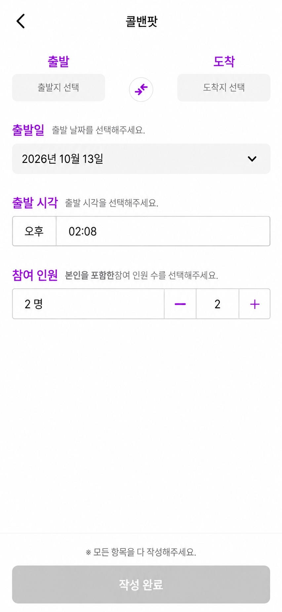
</column>
</columns>
</details>

<toggle heading="h3">
콜밴팟 알림 화면 (mobile)

- 플랫폼: mobile
- 화면 이름: callvan\_notification

<columns>
<column ratio="50">
- web(데스크톱): 서비스 없음 — 적용 대상 제외
</column>
<column ratio="50">
- mobile
- 주 진입점: 콜밴팟 목록 화면 → 알림(종) 아이콘 클릭

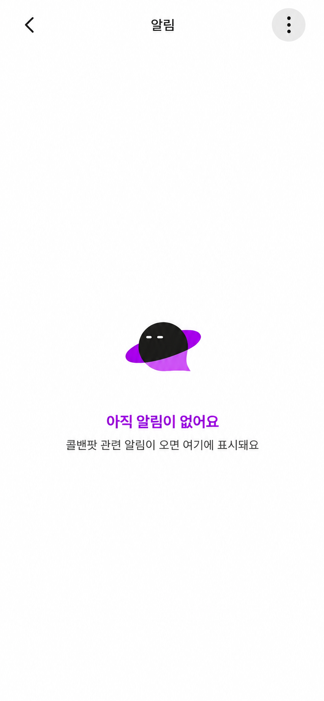
</column>
</columns>
</details>

<toggle heading="h3">
콜밴팟 참여자 목록 화면 (mobile)

- 플랫폼: mobile
- 화면 이름: callvan\_participant\_list
- 근거: [Figma 참고](https://www.figma.com/design/tDCzPQyt4AeWSW7937T10a/KOIN-Mobile?node-id=48921-194643) / 실제 화면 미확인
- 상태: Figma 기준 사용 확정. 실제 캡처 확보를 대기 조건으로 두지 않는다.

<columns>
<column ratio="50">
- web(데스크톱): 서비스 없음 — 적용 대상 제외
</column>
<column ratio="50">
- mobile
- 주 진입점: 콜밴팟 목록 → 참여한 팟의 참여 인원 영역 클릭 (디자인 기준 / 실제 경로 미확인)

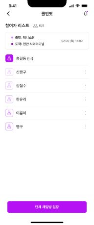
</column>
</columns>
</details>

<toggle heading="h3">
콜밴팟 단체채팅 화면 (mobile)

- 플랫폼: mobile
- 화면 이름: callvan\_chat
- 근거: [Figma 참고](https://www.figma.com/design/tDCzPQyt4AeWSW7937T10a/KOIN-Mobile?node-id=48921-195643) / 실제 화면 미확인
- 상태: Figma 기준 사용 확정. 실제 캡처 확보를 대기 조건으로 두지 않는다.

<columns>
<column ratio="50">
- web(데스크톱): 서비스 없음 — 적용 대상 제외
</column>
<column ratio="50">
- mobile
- 주 진입점: 콜밴팟 참여자 목록 → ‘단체 채팅방 입장’ 클릭 (디자인 기준 / 실제 경로 미확인)

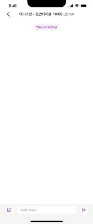
</column>
</columns>
</details>

<toggle heading="h3">
콜밴팟 신고 사유 선택 화면 (mobile)

- 플랫폼: mobile
- 화면 이름: callvan\_report\_reason
- 근거: [Figma 참고](https://www.figma.com/design/tDCzPQyt4AeWSW7937T10a/KOIN-Mobile?node-id=49584-178973) / 실제 화면 미확인
- 상태: Figma 기준 사용 확정. 실제 캡처 확보를 대기 조건으로 두지 않는다.

<columns>
<column ratio="50">
- web(데스크톱): 서비스 없음 — 적용 대상 제외
</column>
<column ratio="50">
- mobile
- 주 진입점: 콜밴팟 참여자 목록 → 참여자 더보기 → ‘신고하기’ 클릭 (디자인 기준 / 실제 경로 미확인)

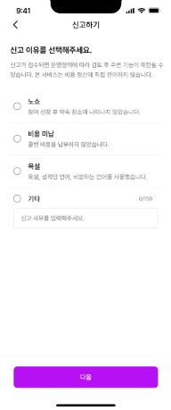
</column>
</columns>
</details>

<toggle heading="h3">
콜밴팟 신고 내용 작성 화면 (mobile)

- 플랫폼: mobile
- 화면 이름: callvan\_report\_detail
- 근거: [Figma 참고](https://www.figma.com/design/tDCzPQyt4AeWSW7937T10a/KOIN-Mobile?node-id=49584-179774) / 실제 화면 미확인
- 상태: Figma 기준 사용 확정. 실제 캡처 확보를 대기 조건으로 두지 않는다.

<columns>
<column ratio="50">
- web(데스크톱): 서비스 없음 — 적용 대상 제외
</column>
<column ratio="50">
- mobile
- 주 진입점: 신고 사유 선택 → 사유 선택 후 ‘다음’ 클릭 (디자인 기준 / 실제 경로 미확인)


</column>
</columns>
</details>
</details>

<details>
<summary>로깅 명세 참고 이미지 (화면 정의 제외)</summary>

- 필터 바텀시트 (선명도 개선본)


- 출발지 선택 바텀시트 (선명도 개선본)


</details>

---

### 쪽지·채팅

<details>
<summary>화면 정의</summary>

- 확인일: 2026-10-13
- 앱: Android 실제 화면. 앱 이미지는 선명도 개선본.
- 웹: 2026-10-16 로그인 후 실제 데스크톱 화면을 캡처해 반영했다. 이전 Figma 자료는 이력 토글에 보존한다.
- 화면 이름은 고정 정의값이며 실제 <code>screen_view</code>·<code>page_view</code> 전송값 검수는 별도다.

<toggle heading="h3">
쪽지 목록 화면 (mobile)

- 플랫폼: mobile
- 화면 이름: chat\_list

<columns>
<column ratio="50">
- web(데스크톱): 아래 ‘쪽지 목록·대화 화면’에 통합.
</column>
<column ratio="50">
- mobile
- 주 진입점: 메인 → 카테고리 → 기타 → 채팅


</column>
</columns>
</details>

<toggle heading="h3">
쪽지 대화 화면 (mobile)

- 플랫폼: mobile
- 화면 이름: chat\_detail

<columns>
<column ratio="50">
- web(데스크톱): 아래 ‘쪽지 목록·대화 화면’에 통합.
</column>
<column ratio="50">
- mobile
- 주 진입점: 쪽지 목록 → 대화 항목 클릭


</column>
</columns>
</details>

<toggle heading="h3">
쪽지 목록·대화 화면 (web)

- 플랫폼: web(데스크톱)
- 화면 이름: chat
- 근거: 실제 WEB 화면 확인·캡처 (2026-10-16, 로그인 후 데스크톱 1440×1000).
- 주 진입점: 메인 → 하단 쪽지 (<code>/lost-item/chat</code>) → 목록의 대화 선택.
- 목록과 대화는 한 페이지에 표시되며 대화 선택은 query만 변경한다. 고정 화면명 <code>chat</code>을 유지한다.


</details>

<toggle heading="h3">
이전 Figma 참고 (web · 이력)

- 플랫폼: web(데스크톱)
- 화면 이름: chat
- 근거: 2026-10-15 로그인 후 실제 WEB 확인. 아래 첨부는 기존 [Figma 참고 이미지](https://www.figma.com/design/DPlcYuiFxhyT5ULbqec59i/KOIN-Web?node-id=8726-23420)다.
- 주 진입점: 메인 → 하단 쪽지 (<code>/lost-item/chat</code>) → 목록의 대화 선택 (2026-10-15 로그인 후 실제 경로 확인)
- 실제 WEB에서도 목록과 대화가 한 페이지에 표시되며, 대화 선택은 query만 변경한다. 고정 화면명 chat을 유지한다.


</details>
</details>

---

### 모의수강신청

<details>
<summary>화면 정의</summary>

- 확인일: 2026-10-15
- 플랫폼: WEB만 구현 (사용자 확인). 앱 화면 정의·로깅 적용 대상에서 제외.
- 실제 데스크톱 웹의 시간표 → 모의 수강신청 이동을 확인했고, 2026-10-15 로그인 후 예비수강과목과 신청 버튼도 확인했다. 기존 첨부 이미지는 비로그인 캡처다.
- 화면 이름은 고정 정의값. 실제 screen\_view·page\_view 전송값 검수는 별도.

<toggle heading="h3">
시간표 화면 (web · 모의수강신청 진입)

- 플랫폼: web(데스크톱)
- 화면 이름: <code>timetable</code>
- 주 진입점: 웹 메인 → 시간표 (<code>/timetable</code>)
- 모의수강신청 진입: 시간표 우측 상단 ‘모의 수강신청’ 클릭 → <code>/course</code>
- 근거: 실제 웹 화면·이동 확인 (2026-10-15). 시간표 전체 서비스 로깅은 이번 범위에서 제외.


</details>

<toggle heading="h3">
모의수강신청 화면 (web)

- 플랫폼: web(데스크톱)
- 화면 이름: course\_practice

<columns>
<column ratio="70">
- web
- 주 진입점: 웹 시간표 (<code>timetable</code>) → 우측 상단 ‘모의 수강신청’ → <code>/course</code>


</column>
<column ratio="30">
- mobile: 미구현 (사용자 확인), 적용 대상 아님
</column>
</columns>

- 강좌 조회·필터·신청과목·예비수강과목 영역은 같은 페이지. 2026-10-15 로그인 후 예비수강과목 영역과 신청 버튼을 확인했다. 실제 수강 신청·전송 검수는 수행하지 않았다.
</details>
</details>

---

### 학교 부서 정보

<details>
<summary>화면 정의</summary>

- 확인일: 2026-10-13
- 실제 Android·데스크톱 웹 확인. 앱 이미지는 선명도 개선본.
- 화면 이름은 정의 제안이며 실제 로그 값 검증은 별도.

<toggle heading="h3">
부서 분류 선택 화면 (web, mobile)

- 플랫폼: web, mobile
- 화면 이름: department\_main

<columns>
<column ratio="50">
- web(데스크톱)
- 주 진입점: 메인 → 하단 학교 부서 정보 (<code>/department</code>)


</column>
<column ratio="50">
- mobile
- 주 진입점: 메인 → 카테고리 → 캠퍼스 → 학교 부서정보


</column>
</columns>
</details>

<toggle heading="h3">
부서 목록 화면 (web, mobile)

- 플랫폼: web, mobile
- 화면 이름: department\_list

<columns>
<column ratio="50">
- web(데스크톱)
- 주 진입점: 부서 분류 선택 → 학사 / 수업 (<code>/department/ACADEMIC</code>)


</column>
<column ratio="50">
- mobile
- 주 진입점: 부서 분류 선택 → 학사 / 수업


</column>
</columns>

- 다른 분류도 같은 목록 화면으로 정의. 분류별 이름을 추가하지 않음.
</details>

- 웹 검색 결과는 <code>/department?keyword=...</code>의 페이지 내 결과 상태로 처리한다. Android 검색 결과·전화번호 복사 실제 화면은 사용자 확인 완료(2026-10-16). 기존 고정 화면명을 유지한다.
</details>

---

### 교내 시설물

<details>
<summary>화면 정의</summary>

- 확인일: 2026-10-13
- 실제 Android·데스크톱 웹 확인. 앱 이미지는 선명도 개선본.
- 화면 이름은 정의 제안이며 실제 로그 값 검증은 별도.

<toggle heading="h3">
교내 시설물 정보 화면 (web, mobile)

- 플랫폼: web, mobile
- 화면 이름: facility\_info

<columns>
<column ratio="50">
- web(데스크톱)
- 주 진입점: 메인 → 하단 교내 시설물 정보 (<code>/campusinfo</code>)


</column>
<column ratio="50">
- mobile
- 주 진입점: 메인 → 카테고리 → 캠퍼스 → 교내 시설물 정보


</column>
</columns>

- 시설별 운영 시간 카드는 같은 화면의 콘텐츠로 처리.
</details>
</details>

---

### 졸학계 (졸업학점 계산기) — 레거시

- 분류일: 2026-10-15. 사용자 지시로 현행 화면 정의·리네이밍 적용 대상에서 제외.
- 레거시 사유: 현재 시간표·서비스 메뉴에서 졸학계 진입점을 확인할 수 없고, 사용자가 서비스 제거로 판단해 레거시 분류를 요청함. 아래 기존 화면·이미지·이름은 과거 자료로 보존한다. 서비스 종료일·코드 전체 삭제 여부는 미확인.

<details>
<summary>과거 화면 자료 (레거시 · 현행 적용 제외)</summary>

- 확인일: 2026-10-13
- 웹: <code>/graduation</code> 페이지 진입·로그인 요구 확인. 계산 내용은 비로그인으로 접근하지 못해 Figma 보완.
- Android: 카테고리·시간표에서 진입점 미확인. 앱 파일의 [PM 기획용 참고](https://www.figma.com/design/tDCzPQyt4AeWSW7937T10a/KOIN-Mobile?node-id=9876-30451)는 실제 Android 화면으로 정의하지 않음.
- 화면 이름은 정의 제안이며 실제 로그 값 검증은 별도.

<toggle heading="h3">
졸업학점 계산기 과거 화면 (web · 레거시)

- 플랫폼: web(데스크톱)
- 화면 이름: grad\_calc
- 근거: [Figma 참고](https://www.figma.com/design/DPlcYuiFxhyT5ULbqec59i/KOIN-Web?node-id=6478-13969) / 로그인 이후 실제 화면 미확인
- 주 진입점: 주소 직접 진입 → <code>https://koreatech.in/graduation</code> (실제 로그인 요구 확인 / 메뉴 진입 경로 미확인)


- 내 정보·학기별 과목·이수 학점 그래프는 한 페이지. 도움말·드롭다운·업로드 팝업은 별도 화면에서 제외.
</details>
</details>

### 작업 기준과 기록

<details>
<summary>통합 문서 안내</summary>

현재 작성 순서·화면 기준·결정·후속은 [로깅 통합 가이드](2910221954bc8254bb2d81c0774e7755.md)에서 관리한다.

<p>
캡처·편집 문제 해결과 원문 이력: [로깅 통합 가이드](2910221954bc8254bb2d81c0774e7755.md) 
</p>

---
</details>
