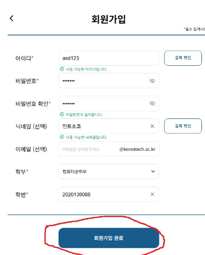
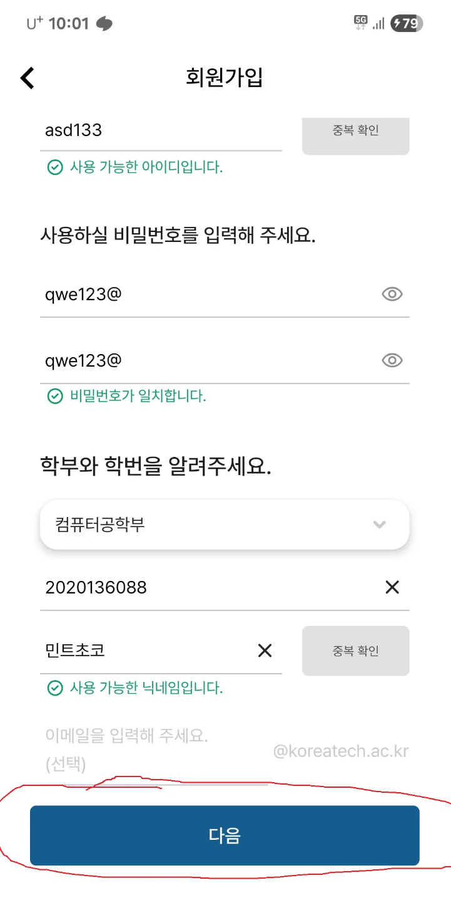
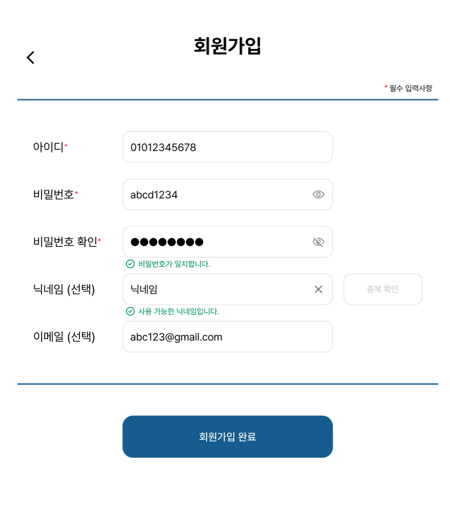
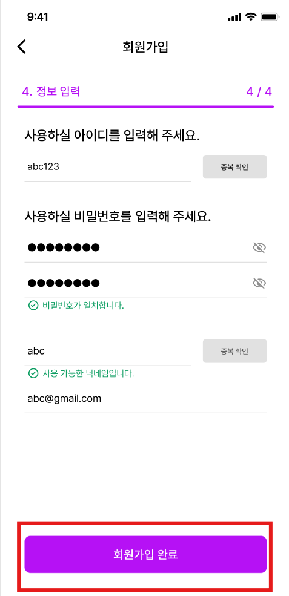

# 1-9 학생_외부인_회원가입완료(클릭)

원문 페이지 ID: 6620221954bc8394b5ba01facac85f0e

> 원문 스냅샷. 명세 확정·앱 배포·수집 완료를 뜻하지 않습니다.

## 원문 속성

```json
{
  "platform": [
    "ANDROID",
    "IOS",
    "WEB"
  ],
  "url": "source-page-id:6620221954bc8394b5ba01facac85f0e",
  "구분": "회원가입완료",
  "상태": "로깅 필요",
  "생성일": "2026-11-08T10:51:24.804Z",
  "이벤트 이름": "1-9 학생\\_외부인\\_회원가입완료(클릭)",
  "태그": [
    "회원가입"
  ]
}
```

<details>
<summary>이전 로깅</summary>

- event\_label : “sign\_up\_completed”
- value : “회원가입완료<b>”</b>
- event\_category : “click”
- custom\_session\_id : \{sign\_up\}\_\{0\}\_\{플랫폼\}\_\{세션시작시간\}\_\{랜덤값\}

<b>웹</b>




<b>모바일</b>




</details>

<details>
<summary>새 로깅 (26.10.04)</summary>

- 설명: 회원가입 정보입력의 기존 회원가입완료 동작과 전송 조건에 따라 기록한다. 기존 회원가입완료 value를 유지하며 별도 성공 이벤트나 실패 value를 추가하지 않는다.
- event\_name: <code>DA2</code>
- screen\_view: <code>input_user_info</code>
- event\_label: <code>account__input_user_info__sign_up__confirm__click</code>
- value: 회원가입완료
- event\_category: <code>click</code>
- custom\_session\_id : \{sign\_up\}\_\{0\}\_\{플랫폼\}\_\{세션시작시간\}\_\{랜덤값\}

<details>
<summary>검토사항</summary>

- label DA2 기준 정렬 (2026-10-27): <code>account__input_user_info__sign_up__submit</code> → <code>account__input_user_info__sign_up__confirm__click</code>
- 기존 event\_category <code>click</code>, value <code>회원가입완료</code>와 원래 전송 조건을 유지한다. 실패 value가 존재한다는 근거는 이 명세에 없으므로 새로 추가하지 않는다. <code>confirm</code>은 기존 완료 동작을 표현하며 성공 이벤트를 새로 만들지 않는다. (2026-10-28 검토사항 문구 정정; 로깅 값 변경 없음)
</details>

<details>
<summary>참고사진 (기능 표시)</summary>

<b>웹</b>



<b>모바일</b>


</details>
</details>
