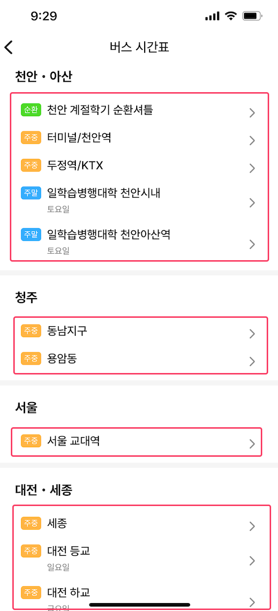
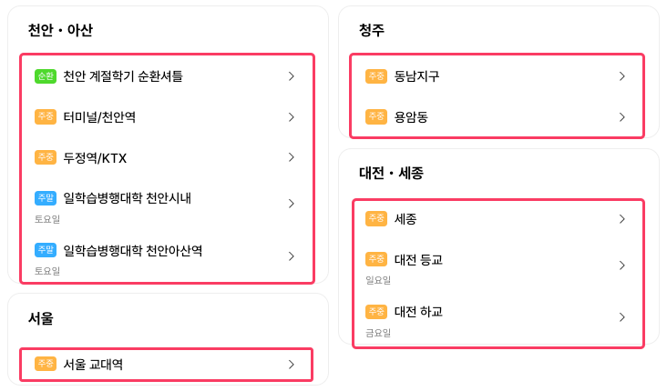
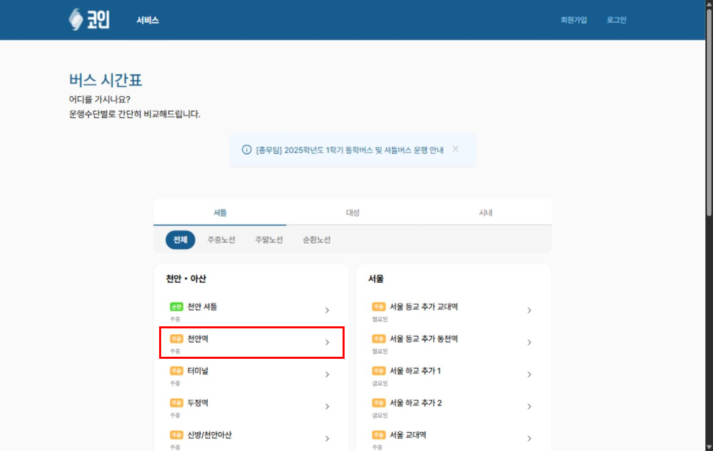
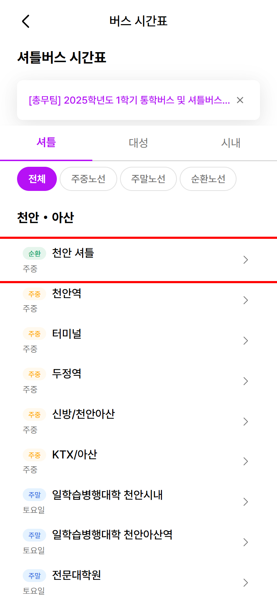

# 4-6. 지역별 세부 노선_클릭 (세부 노선 변경시 업데이트 필요)

원문 페이지 ID: 6650221954bc8242a2a2814d77d4d350

> 사용자 제공 ZIP 내보내기 보관본. 레거시·동결·검토 상태는 원문을 따르며 코드 생성 승인·앱 배포 완료를 뜻하지 않습니다.

생성일: 2026년 11월 12일 오후 2:07
태그: 4. 버스 시간표
platform: ANDROID, IOS, WEB
구분: 셔틀버스 시간표
상태: 로깅 필요

- 과거 로깅
    - event_label : “area_specific_route”
    - value : (세부 노선 변경시 업데이트 필요)
    **{노선_세부 노선} 형식**
        - “순환_천안 계절학기 순환셔틀”, “주중_터미널/천안역”, “주말_일학습병행대학 천안시내” 등
    - event_category : “click”
    - 참고사진
    
    
    
    AND, IOS, WEB(Mobile view)
    
    
    
    WEB
    
- 새 로깅
    - 설명: 버스 시간표 화면 셔틀 탭에서 노선(예: 천안 셔틀)을 클릭해 셔틀버스 시간표 상세 화면으로 들어가는 경우
    - screen_view: `bus_timetable`
    - event_name: `DA1`
    - event_label: `bus__bus_timetable__shuttle_route__entry__click`
    - value: {노선 구분}_{세부 노선} (예: 순환_천안 셔틀, 주중_천안역)
    - event_category: `click`
    
    ### 참고사진 (기능 표시)
    
    **웹**
    
    **참고사진 · 웹**
    
    
    
    WEB · 빨간 네모: 지역별 셔틀 노선 진입. stage 실제 화면 캡처에 위치 표시.
    
    **모바일**
    
    **참고사진 · 모바일**
    
    모바일 — 지역별 세부 노선 클릭 (출처: stage 실제 캡처, 빨간 네모 = 클릭 위치)
    
    
