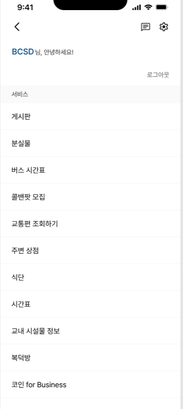
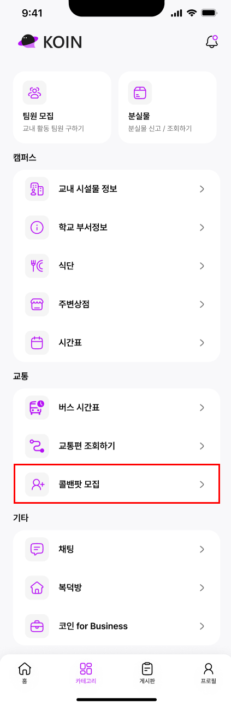

# [레거시] 1-3 카테고리 → 콜밴팟 모집

원문 페이지 ID: 6660221954bc83c39e5b01f01296f764

> 원문 스냅샷. 명세 확정·앱 배포·수집 완료를 뜻하지 않습니다.

## 원문 속성

```json
{
  "platform": [
    "ANDROID",
    "IOS"
  ],
  "url": "source-page-id:6660221954bc83c39e5b01f01296f764",
  "상태": "로깅 필요",
  "이름": "\\[레거시\\] 1-3 카테고리 → 콜밴팟 모집",
  "태그": [
    "1. 메인 -> 콜밴팟"
  ]
}
```

<details>
<summary>이전 로깅</summary>


- event\_name : CAMPUS
- event\_category : click
- event\_label : hamburger
- value : 콜밴팟 모집



</details>

<details>
<summary>새 로깅 (2026-10-15) — 레거시 · 이력 보존</summary>

- 레거시 전환 (2026-11-01 사용자 지시): 이 1-3 명세는 삭제하지 않고 과거 이력으로 보존한다. 현행 카테고리 콜밴팟 클릭은 홈 3-6 [3-6 카테고리 내부 클릭 (현재 로깅) 2026.08.30 이후 찍히는 로깅](bb10221954bc8337aae781494584adee.md)을 참조한다. 아래 라벨·value·사진·이전 로깅은 보존용이며 별도 신규 구현·추가 전송 대상으로 삼지 않는다. 실제 SDK 전송·기존 이벤트 중단 여부는 별도 확인이 필요하다.

<details>
<summary>검토사항</summary>

- 통합 가이드·후속: [로깅 통합 가이드](3c30221954bc8214b1c481c5bbb6fba5.md)
- 변경 근거: 사용자 확인으로 기존 메뉴 디자인이 카테고리 화면으로 교체됨. 현행 명칭과 label의 세부 구간을 category로 통일한다. 과거 label과 원본 사진은 이전 로깅에 보존.
- label 통일 (2026-10-27): callvan\_\_main\_category\_\_callvan\_entry\_\_category\_entry → callvan\_\_main\_category\_\_callvan\_entry\_\_category\_entry\_\_click
- 현행 기준 문서 (이 1-3은 레거시): [3-6 카테고리 내부 클릭 (현재 로깅) 2026.08.30 이후 찍히는 로깅](bb10221954bc8337aae781494584adee.md). 후속 사용자 결정으로 홈 3-6을 현행으로 유지하고 이 1-3은 레거시 이력으로만 보존한다. 이 페이지를 근거로 별도 신규 구현·추가 전송하지 않는다. 실제 SDK 호출 정리는 별도 확인이 필요하다.
</details>

### 참고사진 (기능 표시)

<details>
<summary>참고사진 · 모바일</summary>

화면 정의에 제공된 카테고리 캡처. 해당 메뉴의 위치에 빨간 테두리만 추가. 이번 작업의 실제 Android 신규 캡처가 아님.


</details>
</details>
