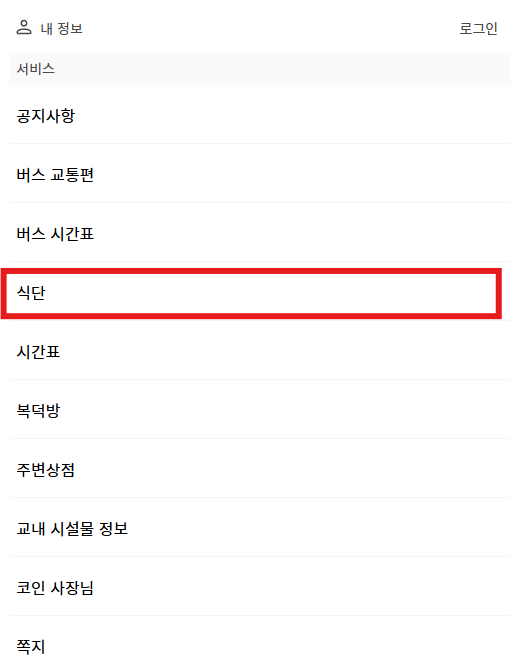

# 2-3. 햄버거_식단_클릭 (삭제)

원문 페이지 ID: 66c0221954bc83e9af9b81f1151285a6

> 누락 원본 복구 스냅샷. 원본의 과거값·검토 기록을 보존하며 생성 계약으로 자동 승인하지 않습니다.

대조 기록: [87개 원본 복구 및 8개 차이 정리](../recovery-review.md)

관련 기존 보관본: [2-3. 햄버거_식단_클릭 (레거시)](b7f0221954bc83a9af4f010f5b5b8c95.md)

## 원문 속성

```json
{
  "platform": [
    "ANDROID",
    "IOS",
    "WEB"
  ],
  "url": "source-page-id:66c0221954bc83e9af9b81f1151285a6",
  "상태": "완료",
  "생성일": "2026-11-08T10:51:37.880Z",
  "이름": "2-3. 햄버거\\_식단\\_클릭 (삭제)",
  "태그": [
    "2. 헤더/푸터/햄버거_식단"
  ]
}
```

<details>
<summary>이전 로깅</summary>


- event\_label : “hamburger”
- value : “식단<b>”</b>
- event\_category : “click”
- 참고사진





</details>


<details>
<summary>새 로깅 (26.10.17)</summary>


- 레거시: 햄버거 메뉴 → 식단 진입 로깅은 삭제 대상이다(페이지 제목 "삭제", 주변상점 1-2 햄버거 페이지와 같은 처리). 새 로깅을 만들지 않는다.
- 대체 로깅 : 앱 하단 카테고리 화면 진입은 홈화면 리디자인 "3-6 카테고리 내부 클릭"으로 수집

<details>
<summary>검토사항</summary>


- 통합 가이드·후속: [로깅 통합 가이드](3c30221954bc8214b1c481c5bbb6fba5.md)

</details>


### 참고사진 (레거시)


<b>웹</b>

<details>
<summary>참고사진 · 웹</summary>


해당 없음 (레거시)

</details>


<b>모바일</b>

<details>
<summary>참고사진 · 모바일</summary>


해당 없음 (레거시)

</details>


</details>
