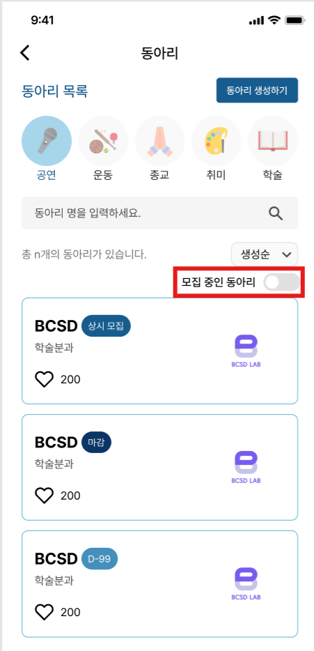
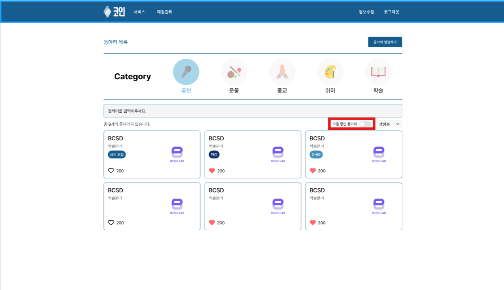

# 2.6 동아리_모집 중인 동아리 토글 클릭

원문 페이지 ID: 6780221954bc82c6a79f0110b9709435

> 필터 밖 원본 행 복구 스냅샷. 중복·빈 페이지도 원본 ID와 속성, 본문을 개별 보존합니다. 명세 승인이나 앱 적용 완료를 뜻하지 않습니다.

대조 기록: [숨겨진 원본 42개 복구](../hidden-recovery.md)

관련 기존 보관본: [레거시 2.6 동아리_모집 중인 동아리 토글 클릭](a960221954bc82e98bde81be9d43511c.md), [레거시 2.6 동아리_모집 중인 동아리 토글 클릭](8980221954bc82fea67581f48570b00b.md)

## 원문 속성

```json
{
  "platform": [
    "ANDROID",
    "IOS",
    "WEB"
  ],
  "url": "source-page-id:6780221954bc82c6a79f0110b9709435",
  "상태": "로깅 필요",
  "이름": "2.6 동아리\\_모집 중인 동아리 토글 클릭"
}
```

<ul>
<li>
설명: 동아리 메인화면에서 모집 중인 동아리 토글 ON/OFF
</li>
<li>
event\_name : “CAMPUS”
</li>
<li>
event\_label : “club\_main\_recruiting\_toggle”
</li>
<li>
value : \{on / off\} // ‘on’ 또는 ‘off’ 값을 가지는 형태
</li>
<li>
event\_category : “click” 
</li>
<li>
참고사진
</li>
</ul>





- 웹 참고사진



