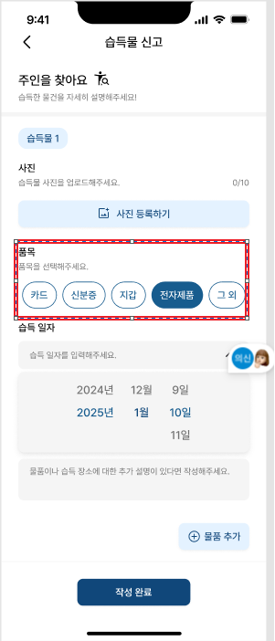
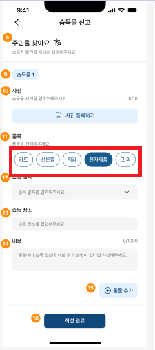

# 11-2.분실물_습득물신고_품목선택_클릭

원문 페이지 ID: 67d0221954bc829aa31d01b4fdcd7e90

> 누락 원본 복구 스냅샷. 원본의 과거값·검토 기록을 보존하며 생성 계약으로 자동 승인하지 않습니다.

대조 기록: [87개 원본 복구 및 8개 차이 정리](../recovery-review.md)

관련 기존 보관본: [11-2.분실물_습득물신고_품목선택_클릭](9d60221954bc83179e308165f4f53b4b.md), [11-2.분실물_습득물신고_품목선택_클릭](01c0221954bc836fa76c01c9487cd249.md)

## 원문 속성

```json
{
  "platform": [
    "ANDROID",
    "IOS",
    "WEB"
  ],
  "url": "source-page-id:67d0221954bc829aa31d01b4fdcd7e90",
  "상태": "완료",
  "이름": "11-2.분실물\\_습득물신고\\_품목선택\\_클릭"
}
```

<ul>
<li>
설명: 습득물 신고 글쓰기 페이지에서 ‘품목을 선택해주세요.’ 버튼을 클릭하여 품목을 선택
</li>
<li>
event\_label : “find\_user\_category”
</li>
<li>
value : \{”카드”, ”신분증”, ”지갑”, ”전자제품”, ”<s>그 외</s>”\} 5가지 값을 추가
</li>
<li>
→ “그 외”를 “기타”로 변경(2025-02-23) 
</li>
<li>
event\_category : “click”
</li>
<li>
참고사진
</li>
</ul>





WEB Mobile View



